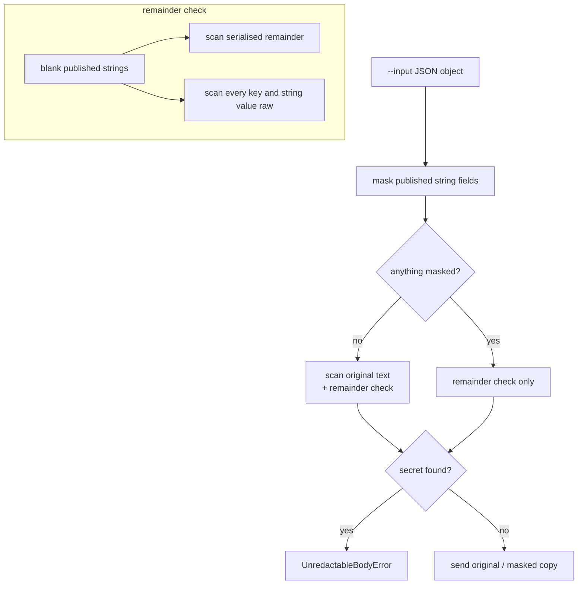

# PR Summary — Issue #5416

## Summary

`maskedJsonBody` (`worker/deno/lib/gh_body_redaction.ts`) no longer refuses a correctly masked `gh api --input` body. Its fail-closed check used to rescan the whole re-serialised JSON, where JSON escaping turns a line break into `\n` and a quote into `\"`. The `secret-assignment` rule then read the already masked value as a new secret. The check now looks only at what the key scan cannot reach: the parsed object with its published string fields blanked. That remainder is scanned as serialised text and as raw parsed strings (every key and string value, nested objects and arrays included). A body with nothing to mask is still scanned as its original text too. The new test's synthetic 40-character fixture tripped gitleaks' `generic-api-key` rule. It is now assembled from two halves, and the test file is path-allowlisted in `.github/gitleaks.toml`, following the sibling redaction fixtures, because a pushed commit carries the literal in one piece. Closes #5416.

## Spec

### Intent and Rationale

- After masking, the published fields have already been through `maskBody`, the same rule `-f body=…` gets. Rescanning them in their escaped form checks nothing new and only produces false refusals. Blanking them removes that, and every other field is still checked.
- Scanning the remainder's parsed strings raw also closes a gap that was already on the base branch. A non-published field holding JSON-quoted text such as `"password": "<value>"` escapes to `\"password\": \"…\"`, which the scan of the serialised text misses. Base published that value whether or not the body was masked.

### Essential Design Decisions

- On the unchanged path the original file is what `gh` sends, so the original text is still scanned (it keeps catching a duplicate key that `JSON.parse` drops), and the structural check is added on top. On the changed path `JSON.stringify(obj)` is sent, so the structural check alone covers every byte outside the masked published strings.
- `isPublishedString(key, value)` is the single test for "a published string field": the masking loop and the remainder builder both call it, so they cannot disagree on which fields are blanked. A published key holding a non-string (for example an object `title`) is not blanked and is still scanned.
- The remainder is built with `Object.fromEntries`, so a `__proto__` key stays an own property and is still scanned.
- The refusal message is unchanged. It is now accurate: it fires only for a secret outside the redactable fields.

### Undiscoverable Facts

- Observed on this branch before the fix: `redactGhBodyArgs(["api","repos/o/r/issues/1/comments","--input",…])` refused the three bodies in the issue (`password:` with the value on the next line, `DEPLOY_TOKEN = "…"` under `Rotate these credentials:`, and `API_TOKEN: "…"` under `secrets:`). The same-line `password: <value>` was sent masked.
- Probing `redactSecrets` on the serialised JSON versus the raw string: `"password": "<value>"` and `api_key\n=<value>` are caught only raw, never in their escaped serialised form. That observation is the reason for the raw parsed-string scan.

## Evidence

Backend-only change: no UI files touched.

- Red run against the base `gh_body_redaction.ts` with the new test file (`worker/deno/lib/gh_body_redaction.ts` swapped for the base-branch copy, new test kept): `FAILED | 3 passed | 6 failed`. The three cross-line/quoted bodies were refused, the top-level off-field test's allowed control was refused by the same bug, and both JSON-quoted off-field secrets were not refused (`Expected function to throw.`).
- After the fix: `ok | 9 passed | 0 failed` for the new file.

## Test Plan

New file `worker/deno/tests/gh_body_redaction_input_escaping_5416_test.ts`. Every test drives `redactGhBodyArgs` with `--input`:

- **The masked body is sent:** `a cross-line password: body is masked and sent`, `a cross-line quoted DEPLOY_TOKEN assignment is masked and sent` and `a YAML child API_TOKEN under secrets: is masked and sent`. Each asserts the `--input` path is rewritten to the materialised copy, one file is written, the secret is absent, and the parsed `body` equals a literal masked string built from `REDACTION_PLACEHOLDER`.
- **Fail-closed on the changed path:** `a secret in a non-published top-level field still refuses`, `a secret in a nested non-published value still refuses`, `a secret inside an array still refuses`, `a published key holding a non-string still refuses` and `a quoted secret hidden by JSON escaping refuses on the changed path`. Each asserts `UnredactableBodyError` with `outside its redactable body`. Each has an allowed control (the same object with the off-field secret removed is sent).
- **Fail-closed on the unchanged path:** `a quoted secret hidden by JSON escaping refuses on the unchanged path`. Its control returns the argv untouched and writes nothing.
- **Existing coverage still green, unedited:** `worker/deno/tests/gh_body_redaction_test.ts` (the #92 `--input` suite, including `a secret outside the body field refuses rather than pass unscanned` on the unchanged path, the clean-body byte-for-byte test and the non-JSON refusal), `worker/deno/tests/gh_title_redaction_test.ts`, `worker/deno/tests/gh_body_prompt_leak_backstop_1421_test.ts`, `worker/deno/tests/gh_body_redaction_masked_instruction_2390_test.ts` and `worker/deno/tests/secret_redaction_label_as_value_5310_test.ts`. Run together with the new file: `ok | 385 passed | 0 failed`. No existing test was edited.
- **gitleaks:** `gitleaks git --config .github/gitleaks.toml --log-opts="e1663b703..HEAD" .` (8.30.1) reported `no leaks found` after the allowlist entry. `worker/deno/tests/gitleaks_check_test.ts` and `worker/deno/tests/gitleaks_template_conformance_test.ts` pass.
- **Full gate:** `./quality.sh < /dev/null` ran on the final code and returned `Result: PASSED (with skipped checks)`. `config integration` and `checkov` were skipped by the gate itself.
- **Docs:** I grepped `SECURITY.md`, `docs/THREAT-MODEL.md`, `docs/*.md` and `README.md` for `--input`, `redactable`, `rescan` and `re-serialis`. No manual describes the rescan mechanism. `SECURITY.md` §6a and threat-model control C24 say an `--input` body that cannot be safely masked is refused, which stays true. I updated the `maskedJsonBody` doc comment and the comment above its check. The module doc ("hides a secret outside a redactable field … raises UnredactableBodyError") stays true, so it was not changed.
- **Issue numbers:** the only issue number cited is #5416 ("gh api --input: the fail-closed rescan refuses a correctly masked body whose text reads differently once JSON-escaped").

🤖 Generated with [Claude Code](https://claude.com/claude-code)
