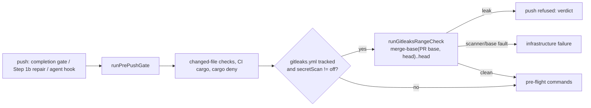

# PR Summary — Issue #5430

## Summary

The worker's pre-push gate (`runPrePushGate` in
`worker/deno/lib/pre_push_gate.ts`) now runs a gitleaks scan over each pushed
branch's whole PR commit range. That range is
`<merge-base with the PR base>..<head>`, the same commit set CI's
`gitleaks / gitleaks` check scans (`base_sha..head_sha`). It uses the same
pinned CLI flags. Before this change, only `./quality.sh` ran gitleaks, and
pushes to an open PR never call it: PR-feedback, CI-fix, spelling and
merge-conflict repairs (`commitAndPushPending` Step 1b), and the agent's own
`git push` hook. That was the path that skipped the local scan. Closes #5430.

## Spec

### Intent and Rationale

- `docs/INTERNALS.md` stated it outright: "The pre-push gate that the worker
  runs over unpushed commits (`gateUnpushedCommits`) does not run gitleaks".
  Every push that is not an issue run's `./quality.sh` therefore reached CI
  unscanned.
- The stage scans the full PR range, not only the commits a push adds. A secret
  an earlier, already-pushed commit added still turns CI red, and a fix (for
  example a narrow allowlist in `.github/gitleaks.toml`, read from the working
  tree as CI reads it from the head) has to make that same scan pass before the
  push.
- It reuses `pushForkCommit`, which already deepens shallow clones and finds the
  merge-base for the `deno test` baseline, and the gitleaks module's own args,
  config lookup and verdict (`gitleaksScanArgs`, `gitleaksConfigPath`,
  `judgeRun`) through a new `runGitleaksRangeCheck`.

### Essential Design Decisions

- **Scope follows the owner's triage comment.** That comment said: "Scope this
  fix to the real local-gate gap: the local `gitleaks` must scan the same full
  `base..head` range as CI after #5436." I therefore did not change the
  `deno test` side of the gate. I also did not add a merged-result scan: #5436
  (open) has not decided whether CI will scan the merge ref, or in what form.
  The strengthened twin test in `worker/deno/tests/gitleaks_check_test.ts` now
  asserts that `gitleaks.yml` has exactly one gitleaks CLI scan line. If #5436
  adds a second scan, that test goes red until the local gate mirrors it.
- **When the stage runs.** It is registered by the same rule as the quality
  gate's stage: the repository tracks `.github/workflows/gitleaks.yml`. It runs
  in every gate mode, including the `repairChecksWithCiCargo` repair spec, after
  cargo deny and before the pre-flight commands.
- **Outcomes.** A finding refuses the push as a verdict. The following are
  infrastructure failures, never a pass: a known base whose merge-base cannot be
  found, a scanner error, a deadline hit, and gitleaks missing inside the fleet
  image. A missing gitleaks on a host is a `[PRE_PUSH_WARNING]`, matching the
  quality stage's host `SKIPPED`. With no base known at all, the stage falls
  back to the commits on no remote; when none places the range, it warns and
  scans nothing.
- **Babysitter.** The babysitter tree gate passes `secretScan: "off"`, because
  its own `runGitleaksTreeCheck` already scans the range plus the uncommitted
  files. The quality gate's own stage keeps its `origin/HEAD` merge-base, which
  is a superset of the PR range for milestone PRs; it does not know the PR base.

### Undiscoverable Facts

- I ran the pinned gitleaks 8.30.1 with PR #5322's own config over
  `481f073..ff67a74f`. It reports `leaks found: 21`, in three commits:
  - `a98c0467` (13 findings): pushed by a fleet run
    (`Vibe-Coder-Run-Id: vibe-mwrm0q1s-9368f3`) to the already-open PR.
  - `0de6b1f8` and `a6d53ee6`: pushed from a Claude Code session outside the
    fleet.
- Six of the eight PRs the issue lists (#5423 and #5425 to #5429) are
  `Sync main into milestone/*` PRs that inherited the red `main`. The owner's
  comment names #5425 to #5429; #5423 is the same kind of sync PR.
- The real PRs' failed checks were:
  - #5159: the `sweep-drift` sweptAt ancestry step, and a shard on a main-merge
    commit.
  - #5232: `parallel_unsafe_test_manifest_test.ts` flagging a new wall-clock
    test.
  - #5365: a wall-clock ratio test that the CI-fix run reproduced green three
    times.
  - None was a gitleaks failure.

## Evidence

The scan runs at this point in the push flow:

- Commands I ran:
  - `gitleaks git --config <pr-5322 config> --redact --no-banner --exit-code 1 --report-format json --log-opts="481f073..ff67a74f" .`
    printed `35 commits scanned` and `WRN leaks found: 21`.
  - `git log -1 --format='%(trailers:key=Vibe-Coder-Run-Id,valueonly)'` on each
    of the three commits.
- Red run against the base: I restored `worker/deno/lib/pre_push_gate.ts`,
  `worker/deno/lib/gitleaks_check.ts` and
  `worker/deno/lib/babysitter_tree_gate.ts` from
  `origin/milestone/ci-gate-parity`, then ran
  `deno test --allow-all --no-check --filter "real gitleaks refuses" tests/pre_push_gate_gitleaks_5430_test.ts`.
  It printed `AssertionError: a range holding a fake token must be refused`
  (`FAILED | 0 passed | 1 failed`). On the head it passes.
- Issue numbers cited: #5430 is this issue; #5436 is "gitleaks PR check scans
  only the first 30 commits, so a long PR merges findings and turns main red (PR
  #5322)"; #5121 is "Shift left: run `gitleaks` in the local gate so CI
  'gitleaks / gitleaks' failures are caught before a PR".
- The change is backend only; there is no UI file and no screenshot.

## Test Plan

- **New: `worker/deno/tests/pre_push_gate_gitleaks_5430_test.ts`**, ten tests
  through `runPrePushGate`.
  - With the real gitleaks:
    - A fake token in an earlier, already-pushed commit of the PR range refuses
      a clean follow-up push, and the message names the rule but not the secret.
    - A fake token already on the base branch (`origin/milestone/x`) does not
      block a clean push.
    - `secretScan: "off"` never scans.
  - Through the seam:
    - The scan gets exactly the merge-base sha and the pushed sha.
    - With no tracked workflow, no scan runs; the merge-base test is the
      positive control.
    - The `blocked`, `infrastructure` and `skipped` outcomes map to a verdict,
      an infrastructure error and a warning.
    - An unresolvable base is an infrastructure failure and nothing is scanned.
    - With no base and nothing unpushed, the stage warns and passes.
- **New: seven `runGitleaksRangeCheck` tests in
  `worker/deno/tests/gitleaks_check_test.ts`.** They cover the CI args, a
  finding as blocked, an `ERR` line with exit 0 as infrastructure, a deadline
  hit, gitleaks absent on a host (skipped) and in the image (infrastructure),
  and a non-sha base refused before any scan.
- **Edited: the twin test
  `gitleaks.yml - every pinned GITLEAKS_VERSION matches the module, and the fallback flags are scanned`.**
  It gains an assertion that the workflow has exactly one gitleaks CLI scan
  line. All its existing assertions are kept.
- **Edited pinned prompt wording only:**
  `worker/deno/tests/quality_gate_budget_test.ts` (two expectations) and
  `worker/deno/tests/repo_config_test.ts` (two expectations). The repair-push
  check lists in `quality_gate_budget.ts` now name the gitleaks range scan, so
  the old sentence is untrue by design. The surrounding assertions are unchanged
  and still pin the rest of each sentence.
- **Existing tests whose fixtures might now reach the new stage:**
  - Tests run and passing: `pre_push_gate_test.ts`, `pre_push_gate_cli_test.ts`,
    `pre_push_gate_cargo_deny_test.ts`, `babysitter_tree_gate_test.ts`,
    `babysitter_repair_4738_test.ts`, `git_push_preflight_test.ts`,
    `completion_phase_repo_formatters_test.ts`,
    `shellcheck_gate_integration_test.ts`,
    `parallel_unsafe_test_manifest_test.ts`.
  - No fixture needed a change: none of these tracks
    `.github/workflows/gitleaks.yml`, which I checked by grep.
- **Guards kept on the new path:** the stage sits inside the existing gate, so
  every block still goes through the same verdict and infrastructure split, the
  one in-run recovery turn and the push refusal. Nothing new bypasses them.
- **Full gate:** `./quality.sh < /dev/null` on the head exited 0. It printed
  `Result: PASSED (with skipped checks)`, with `deno tests PASSED` (a full run,
  not cached) and `gitleaks PASSED`. The skipped checks were
  `config integration` and `checkov`, which are environmental.

## Docs

- I read and updated these sections:
  - `docs/INTERNALS.md`, "Quality gate": the gitleaks-stage and
    publication-paths paragraphs. The false "does not run gitleaks" sentence is
    replaced.
  - `docs/CONFIGURATION.md`, the push-guarantee paragraph, the no-pre-flight
    paragraph and "Agent pre-push hook and the changed-files check", including a
    new **gitleaks range scan** bullet.
  - The doc comments in `worker/deno/lib/pre_push_gate.ts` (now five steps),
    `worker/deno/lib/gitleaks_check.ts` and `worker/deno/lib/git_push.ts`, and
    the prompt text in `worker/deno/lib/quality_gate_budget.ts`.
- I left `docs/pre-pr-ci-audit.md:434` as it is. It is a dated audit record
  saying the pre-push gate had no gitleaks stage, and that was true when it was
  written.
- Related existing rules I checked: the quality-gate gitleaks stage's
  registration rule (`quality_gate.ts`), which this stage reuses, and the
  babysitter's tree scan, which turns the stage off. No prompt rule was added.

## Not done / remaining risk

- `deno test` parity on these push paths. The pre-push gate still runs
  dependency-selected tests there; the owner's comment scoped this issue to
  gitleaks.
- A merged-result scan, pending #5436's decision on CI's form.
- The stage is not exercised on a macOS host. Its `[PRE_PUSH_WARNING]` path for
  a host without gitleaks is covered by the seam tests only.
