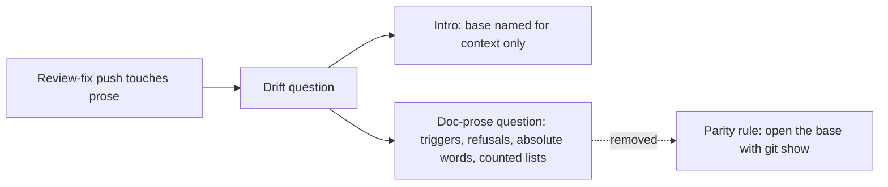

# PR Summary — Issue #5432

## Summary

Removes the review-fix parity rule that #4278 (for #4223) added to the drift
check's doc-prose question. #4319 had already deleted its first-run half. The
drift question goes back to its pre-#4278 wording: `docProseParityRule` is
deleted, `docProseClaimInstruction` no longer takes a `baseRef` or lists the
comparison shape, the drift intro again names the base "for context only —
judge drift against this push's change, not against the base", and the
pr-feedback manual no longer describes a parity check. Closes #5432.

## Spec

### Intent and Rationale

- The issue reports the `unverified-parity-claim` pattern on 14 PRs since #4033 closed. The remaining rule runs only on review-fix pushes and only over manuals and comments, so it cannot reach most of the cases the ledger counts. It also costs words on every prose push, and it was the only reason the drift question could open the base branch.
- This is a removal of guidance that has not worked. It does not claim the pattern stops.

### Essential Design Decisions

- The intro sentence is restored to the exact pre-#4278 text (`git show 8c953f6c0^:worker/deno/lib/pr_feedback_drift_check.ts`). That text contains the issue's wording ("judge drift against this push's change, not against the base") and still matches the `@param opts.baseRef` doc comment ("named for context only").
- The other `baseRef` uses in `pr_feedback_drift_check.ts` (summary scope, `restoreForeignSummaries`, the PR diff range) are unchanged, as the issue asks.
- The #4223 test in `pr_feedback_drift_check_3143_test.ts` is replaced rather than only deleted. The replacement pins the restored contract: the base is named for context only, and the prompt has no `git show <base>:` instruction and no parity wording. The issue did not ask for this replacement.

### Undiscoverable Facts

- The agent-facing rule stays: `CODING-STANDARDS.md` **Prose about the PR's own change** and the absolute-word lists in `prompts/issue/prompt.md` and `prompts/pr_feedback/prompt.md` are untouched by this diff.
- An earlier run of this issue was parked by the host-disk guard after committing the code change. This run added the PR summary and re-ran the checks. `docs/archive/handover/issue-5432.md` is the worker's handover note from that interruption.

## Evidence

Backend/prompt-text change only; no UI files touched.

- `git grep -n "docProseParityRule\|parity sentence\|Open the base only" -- ':!docs/archive'` returns one hit: the negative assertion in `worker/deno/tests/pr_feedback_drift_check_3143_test.ts`.
- Docs sweep: I read the drift-check stage paragraph in `docs/workflows/pr-feedback.md` (the doc-prose question item) through and updated it. Grepping `docs/`, `prompts/`, `worker/deno/lib/` and `README.md` for `base side`, `exactly as X did`, `as before` and `parity` found no other text that describes this check. The remaining `parity` hits are unrelated: provider, launcher and setup parity.
- `docProseClaimInstruction` has two callers: `worker/deno/lib/pr_feedback_drift_check.ts` and the tests. Both now pass only the change phrase.
- Issue numbers cited: #5432 (Remove the review-fix parity rule after recurrence …), in the new test's name.

## Test Plan

- Removed `worker/deno/tests/doc_prose_claims_test.ts`: "docProseParityRule names the base ref, or drops git show when there is none (Issue #4223)" and "docProseClaimInstruction asks about a parity sentence on both sides (Issue #4223)". Both pinned only the removed function and wording, which the issue removes, so they have no replacement. The remaining `docProseClaimInstruction` behaviour is still covered by "docProseClaimInstruction substitutes the change phrase" in the same file and by `worker/deno/tests/doc_prose_scope_literals_3877_test.ts`.
- Edited `worker/deno/tests/pr_feedback_drift_check_3143_test.ts`: replaced "buildDriftQuestionPrompt opens the base only for a parity sentence (Issue #4223)" with "buildDriftQuestionPrompt names the base for context only and asks no parity question (Issue #5432)".
  - Removed: the old assertions that `git show origin/main:` and `as before` appear and `not against the base` does not. The issue makes them untrue.
  - Kept: the no-base case still asserts no base ref leaks into the prompt (now `origin/`, previously `git show`).
  - Added: the prompt still contains the doc-prose question for a manual, as a positive control.
  - The new test failed against the unedited production code (it found no "named for context only") and passes at the head.
- `deno task test:unit tests/doc_prose_claims_test.ts tests/pr_feedback_drift_check_3143_test.ts tests/doc_prose_scope_literals_3877_test.ts tests/pr_feedback_drift_check_3347_test.ts`, run from `worker/deno`: 61 passed, 0 failed.
- `./quality.sh < /dev/null` on the head: passed. The config integration and checkov stages were skipped.
