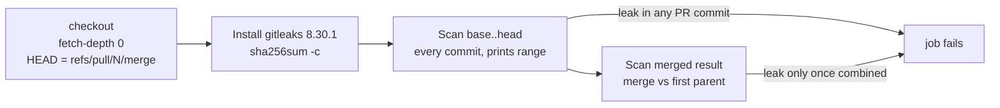

# PR Summary — Issue #5436

## Summary

The PR-side `gitleaks / gitleaks` check now scans the whole pull request,
whatever its commit count, using one gitleaks version. The licensed
`gitleaks/gitleaks-action` (it scanned only the first 30 commits a PR lists,
and bundled gitleaks 8.24.3) is removed. The PR job now always installs the
pinned, checksum-verified gitleaks 8.30.1 CLI and runs two unconditional
steps:

1. **Scan every commit in the pull request (base..head)** prints
   `Scanning <n> commit(s): <base>..<head>`, then runs `gitleaks git` with
   `--log-opts="${BASE_SHA}..${HEAD_SHA}"`, both taken from
   `github.event.pull_request`.
2. **Scan the merged result (refs/pull/N/merge)** checks that `HEAD` is the
   merge of the PR head, then scans the merge commit against its first parent
   (`--first-parent --diff-merges=first-parent -1 <merge>`). That is the diff
   a squash merge lands.

The licence secret wiring (`workflow_call` secret, the `quality.yml`
pass-through, `environment: scanning-secrets`) and the `|| true` base-fetch
step are gone with the action. A workflow validator and a real-gitleaks
regression test pin the new shape. Closes #5436.

## Spec

### Intent and Rationale

- The 30-commit cut-off belonged to the licensed action, which built its range from `GET pulls/N/commits` (default page 30). The pinned CLI with an explicit `base..head` range has no such page. Dropping the action also leaves one gitleaks version (8.30.1) in CI.
- The merged-result scan closes a second gap observed with the real CLI. `git log -p` shows no patch for a merge commit, so a secret introduced only in a merge resolution passes a `base..head` scan. The test `a secret only in the merge resolution is caught by the merged-result scan` pins this.

### Essential Design Decisions

- The issue suggested `--log-opts="-1 -p <merge-ref>"`. Observed with gitleaks 8.30.1, that scans **0 commits**: a merge's plain patch is empty. The step uses `--first-parent --diff-merges=first-parent -1 <merge>` instead. It is passed explicitly so it does not rely on git implying `--diff-merges` from `--first-parent`.
- Both scan steps fail loud before scanning. A range end missing from the checkout, or a `HEAD` whose second parent is not `pull_request.head.sha`, exits 1 with a `::error::`. gitleaks itself exits 0 on a bad revision range.
- Of the issue's two options, the licensed action was dropped rather than kept as a non-blocking extra. Keeping it would leave a second gitleaks version in CI, against criterion 3.
- The scan scripts stay inline in the workflow rather than in a script file. The behaviour tests execute each step's own `run:` text under `bash --noprofile --norc -eo pipefail`, so a test cannot pass against a copy of the script.

### Undiscoverable Facts

- Observed with gitleaks 8.30.1 on a throwaway repository: `--log-opts="<base>..<head>"` over 35 commits printed `35 commits scanned` and `leaks found: 1` for a leak in commit 35.
  - For a merge-resolution leak, the same range printed `no leaks found`.
  - `--log-opts="-1 <merge>"` printed `0 commits scanned`.
  - `--log-opts="--first-parent --diff-merges=first-parent -1 <merge>"` printed `1 commits scanned` and `leaks found: 1`.
- `--log-level debug` shows that gitleaks runs `git log -p -U0 <log-opts>`. It adds no merge-diff flag of its own.
- The fleet template in `worker/deno/lib/workflow_definitions.ts` (mirrored in `prompts/workflow_setup/prompt.md`) still ships the licensed action with the licence-less fallback. Other repositories set up from it keep the action's 30-commit page. That template, its drift scanner and its conformance tests are outside this issue's named file and are unchanged, apart from one comment that described this repository's copy.

## Evidence

Backend/CI change only; no UI files.

- `worker/deno/tests/gitleaks_pr_workflow_5436_test.ts` runs the workflow's own step scripts against real gitleaks. The leak-in-commit-35 test asserts a non-zero exit, `Scanning 35 commit(s)`, the full `<base>..<head>` range, `35 commits scanned` and `leaks found: 1`, and that the token is redacted.
- `actionlint` is clean on `gitleaks.yml` and `quality.yml`. The file-scoped Actions checks (`WORKFLOW_FILE_CHECKS` in `worker/deno/lib/workflow_file_checks.ts`) report zero findings on both files.
- `docs/audits/dependency-inventory.md` was regenerated with `supply-chain-gate --write-inventory`. Its only change is the dropped `gitleaks/gitleaks-action` row. No `deno.lock` change.
- Docs and comments updated, after reading each passage that names the PR job:
  - `docs/FULL-HISTORY-SECRET-SCAN.md` (intro paragraph and CI table)
  - `docs/CONTAINER.md` (gitleaks bullet)
  - `docs/INTERNALS.md` (gitleaks stage paragraph)
  - `.github/gitleaks.toml` (allowlist-form comment)
  - the `container/tools.json` gitleaks `notes`
  - the `worker/deno/lib/gitleaks_check.ts` doc comments
  - one template comment in both `worker/deno/lib/workflow_definitions.ts` and `prompts/workflow_setup/prompt.md`, changed identically
- Provenance cited in the diff:
  - #5436: gitleaks PR check scans only the first 30 commits, so a long PR merges findings and turns main red (PR #5322).
  - PR #5322 is the 51-commit PR the issue reports.
- No new rule was added to a prompt or `CODING-STANDARDS.md`. The only prompt edit is a comment inside the template YAML.

## Reproduction

- **symptom** — PR #5322 (51 commits) passed `gitleaks / gitleaks` because the licensed action scanned only `7707659^..eb59cc2`, the first 30 commits. The squash merge then turned `main` red with 20 findings.
- **status** — `partial` — reason: the licensed action's 30-commit page runs only on GitHub with the org licence, so that exact path was not run here. Two things were reproduced against the base branch. First, the new workflow test file goes red on the base `gitleaks.yml`: `the real workflow has no violations` fails because the base file still carries `gitleaks/gitleaks-action`, and every step-based test fails because the base steps are missing. Second, the merge-resolution blind spot: the range command the base CLI step ran passes a secret that only a merge introduces. After the fix all 16 tests pass.
- **regression test** — `worker/deno/tests/gitleaks_pr_workflow_5436_test.ts::gitleaks.yml PR job - a leak in commit 35, beyond the 30-commit page, fails the range scan`

## Acceptance Criteria

<!-- vibe-spec-review inputs="diff+issue-body" -->

- **met** — Make the PR scan cover the whole PR: `github.event.pull_request.base.sha..github.event.pull_request.head.sha`, every commit, whatever the commit count — evidence: `worker/deno/tests/gitleaks_pr_workflow_5436_test.ts::gitleaks.yml PR job - a leak in commit 35, beyond the 30-commit page, fails the range scan`, `::a range scan from the wrong base is refused` — reviewer: met
- **met** — Scan the merged result too, so findings that only appear once commits are combined cannot slip through — evidence: `worker/deno/tests/gitleaks_pr_workflow_5436_test.ts::gitleaks.yml PR job - a secret only in the merge resolution is caught by the merged-result scan`, `::a merged-result scan without first-parent diffs is refused` — reviewer: met
- **met** — Use one gitleaks version for every path — evidence: `worker/deno/tests/gitleaks_check_test.ts::gitleaks.yml - every pinned GITLEAKS_VERSION matches the module, and the range-scan flags are scanned`, `worker/deno/tests/gitleaks_pr_workflow_5436_test.ts::gitleaks.yml PR job - a gitleaks-action step is refused` — reviewer: met
- **met** — A regression test or fixture PR with more than 30 commits, whose leak is in the last commit, fails `gitleaks / gitleaks` — evidence: `worker/deno/tests/gitleaks_pr_workflow_5436_test.ts::gitleaks.yml PR job - a leak in commit 35, beyond the 30-commit page, fails the range scan` (it runs the job's own range-step script; the real-gitleaks tests are skipped where gitleaks is absent, as on the CI `validate` shards, and run in the fleet image's gate) — reviewer: met
- **met** — The scan log prints the full `base..head` range — evidence: `worker/deno/tests/gitleaks_pr_workflow_5436_test.ts::gitleaks.yml PR job - a leak in commit 35, beyond the 30-commit page, fails the range scan` asserts `<base>..<head>` and `Scanning 35 commit(s)` in the output — reviewer: met
- **met** — Only one gitleaks version is used in CI — evidence: `.github/workflows/gitleaks.yml` (both jobs pin 8.30.1 with one SHA-256), `worker/deno/tests/container_manifest_test.ts::container/ - the gitleaks pin matches the CI workflow's gitleaks CLI (Issue #1596)` — reviewer: met
- **unrequested** — The licence secret wiring is removed: the `workflow_call` secret, the `quality.yml` pass-through, `environment: scanning-secrets` and the job-level `GITLEAKS_LICENSE` — reviewer: unrequested — reason: these existed only to feed the dropped licensed action, and passing a secret the called workflow no longer declares is an invalid-secret error.
- **unrequested** — The "Fetch base branch" step is replaced by fail-loud commit checks — reviewer: unrequested — reason: its `git fetch … || true` swallowed failures, and `fetch-depth: 0` already fetches every branch. The range step now exits 1 when either end is missing, because gitleaks exits 0 on a bad range.
- **unrequested** — A validator test suite (`prScanViolations` with 9 mutation tests) and extra behaviour tests — reviewer: unrequested — reason: the repository's workflow-validator rule requires that a workflow behaviour change be validated, with a positive and a negative test per invariant.
- **unrequested** — Three obsolete local-`gitleaks.yml` tests in `worker/deno/tests/workflow_definitions_test.ts` are removed or narrowed — reviewer: unrequested — reason: they asserted the licence gating and the base-fetch step this issue removes. Their surviving checks are covered by the new validator.
- **unrequested** — Comment, doc and test-name rewording — reviewer: unrequested — reason: these sentences described the removed action or CLI fallback as present, so the change made them false.

## Standards Review

<!-- vibe-standards-review inputs="diff+CODING-STANDARDS.md" -->

- **violation** — A workflow behaviour change extends the workflow validator: `prScanViolations` did not read the scan steps' `run:` text, so CI (where the real-gitleaks tests are skipped) would stay green if the merge step's `--first-parent` flags were deleted — evidence: `worker/deno/tests/gitleaks_pr_workflow_5436_test.ts:121` — reason: fixed in this diff (both steps' `gitleaks git` command and `--log-opts` are now validated, with two new negative tests)
- **violation** — Every outcome of a branch you add needs a test: the merge guard's second refusal reason (a merge whose second parent is not the PR head) was untested — evidence: `.github/workflows/gitleaks.yml:103` — reason: fixed in this diff (`the merged-result scan refuses a merge whose second parent is not the PR head`)
- **violation** — Doc comments outside the diff go stale too: the allowlist comment still described the licensed action and CLI fallback as both running — evidence: `.github/gitleaks.toml:52` — reason: fixed in this diff
- **violation** — Change every copy of a twinned rule: the `container/tools.json` gitleaks notes and a `container_manifest_test.ts` test name still said "CLI fallback" after `docs/CONTAINER.md` was reworded — evidence: `container/tools.json:183` — reason: fixed in this diff
- **clean** — Review-enforced rules checked:
  - Dummy and "how" tests: every mutation test asserts its exact message against a real-file positive control.
  - Refusal tests are refused by the rule they name.
  - Reuse over copying: `usesGitleaksAction`, `probe` and `NO_HOST_GIT_CONFIG` are reused, not re-implemented.
  - Check where you insert.
  - Issue-number provenance.
  - The twin template and prompt edits are identical.
- **clean** — Other areas checked:
  - Australian English.
  - Fail-loud guards before both scans.
  - Pinned and checksum-verified install.
  - Host-state isolation: temp directories, `clearEnv`, no fixed `/tmp` paths.
  - Bash 3.2-portable scripts.
  - A self-built fixture history, so no shallow-checkout assumption.
  - The commit trailers.
- **clean** — Edited existing tests still guard behaviour:
  - In `worker/deno/tests/gitleaks_check_test.ts`, the range-scan twin test still goes red on a missing range command or on flag drift from `gitleaksScanArgs`.
  - In `worker/deno/tests/workflow_definitions_test.ts`, the renamed detection-pattern test is unchanged.

## Test Plan

- **New:** `worker/deno/tests/gitleaks_pr_workflow_5436_test.ts`, 16 tests.
  - Validator, 10 tests:
    - The real `gitleaks.yml` yields no violations.
    - One mutation per rule, each refused by that rule alone:
      - a `gitleaks-action` step
      - a shallow checkout
      - an unverified install
      - a conditional range step
      - a wrong base expression
      - the range command no longer scanning the range
      - a missing merged-result step
      - a conditional merged-result step
      - the first-parent flags removed
  - Behaviour, 6 tests, real gitleaks, a 35-commit fixture built with `git fast-import`:
    - A leak in commit 35 fails the range scan.
    - 35 clean commits pass both scans, which assert `35 commits scanned` and `1 commits scanned`, so a scan that read nothing cannot pass.
    - A merge-resolution-only leak passes the range scan but fails the merged-result scan.
    - The merged-result step refuses a `HEAD` with no second parent.
    - The merged-result step refuses a merge whose second parent is not the PR head.
    - The range step fails loud on an unresolvable base.
- **Red against base:** with the base `gitleaks.yml` restored and the new test kept, all 13 tests then in the file failed (the 3 added in the review round were not yet written). After the fix, all 16 pass.
- **Modified:** `worker/deno/tests/gitleaks_check_test.ts`. The helper `ciFallbackScanArgs` becomes `ciRangeScanArgs`.
  - **Obsolete:** the `./gitleaks git` fallback command. The workflow now has two `gitleaks git` commands.
  - **Still required:** the CI range command's flags equal the local stage's `gitleaksScanArgs`, and every `GITLEAKS_VERSION` pin equals the module's.
  - **Proven by:** the same test, unchanged apart from wording. The helper now also requires exactly one command over `${BASE_SHA}..${HEAD_SHA}`.
- **Modified:** `worker/deno/tests/workflow_definitions_test.ts`.
  - **Removed** "local gitleaks.yml fetches PR base branch before action" and "local gitleaks.yml falls back to the open-source CLI when unlicensed". The issue makes them untrue: "either drop the licensed action or keep it as a non-blocking extra", and "Only one gitleaks version is used in CI".
  - **Narrowed** "local gitleaks.yml wires GITLEAKS_LICENSE secret", renamed "local gitleaks.yml satisfies the detection patterns". Its `GITLEAKS_LICENSE` assertion is dropped. Its detection-pattern loop is kept.
  - **Still covered elsewhere:**
    - `gitleaks git` invoked: `ciRangeScanArgs`.
    - `sha256sum -c`: `an unverified install is refused`.
    - The YAML parses: the new test file parses it at load.
    - `fetch-depth: 0`: `a shallow checkout is refused`.
- **Modified:** `worker/deno/tests/container_manifest_test.ts`. Only the test name and a comment changed; every assertion is unchanged.
- `./quality.sh < /dev/null` on head `98937383f`: **passed**, with two skips.
  - Deno tests passed in both the parallel and serial passes.
  - semgrep, gitleaks, markdownlint, lint, type check and fmt all passed.
  - `config integration` was skipped: no `.config.json` on this host.
  - `checkov` was skipped: not on PATH; the CI checkov job is authoritative.
- The first gate run on this branch failed one test: `supply_chain_gate_test.ts` reported a stale dependency inventory, which was regenerated.
- **Not checked:**
  - The new workflow has not run on GitHub yet. It first runs on this PR's own CI.
  - The real-gitleaks behaviour tests are skipped on the CI `validate` shards, which do not install gitleaks. They run in the fleet image's gate, where gitleaks is baked in.
  - The fleet template keeps the 30-commit blind spot for other repositories. It was not changed here.

🤖 Generated with [Claude Code](https://claude.com/claude-code)
