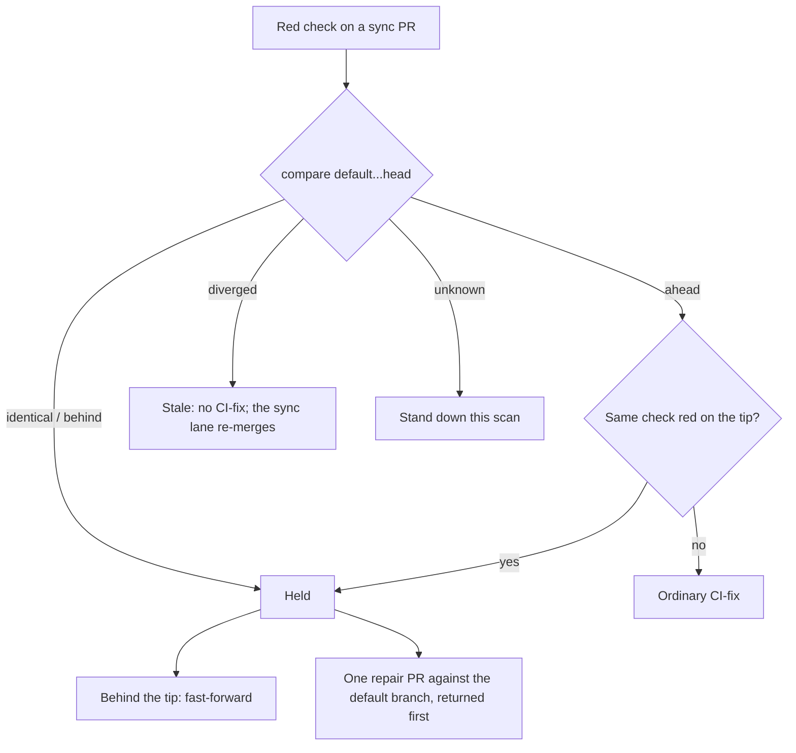

# PR Summary — Issue #5437

## Summary

When the default branch is red, the CI-fix scan no longer hands each
`sync/milestone-*` PR to the CI-fix agent. `findFailedCiChecks` now:

- holds a sync PR's failure that it inherits from the default branch;
- opens one `fix/red-default-branch-<sha12>` repair PR against the default
  branch, or adopts an open one;
- returns that repair PR's own failure before any other failure;
- fast-forwards a held sync head that is behind the tip.

The repair PR's body carries the "main is red: holding sync PRs …, fix in #N"
status. The shift-left filer no longer counts runs on sync branches or on the
repair branch. Part of #5437.

## Spec

### Intent and Rationale

- A sync PR's head is the default branch merged into the milestone, so a failure the default branch also has can only be fixed once, on the default branch. Fixing it on the sync branch wrote the fix twice (#5429 and #5434).
- Ancestry comes from `compare/<default>...<head>` (`lib/default_branch_ancestry.ts`). `identical`/`behind` means the head *is* a default-branch commit, so every failure on it is inherited. `ahead` means a fresh merge, so only a check also red on the tip is inherited. `diverged` means a stale sync head that the milestone sync lane re-merges on its next cycle, so it gets no CI-fix agent.
- The repair PR starts as an empty commit on the tip, because GitHub refuses a PR with no commits. Its own CI then fails on the same check, and the ordinary CI-fix lane repairs the default branch through it.

### Essential Design Decisions

- A sync PR is never handed to the CI-fix agent when ancestry, the tip SHA, or the tip's check runs cannot be read. It stands down for that scan (`fetchFailedCheckRunsStrict` throws rather than returning `[]`).
- "Give it top priority": the issue's wording could mean applying the `top-priority` label, but the coding guidelines forbid self-applying a reserved workflow label. Instead the repair PR's failure is returned before every other failure.
- Only a `fix/red-default-branch-*` head is adopted. A fix PR a human opened, such as #5434, is not recognised automatically, so criterion 2 is `partial`.
- Refresh is fast-forward only (`PATCH git/refs/heads/<sync>` with `force=false`), and only for a head proven to be an ancestor of the tip, so no commit can be lost. Merge-commit sync heads are refreshed by the existing milestone sync lane (`raiseMilestoneSyncPr`).
- The shift-left exclusion is by branch: sync branches and the repair branch. An earlier "head already on the default branch" exclusion was dropped. It would also have dropped real failures from PRs that were merged with a merge commit.

### Undiscoverable Facts

- Observed: `gh api repos/stSoftwareAU/VibeCoder/compare/main...302adaa5e --jq .status` returned `behind`, and `compare/main...main` returned `identical`. The ancestry mapping is built on these outputs. GitHub documents `ahead` and `diverged`.
- The #5429 sync-branch push (`52ff34d`) came from the worker's CI-fix lane (`vibe-mwsibuoo-8c1cd5.ci_fix-…`), not from the babysitter. That is why the hold lives in `findFailedCiChecks`.

## Evidence

Backend/CLI change. The new tests drive the real `findFailedCiChecks` and
`runShiftLeftScan` with `gh` fakes that answer according to their arguments.

Docs: added `docs/INTERNALS.md` → "Red default branch: hold sync PRs, repair
once (Issue #5437)". Added the lib-sweep slice
`docs/audits/lib-sweep-coverage/top-up-5437.json` for the two new modules.

## Reproduction

- **symptom** — five sync PRs with head `302adaa` (= `main`) failed `gitleaks`. The CI-fix lane pushed a fix onto one sync branch (#5429) while #5434 fixed `main`, and shift-left counted the sync failures as local-gate misses (#5430).
- **status** — `verified` — with `worker/deno/lib/pr_maintenance.ts` and `worker/deno/lib/shift_left_failures.ts` restored to the base commit, 12 of the new tests failed. Examples: the three-sync-PR test returned a sync PR as the CI-fix target and opened no repair PR, and the sync-branch shift-left test observed the sync run. All of them pass on the head.
- **regression test** — `worker/deno/tests/red_default_branch_repair_5437_test.ts::findFailedCiChecks - red main with three identical sync PRs hands none to the CI-fix agent and opens one repair PR (Issue #5437)`

## Acceptance Criteria

<!-- vibe-spec-review inputs="diff+issue-body" -->

- **partial** — Detect a red default branch. Before running a ci-fix on a PR, check whether the same required check fails on the base commit it inherits from `main`. For a `sync/milestone-*` PR, the failing commit *is* `main`. — evidence: `worker/deno/tests/red_default_branch_repair_5437_test.ts::findFailedCiChecks - red main with three identical sync PRs hands none to the CI-fix agent and opens one repair PR (Issue #5437)` — reviewer: partial — reason: the check covers sync PRs only; a non-sync PR keeps the existing Issue #1880 base-branch verification, and "required" checks are not filtered separately
- **partial** — Repair once. If `main` is red, open or adopt **one** fix PR against `main` (or the existing one, like #5434), give it top priority, and do **not** ci-fix sync PRs for that failure. — evidence: `worker/deno/tests/red_default_branch_repair_5437_test.ts::findFailedCiChecks - an open repair PR is adopted, not duplicated, and its status is edited once when the marker differs (Issue #5437)` — reviewer: partial — reason: only a `fix/red-default-branch-*` head is adopted; a fix PR a human opened, such as #5434, is not recognised, and top priority is scan order, not the reserved label
- **partial** — Re-sync after the repair. Once `main` is green, update or recreate the sync PRs so they pick up the repair, rather than leaving them on the stale red head. — evidence: `worker/deno/tests/red_default_branch_repair_5437_test.ts::findFailedCiChecks - a held sync head behind the tip is fast-forwarded to it, fast-forward only (Issue #5437)` — reviewer: partial — reason: since the review, a stale merge-commit (`diverged`) sync head is no longer handed to the CI-fix agent, but its refresh still relies on the existing milestone sync lane re-merging the default branch, which no test here exercises
- **partial** — Keep the shift-left count clean. Exclude failures that are inherited from a red base (including all sync PRs) from the shift-left recurrence counter. — evidence: `worker/deno/tests/shift_left_failures_test.ts::scan: a run on a milestone sync branch is not observed, while an identical feature-branch run is (Issue #5437)` — reviewer: partial — reason: runs on sync branches and on the repair branch are excluded; a non-sync PR whose head fails only because its base was red is still counted. The over-broad "head already on the default branch" exclusion the reviewer flagged was removed
- **met** — Leave a single, visible "main is red: holding sync PRs, fix in #N" status (for example on the fix PR), so a human can see why streams are held. — evidence: `worker/deno/tests/red_default_branch_repair_5437_test.ts::formatRedDefaultBranchStatus - names the held sync PRs and the fix PR, with the marker (Issue #5437)` — reviewer: met
- **met** — Tests cover: a red `main` with N open sync PRs leads to exactly one fix PR against `main` and no ci-fix pushes to `sync/milestone-*` branches. — evidence: `worker/deno/tests/red_default_branch_repair_5437_test.ts::findFailedCiChecks - red main with three identical sync PRs hands none to the CI-fix agent and opens one repair PR (Issue #5437)` — reviewer: met
- **partial** — Sync PRs are refreshed after `main` goes green. — evidence: `worker/deno/tests/red_default_branch_repair_5437_test.ts::findFailedCiChecks - a held sync head behind the tip is fast-forwarded to it, fast-forward only (Issue #5437)` — reviewer: partial — reason: only fast-forwardable heads are refreshed by this change; merge-commit heads wait for the sync lane
- **partial** — Inherited failures are excluded from the shift-left counter. — evidence: `worker/deno/tests/shift_left_failures_test.ts::scan: a run on a milestone sync branch is not observed, while an identical feature-branch run is (Issue #5437)` — reviewer: partial — reason: as above, the exclusion is by branch (sync and repair branches), not by comparing against a red base
- **unrequested** — `fetchFailedCheckRunsStrict`, split out of `fetchFailedCheckRuns` — reviewer: unrequested — reason: an unreadable tip must stand the sync PR down, never read as green
- **unrequested** — a held sync head is fast-forwarded even while `main` is still red — reviewer: unrequested — reason: harmless (fast-forward only), and it means the sync PR picks up the repair as soon as it lands
- **unrequested** — a sync PR whose ancestry cannot be read stands down for that scan — reviewer: unrequested — reason: fail closed, so "could not tell" never hands a sync PR to the CI-fix agent

## Standards Review

<!-- vibe-standards-review inputs="diff+CODING-STANDARDS.md" -->

- **violation** — an external fake should answer according to its input — evidence: `worker/deno/tests/default_branch_ancestry_5437_test.ts` — reason: fixed in this diff (the fake answers only the exact compare args for the sha under test; the shift-left compare fake was removed with the exclusion it served)
- **violation** — "how" tests asserting call counts — evidence: `worker/deno/tests/shift_left_failures_test.ts` — reason: fixed in this diff (the default-branch read-count test and the jobs-never-read assertion were removed)
- **violation** — reading the worker's own marker with an unanchored first match — evidence: `worker/deno/lib/red_default_branch_repair.ts:42` — reason: fixed in this diff (anchored at the end of the body, with a test for a mid-text quoted marker)
- **violation** — every outcome of a branch you add needs a test that reaches it — evidence: `worker/deno/lib/red_default_branch_repair.ts` — reason: fixed in this diff for the `gh pr create` failure and the refused fast-forward PATCH; the tree/commit/ref read failures, the invalid-branch refusal and the adopted-PR `pr edit` failure are still untested
- **violation** — the INTERNALS "Unknown stands down" bullet overstated the unreadable-tip case — evidence: `docs/INTERNALS.md` — reason: fixed in this diff
- **clean** — Australian English, fail-loud reads (strict check-run read, unknown never read as green), no test-only members, fast-forward-only ref update destroys nothing, no shared `/tmp` paths, mermaid included; review-enforced rules checked: avoid over-engineering, check where you insert, documentation-drift scoping

## Test Plan

- New: `worker/deno/tests/red_default_branch_repair_5437_test.ts` drives the real `findFailedCiChecks`. It covers: held sync PRs with one repair PR; a positive control where a fleet PR's failure is still returned; adoption with the edit-once/no-edit marker cases, plus a mid-text quoted marker; the fast-forward and a refused fast-forward; a `contains-default` head with and without the tip red; a `diverged` stale head; unknown ancestry; an unreadable tip check-run read; a failed `pr create`; repair-PR priority; and `formatRedDefaultBranchStatus`.
- New: `worker/deno/tests/default_branch_ancestry_5437_test.ts` covers every compare status, a thrown error and an invalid sha, using an input-aware fake.
- Edited existing: `worker/deno/tests/shift_left_failures_test.ts`. Its fake gained a `headBranches` option, and the default is unchanged (`issue-N`). No existing assertion was removed or changed. New tests: a sync-branch run and a repair-branch run are not observed, while the other runs in the same scan are.
- Red run against base: with `worker/deno/lib/pr_maintenance.ts` and `worker/deno/lib/shift_left_failures.ts` restored to `8596aa75b`, 12 new tests failed, observed before the review-fix round. All pass on the head.
- Targeted run on the head: `deno task test:unit tests/red_default_branch_repair_5437_test.ts tests/pr_maintenance_ci_deferral_test.ts tests/pr_maintenance_test.ts tests/pr_maintenance_merge_queue_test.ts tests/default_branch_ancestry_5437_test.ts` → 139 passed, 0 failed. `tests/default_branch_ancestry_5437_test.ts tests/shift_left_failures_test.ts` → 41 passed, 0 failed.
- Full gate: the first `./quality.sh` run failed only on the lib-sweep slice for the two new modules. `top-up-5437.json` fixes that, and `deno task check:manifests` then passed. The second full run on the head was still in its deno-tests stage at the run deadline, with every earlier stage passed. <!-- vibe-quality-gate-skipped reason="second ./quality.sh run did not finish before the run deadline; first run failed only on the lib-sweep slice, since fixed" -->
- Twinned rules: none found. This changes a scan, not a PR-summary gate.

🤖 Generated with [Claude Code](https://claude.com/claude-code)
