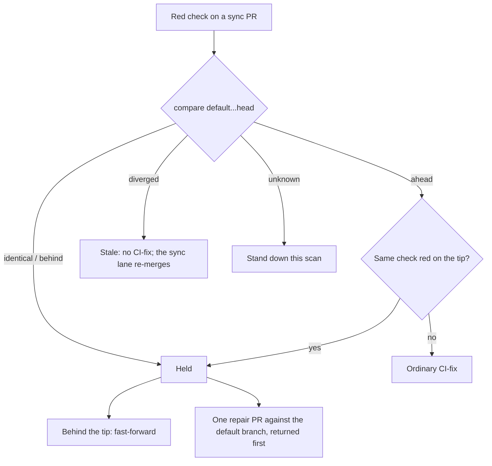

# PR Summary — Issue #5437

## Summary

When the default branch is red, the CI-fix scan no longer hands each
`sync/milestone-*` PR to the CI-fix agent. `findFailedCiChecks` now:

- holds a sync PR's failure that it inherits from the default branch;
- opens one `fix/red-default-branch-<sha12>` repair PR against the default
  branch, or adopts an open one;
- returns that repair PR's own failure before any other failure;
- fast-forwards a held sync head that is behind the tip.

The repair PR's body carries the "main is red: holding sync PRs …, fix in #N"
status. The shift-left filer no longer counts runs on sync branches or on the
repair branch. Part of #5437.

## Spec

### Intent and Rationale

- A sync PR's head is the default branch merged into the milestone, so a failure the default branch also has can only be fixed once, on the default branch. Fixing it on the sync branch wrote the fix twice (#5429 and #5434).
- Ancestry comes from `compare/<default>...<head>` (`lib/default_branch_ancestry.ts`). `identical`/`behind` means the head *is* a default-branch commit, so every failure on it is inherited. `ahead` means a fresh merge, so only a check also red on the tip is inherited. `diverged` means a stale sync head that the milestone sync lane re-merges on its next cycle, so it gets no CI-fix agent.
- The repair PR starts as an empty commit on the tip, because GitHub refuses a PR with no commits. Its own CI then fails on the same check, and the ordinary CI-fix lane repairs the default branch through it.

### Essential Design Decisions

- A sync PR is never handed to the CI-fix agent when ancestry, the tip SHA, or the tip's check runs cannot be read. It stands down for that scan (`fetchFailedCheckRunsStrict` throws rather than returning `[]`).
- "Give it top priority": the issue's wording could mean applying the `top-priority` label, but the coding guidelines forbid self-applying a reserved workflow label. Instead the repair PR's failure is returned before every other failure.
- Only a `fix/red-default-branch-*` head is adopted. A fix PR a human opened, such as #5434, is not recognised automatically, so criterion 2 is `partial`.
- Refresh is fast-forward only (`PATCH git/refs/heads/<sync>` with `force=false`), and only for a head proven to be an ancestor of the tip, so no commit can be lost. Merge-commit sync heads are refreshed by the existing milestone sync lane (`raiseMilestoneSyncPr`).
- The shift-left exclusion is by branch: sync branches and the repair branch. An earlier "head already on the default branch" exclusion was dropped. It would also have dropped real failures from PRs that were merged with a merge commit.

### Undiscoverable Facts

- Observed: `gh api repos/stSoftwareAU/VibeCoder/compare/main...302adaa5e --jq .status` returned `behind`, and `compare/main...main` returned `identical`. The ancestry mapping is built on these outputs. GitHub documents `ahead` and `diverged`.
- The #5429 sync-branch push (`52ff34d`) came from the worker's CI-fix lane (`vibe-mwsibuoo-8c1cd5.ci_fix-…`), not from the babysitter. That is why the hold lives in `findFailedCiChecks`.

## Evidence

Backend/CLI change. The new tests drive the real `findFailedCiChecks` and
`runShiftLeftScan` with `gh` fakes that answer according to their arguments.

Docs: added `docs/INTERNALS.md` → "Red default branch: hold sync PRs, repair
once (Issue #5437)". Added the lib-sweep slice
`docs/audits/lib-sweep-coverage/top-up-5437.json` for the two new modules.

## Reproduction

- **symptom** — five sync PRs with head `302adaa` (= `main`) failed `gitleaks`. The CI-fix lane pushed a fix onto one sync branch (#5429) while #5434 fixed `main`, and shift-left counted the sync failures as local-gate misses (#5430).
- **status** — `verified` — with `worker/deno/lib/pr_maintenance.ts` and `worker/deno/lib/shift_left_failures.ts` restored to the base commit, 12 of the new tests failed. Examples: the three-sync-PR test returned a sync PR as the CI-fix target and opened no repair PR, and the sync-branch shift-left test observed the sync run. All of them pass on the head.
- **regression test** — `worker/deno/tests/red_default_branch_repair_5437_test.ts::findFailedCiChecks - red main with three identical sync PRs hands none to the CI-fix agent and opens one repair PR (Issue #5437)`

## Acceptance Criteria

ACCEPTANCE_BLOCK

## Standards Review

STANDARDS_BLOCK

## Test Plan

TEST_PLAN_BLOCK

🤖 Generated with [Claude Code](https://claude.com/claude-code)
