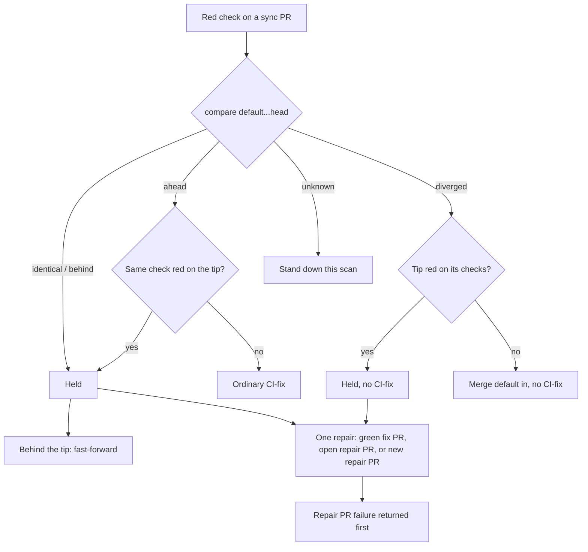

# PR Summary — Issue #5437

## Summary

When the default branch is red, the CI-fix scan (`findFailedCiChecks` in
`worker/deno/lib/pr_maintenance.ts`) no longer fixes the same failure once per
`sync/milestone-*` PR. It holds failures inherited from the default branch,
repairs the default branch through one PR, refreshes the sync PRs once the
repair lands, and keeps inherited failures out of the shift-left counter.

Part of #5437.

- **Detect:** a sync PR's head is compared with the default branch
  (`compare/<default>...<head>`, `worker/deno/lib/default_branch_ancestry.ts`).
  A head that is the tip or behind it inherits every failure. A fresh merge
  (`ahead`) inherits only checks also red on the tip. A stale head (`diverged`)
  is never handed to the CI-fix agent. A non-sync PR into the default branch is
  held only when the check is red on the tip **and** on its merge base.
- **Repair once:** one repair PR per repository. The scan adopts a green fix PR
  whose head contains the tip, such as #5434, or an open
  `fix/red-default-branch-*` PR, or opens one (an empty commit on the tip). The
  repair PR's failure is returned before every other failure. While a green fix
  PR is adopted, the worker's own repair PR waits.
- **Re-sync:** a held sync head behind the tip is fast-forwarded
  (`force=false`). A stale merge-commit sync head gets the default branch merged
  in server-side once the tip is green on its checks.
- **Status:** "main is red: holding sync PRs #…, fix in #N" goes in the repair
  PR's body, or in one fleet comment on an adopted fix PR, edited in place.
- **Repair PR is never deferred:** on a `fix/red-default-branch-*` head the
  CI-fix processor refuses a `Depends on` base-branch deferral
  (`_resolveBaseBranchDeferral` in `worker/deno/lib/pr_ci_processor.ts`), and
  the CI-fix prompt carries `RED_DEFAULT_BRANCH_REPAIR_NOTE`
  (`worker/deno/lib/prompt_builder.ts`) telling the agent the base's failure is
  the one to fix.
- **Shift-left:** runs on sync branches and the repair branch are not counted,
  nor is a job whose check already failed on the PR's merge base.

## Spec

### Intent and Rationale

- A sync PR's head is the default branch merged into a milestone, so a failure
  the default branch shares is fixed once, on the default branch. Fixing it on a
  sync branch wrote the fix twice (#5429 and #5434).
- The repair PR starts as an empty commit on the tip, because GitHub refuses a
  PR with no commits. Its own CI then fails on the same check, and the ordinary
  CI-fix lane repairs the default branch through it.

### Essential Design Decisions

- "Cannot tell" never hands a sync PR to the CI-fix agent. An unreadable
  ancestry, tip or tip check-run read stands it down for that scan, and
  `fetchFailedCheckRunsStrict` throws rather than returning `[]`. A non-sync PR
  whose tip or merge-base read fails falls through to the ordinary CI-fix path.
- "Give it top priority" is scan order. Reading it as the `top-priority` label
  would breach the guidelines' ban on self-applying a reserved workflow label,
  so the repair PR's failure is returned first instead.
- A human fix PR is adopted only when its head contains the red tip (`compare`
  status `ahead`) and its own CI passed every held check. A fix whose CI has not
  gone green yet is not recognised, which is why criterion 2 stays `partial`.
- Refresh never rewrites history. A fast-forward uses `force=false`, and the
  server-side `POST repos/<repo>/merges` only adds a commit. A conflict is
  logged, and the milestone sync lane retries.

### Undiscoverable Facts

- Observed:
  `gh api repos/stSoftwareAU/VibeCoder/compare/main...302adaa5e --jq .status`
  returned `behind`, `compare/main...main` returned `identical`, and
  `--jq .merge_base_commit.sha` for `302adaa5e` returned
  `302adaa5ed4f0d3cd7affc1c110bfa7c87e5db83`.
- Observed: the failed check runs on `302adaa5e` are `gate` and
  `gitleaks / gitleaks`, and the failed Actions jobs of the runs on that head
  carry the same names. That is why shift-left can compare job names with
  check-run names.
- The #5429 sync-branch push (`52ff34d`) came from the worker's CI-fix lane (run
  `vibe-mwsibuoo-8c1cd5.ci_fix-…`). #5434 was opened by `nleck` against `main`.

## Evidence

Backend change. Tests drive the real `findFailedCiChecks` and `runShiftLeftScan`
with `gh` fakes that answer according to their arguments. Their fixtures are
taken from the real outputs quoted above. GitHub's REST documentation for "Merge
a branch" gives the `POST /merges` outcomes: 201 merged, 204 nothing to merge,
409 conflict.

Docs updated: the `docs/INTERNALS.md` section "Red default branch: hold sync
PRs, repair once (Issue #5437)", and the "Shift-left detection" section of
`docs/workflows/fleet-pr-babysitter.md`. The "Base-branch failure (deferral)"
bullet and the paragraph after the deferral chart in `docs/workflows/ci-fix.md`,
the `ci_fix` row of `docs/PROMPTS.md`, and the `_resolveBaseBranchDeferral` doc
comment name the repair PR as a second exception to deferral. New modules are claimed in
`docs/audits/lib-sweep-coverage/top-up-5437.json`.

## Reproduction

- **symptom** — five sync PRs with head `302adaa` (= `main`) failed `gitleaks`.
  The CI-fix lane pushed a fix onto one sync branch (#5429) while #5434 fixed
  `main`, and shift-left counted the sync failures as local-gate misses (#5430).
- **status** — `verified` — with `worker/deno/lib/pr_maintenance.ts` and
  `worker/deno/lib/shift_left_failures.ts` restored to base commit `8596aa75b`,
  the new tests failed (53 failed at commit `da3d654ae`). They pass on the head.
- **regression test** —
  `worker/deno/tests/red_default_branch_repair_5437_test.ts::findFailedCiChecks - red main with three identical sync PRs hands none to the CI-fix agent and opens one repair PR (Issue #5437)`

## Acceptance Criteria

<!-- vibe-spec-review inputs="diff+issue-body" -->

- **partial** — Detect a red default branch. Before running a ci-fix on a PR,
  check whether the same required check fails on the base commit it inherits
  from `main`. For a `sync/milestone-*` PR, the failing commit _is_ `main`. —
  evidence:
  `worker/deno/tests/red_default_branch_repair_5437_test.ts::findFailedCiChecks - a non-sync PR into main failing a check the tip and its merge base are both red on is held, not handed to the CI-fix agent (Issue #5437)`
  — reviewer: partial — reason: the reviewer's gap, that a diverged sync PR was
  not held, is fixed since its review
  (`…a diverged sync PR is not refreshed while the tip is red on its checks, but is held for one repair PR`);
  every failing check is compared, not only required ones
- **partial** — Repair once. If `main` is red, open or adopt **one** fix PR
  against `main` (or the existing one, like #5434), give it top priority, and do
  **not** ci-fix sync PRs for that failure. — evidence:
  `worker/deno/tests/red_default_branch_repair_5437_test.ts::findFailedCiChecks - a green human fix PR against main is adopted: no repair PR, and the status is commented on it once (Issue #5437)`
  — reviewer: partial — reason: a human fix PR is adopted only once its own CI
  is green on the held checks; one still running is not recognised, so the
  worker opens its own repair PR meanwhile
- **met** — Re-sync after the repair. Once `main` is green, update or recreate
  the sync PRs so they pick up the repair, rather than leaving them on the stale
  red head. — evidence:
  `worker/deno/tests/red_default_branch_repair_5437_test.ts::findFailedCiChecks - a diverged sync PR is refreshed by merging main into it once the tip is green on its checks (Issue #5437)`
  — reviewer: met
- **partial** — Keep the shift-left count clean. Exclude failures that are
  inherited from a red base (including all sync PRs) from the shift-left
  recurrence counter. — evidence:
  `worker/deno/tests/shift_left_failures_test.ts::scan: a check that failed on the base commit is not observed, while the same check on a green base is (Issue #5437)`
  — reviewer: met — reason: a non-sync PR's inherited failure is excluded only
  when its merge-base commit carries a failed check run; a merge base with no
  check runs (usual for `main` commits here, as `quality.yml` is
  `pull_request`-only) still counts
- **met** — Leave a single, visible "main is red: holding sync PRs, fix in #N"
  status (for example on the fix PR), so a human can see why streams are held. —
  evidence:
  `worker/deno/tests/red_default_branch_repair_5437_test.ts::findFailedCiChecks - a changed held set edits the one fleet status comment in place: one PATCH to its id, no new comment (Issue #5437)`
  — reviewer: met
- **met** — Tests cover: a red `main` with N open sync PRs leads to exactly one
  fix PR against `main` and no ci-fix pushes to `sync/milestone-*` branches. —
  evidence:
  `worker/deno/tests/red_default_branch_repair_5437_test.ts::findFailedCiChecks - red main with three identical sync PRs hands none to the CI-fix agent and opens one repair PR (Issue #5437)`
  — reviewer: met
- **met** — Sync PRs are refreshed after `main` goes green. — evidence:
  `worker/deno/tests/red_default_branch_repair_5437_test.ts::findFailedCiChecks - three sync PRs on a red tip get one repair, then one fast-forward each once the repair lands (Issue #5437)`
  — reviewer: partial — reason: the reviewer asked for a red → repair → green
  sequence test; that test was added after its review, and runs two scans over
  the same fixture
- **partial** — Inherited failures are excluded from the shift-left counter. —
  evidence:
  `worker/deno/tests/shift_left_failures_test.ts::scan: a run on a milestone sync branch is not observed, while an identical feature-branch run is (Issue #5437)`
  — reviewer: met — reason: not excluded when the merge base has no check runs,
  the normal case for `main` and milestone commits in this repo
- **unrequested** — `docs/audits/lib-sweep-coverage/top-up-5437.json` —
  reviewer: unrequested — reason: the repository's lib-sweep coverage test
  requires every new lib module to be claimed by a slice
- **unrequested** — `fetchFailedCheckRunsStrict`, split out of
  `fetchFailedCheckRuns` — reviewer: unrequested — reason: an unreadable
  check-run read must stand a sync PR down, never read as green
- **unrequested** — the worker's repair PR waits while a green human fix PR is
  adopted (`red-default-branch-fix-adopted`) — reviewer: unrequested — reason:
  without it the fix would be written twice, which is the bug

## Standards Review

<!-- vibe-standards-review inputs="diff+CODING-STANDARDS.md" -->

- **violation** — Fail Loud: missing keys read as defaults (`login ?? ""`, rows
  skipped silently) — evidence: `worker/deno/lib/shift_left_failures.ts` —
  reason: fixed in this diff (missing `user.login`, `headRefOid` and related
  fields now fail the read and name the field; tests
  `scan: a linked PR whose response has no user.login fails loudly, naming the field (Issue #5437)`
  and
  `findGreenFixPr - a PR row without its head commit fails the read, and the warn names headRefOid (Issue #5437)`)
- **violation** — Fail Loud: a status comment with no login was read as `""` —
  evidence: `worker/deno/lib/red_default_branch_repair.ts` — reason: fixed in
  this diff
  (`postRedDefaultBranchStatusComment - a comment without a user.login reads as read-failed, and the warn names the login (Issue #5437)`)
- **violation** — edited fake returned `base` whatever the jq filter asked —
  evidence: `worker/deno/tests/shift_left_failures_test.ts` — reason: fixed in
  this diff (the fake now answers per filter; dropping `.base.ref` from
  `resolvePr` was observed to turn 4 tests red)
- **violation** — in-repo helper re-implemented (merge-base read, check-run
  read) — evidence: `worker/deno/lib/shift_left_failures.ts` — reason: fixed in
  this diff (both use `readMergeBaseSha` in
  `worker/deno/lib/default_branch_ancestry.ts` and `fetchFailedCheckRunsStrict`)
- **violation** — duplicated `errorText` and 40-hex SHA patterns — evidence:
  `worker/deno/lib/red_default_branch_repair.ts` — reason: fixed in this diff
  (one `errorText` and one `FULL_COMMIT_SHA_PATTERN` exported from
  `worker/deno/lib/default_branch_ancestry.ts`)
- **violation** — Every changed call site needs a test that goes red without
  it: the `repairsDefaultBranch` wiring in `processCiFailure` had no covering
  test — evidence: `worker/deno/lib/pr_ci_processor.ts:2002` — reason: fixed in
  this diff (the deferral test records the agent's prompt; with the wiring set
  to `false` the repair test was observed red on its prompt assertion)
- **violation** — Adding a member owes a docs change: the new repair-PR refusal
  was missing from the `_resolveBaseBranchDeferral` doc comment and the
  operator docs — evidence: `worker/deno/lib/pr_ci_processor.ts:4191` — reason:
  fixed in this diff (doc comment, `docs/workflows/ci-fix.md`, `docs/PROMPTS.md`)
- **clean** — Australian English; log levels; fail loud elsewhere (every catch
  logs the `gh` cause, unknown never holds or hands over); no history
  assumptions (compare API, not local `merge-base`); no test-only members; no
  `/tmp` paths in tests; no workflow change. Review-enforced rules checked:
  dummy and "how" tests, avoid over-engineering, Australian English.

## Test Plan

- `worker/deno/tests/red_default_branch_repair_5437_test.ts` (new) drives
  `findFailedCiChecks`. It covers:
  - sync PRs at, behind, ahead of and diverged from the tip, plus unknown
    ancestry;
  - non-sync PRs into `main` with the tip and merge base red, the merge base
    green, a failed merge-base read, a tip not red, and a failed tip read;
  - opening and adopting the repair PR, adopting a green fix PR, and refusing
    partial-green, stale and unreadable candidates;
  - the single status comment edited in place;
  - failure paths: PR create, fast-forward, tree, commit, ref, edit, comment,
    check-run and list reads;
  - the red → repair → green sequence;
  - a hostile marker regex input.
- `worker/deno/tests/default_branch_ancestry_5437_test.ts` (new) covers every
  compare status with its cause, a thrown error and an invalid sha, using an
  input-aware fake.
- `worker/deno/tests/shift_left_failures_test.ts` (edited) adds tests for sync
  and repair branches, a red merge base (linked and unlinked runs), a different
  check, failed merge-base and base check-run reads, and a missing `user.login`.
  - Its fake now answers `pulls` reads as JSON with `login` and, only when the
    jq filter asks for it, `base`. It also answers the compare and base
    check-run reads, with defaults of no base failures.
  - No existing assertion was removed or changed, and the existing tests still
    reach the counting logic.
- Red against base: with `worker/deno/lib/pr_maintenance.ts` and
  `worker/deno/lib/shift_left_failures.ts` restored to `8596aa75b`, 53 tests
  failed (observed at `da3d654ae`).
- Targeted run on the head:
  `deno task test:unit tests/red_default_branch_repair_5437_test.ts tests/pr_maintenance_ci_deferral_test.ts tests/pr_maintenance_test.ts tests/pr_maintenance_merge_queue_test.ts`
  gave 163 passed, 0 failed.
- Full gate: `./quality.sh` passed on `59f1a5c61`
  (`Result: PASSED (with skipped checks)`; config integration and checkov are
  skipped because their tools are not installed on the host). It passed again on
  the final code head `9c1fb4314`.
- `worker/deno/tests/ci_fix_prompt_v4_test.ts` (edited) adds
  `buildCiFixPrompt - a repair PR for a red default branch is told not to defer to its base, and an ordinary PR is not (Issue #5437)`.
- `worker/deno/tests/pr_ci_processor_deferral_test.ts` (edited) adds
  `processCiFailure - a repair PR for a red default branch is never deferred to its red base: it takes the ordinary path and charges an attempt (Issue #5437)`.
  Its input is the red-base deferring test's input with only the head branch
  changed, plus a control on `issue-150-fix` with a green base. The scenario's
  Claude stub now records the prompt (`Captured.prompts`); no existing
  assertion changed. Observed red with the branch guard in
  `_resolveBaseBranchDeferral` disabled (the deferral marker was posted), and
  red with `repairsDefaultBranch: false` (the prompt lacked the note).
  `deno task test:unit tests/pr_ci_processor_deferral_test.ts`: 46 passed,
  0 failed.
- Twinned rules: none found. This changes a scan, not a PR-summary gate.

🤖 Generated with [Claude Code](https://claude.com/claude-code)
