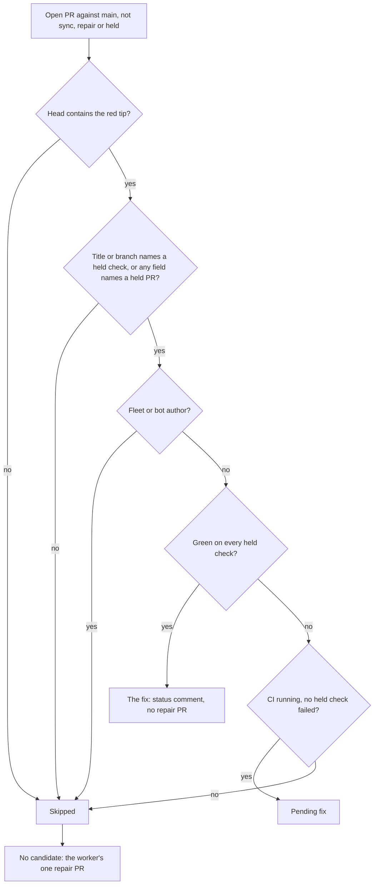

# PR Summary — Issue #5437

## Summary

This is the third PR for #5437. #5459 and #5466 already merged into
`milestone/red-main-recovery`. Together they hold inherited red-main failures on
sync PRs, repair the default branch once, adopt a human fix that is green or
still running, refresh the sync PRs, post one status and clean the shift-left
count. This PR closes the gap #5466 left open. Before it, any open human PR that
contained the red tip and was green on the held checks was adopted as the fix. A
check that scans only a PR's own commits (gitleaks scans `base.sha..head.sha`)
passes on any unrelated PR, so the fleet could wait on such a PR while `main`
stayed red.

`findGreenFixPr` (`worker/deno/lib/red_default_branch_repair.ts`) now adopts a
candidate only when `fixCandidateNamesHeldFailure` finds one of these:

- a held check's name, as a whole case-insensitive token, in the PR's title or
  head branch
- a held PR as `#N` anywhere in the title, body or branch

Fleet-authored and bot PRs are now never the fix on either path. Before this PR
they were excluded only while their CI was running. The PR list reads `title`
and `body`, and a row missing either field fails the read, so the scan falls
back to the worker's repair PR.

Part of #5437.

## Spec

### Intent and Rationale

- Being green on a diff-scoped check proves nothing about `main`. A PR that
  names the failing check or a held PR is the best evidence the listing gives
  that it is about this failure.

### Essential Design Decisions

- Check names count only in the title or the branch. Bodies routinely say
  "quality gate", and `gate` was one of the incident's held checks. A held PR
  `#N` counts in the body too.
- Matching uses `indexOf` with ASCII-alphanumeric boundary tests. No pattern is
  built from PR text.
- Fleet and bot PRs are excluded on the green path as well. The worker's own
  repair PR (`fix/red-default-branch-*`) is the fleet's fix, and a fleet PR
  green on gitleaks is not one.
- Assumption: a human fix names its failure in its title or branch, as #5434's
  title and its branch `fix/gitleaks-allow-5310-fixtures` both do. A human fix
  that names neither is duplicated by the worker's repair PR rather than
  adopted. Two fixes is the safer failure than holding a red `main` on an
  unrelated PR.

### Undiscoverable Facts

- `gh pr list --json title,body` answers a string for both fields. Observed on
  this repository's PR list in this run; `body` is `""` when empty.
- #5434's title is "Allowlist the #5310 label-as-value test's synthetic values
  in gitleaks" (`gh pr view 5434 --json title,headRefName`).

## Evidence

Backend only. The behaviour is covered by tests that drive `findFailedCiChecks`
through the scan fixture's faked `gh`, and by direct tests of `findGreenFixPr`
and `fixCandidateNamesHeldFailure`.

## Reproduction

- **symptom** — an open human PR unrelated to the failure, green on gitleaks
  because gitleaks scans only the PR's own commits, was adopted as the fix while
  `main` stayed red, so no repair PR was opened
- **status** — `partial` — reason: the end-to-end regression test was observed
  failing with the new naming skip disabled at the head (`88 passed | 2 failed`)
  and passing with it restored. The base production file itself was not checked
  out to re-run the test
- **regression test** —
  `worker/deno/tests/red_default_branch_repair_5437_test.ts::findFailedCiChecks - an unrelated human PR green on gitleaks is not adopted, and the repair PR is opened (Issue #5437)`

## Acceptance Criteria

<!-- vibe-spec-review inputs="diff+issue-body" -->

- **met** — Detect a red default branch. Before running a ci-fix on a PR, check
  whether the same required check fails on the base commit it inherits from
  `main`. For a `sync/milestone-*` PR, the failing commit _is_ `main`. —
  evidence:
  `worker/deno/tests/red_default_branch_repair_5437_test.ts::findFailedCiChecks - a non-sync PR into main failing a check the tip and its merge base are both red on is held, not handed to the CI-fix agent (Issue #5437)`
  (delivered in #5459) — reviewer: met
- **partial** — Repair once. If `main` is red, open or adopt **one** fix PR
  against `main` (or the existing one, like #5434), give it top priority, and do
  **not** ci-fix sync PRs for that failure. — evidence:
  `worker/deno/tests/red_default_branch_repair_5437_test.ts::findFailedCiChecks - an unrelated human PR green on gitleaks is not adopted, and the repair PR is opened (Issue #5437)`
  and
  `worker/deno/tests/red_default_branch_repair_5437_test.ts::findFailedCiChecks - a fleet-authored PR whose title names gitleaks and that is green on it is not adopted, and the repair PR is opened (Issue #5437)`
  — reviewer: partial — reason: the worker's repair PR is handled first, ahead
  of every other failure, but an adopted human fix PR gets no priority step: the
  fleet comments on it and waits. Telling a real fix apart is still a heuristic:
  it rests on the PR naming its failure. The reviewer flagged that `gate` in a
  body or fleet PR could pass for the fix. This diff then confined check names
  to the title and branch and excluded fleet PRs on the green path
  (`findGreenFixPr - a green human PR whose body says quality gate is not the fix for gate, but one whose title names gate is (Issue #5437)`).
  A human PR titled with a held check's name but not fixing it would still be
  adopted
- **met** — Re-sync after the repair. Once `main` is green, update or recreate
  the sync PRs so they pick up the repair, rather than leaving them on the stale
  red head. — evidence:
  `worker/deno/tests/red_default_branch_repair_5437_test.ts::findFailedCiChecks - a diverged sync PR is refreshed by merging main into it once the tip is green on its checks (Issue #5437)`
  (delivered in #5459) — reviewer: met
- **met** — Keep the shift-left count clean. Exclude failures that are inherited
  from a red base (including all sync PRs) from the shift-left recurrence
  counter. — evidence:
  `worker/deno/tests/shift_left_failures_test.ts::scan: a run on a milestone sync branch is not observed, while an identical feature-branch run is (Issue #5437)`
  (delivered in #5459) — reviewer: met
- **met** — Leave a single, visible "main is red: holding sync PRs, fix in #N"
  status (for example on the fix PR), so a human can see why streams are held. —
  evidence:
  `worker/deno/tests/red_default_branch_repair_5437_test.ts::findFailedCiChecks - a changed held set edits the one fleet status comment in place: one PATCH to its id, no new comment (Issue #5437)`
  (delivered in #5459 and #5466) — reviewer: met
- **met** — Tests cover: a red `main` with N open sync PRs leads to exactly one
  fix PR against `main` and no ci-fix pushes to `sync/milestone-*` branches. —
  evidence:
  `worker/deno/tests/red_default_branch_repair_5437_test.ts::findFailedCiChecks - red main with three identical sync PRs hands none to the CI-fix agent and opens one repair PR (Issue #5437)`
  — reviewer: met
- **met** — Sync PRs are refreshed after `main` goes green. — evidence:
  `worker/deno/tests/red_default_branch_repair_5437_test.ts::findFailedCiChecks - three sync PRs on a red tip get one repair, then one fast-forward each once the repair lands (Issue #5437)`
  — reviewer: met
- **met** — Inherited failures are excluded from the shift-left counter. —
  evidence:
  `worker/deno/tests/shift_left_failures_test.ts::scan: a check that failed on the base commit is not observed, while the same check on a green base is (Issue #5437)`
  — reviewer: met
- **unrequested** — `parseFixCandidates` rejects a listed PR row without `title`
  or `body` — reviewer: unrequested — reason: fail-loud parsing of the two
  fields the naming guard reads; a malformed answer falls back to the repair PR

## Standards Review

<!-- vibe-standards-review inputs="diff+CODING-STANDARDS.md" -->

- **violation** — a new test passed without its change: the unnamed running
  candidate was hidden because a green fix wins — evidence:
  `worker/deno/tests/red_default_branch_repair_5437_test.ts` — reason: fixed in
  this diff (the test now asserts the `names none of the held` info line for
  `#12`)
- **violation** — a refusal test asserted only that the field was mentioned —
  evidence: `worker/deno/tests/red_default_branch_repair_5437_test.ts` — reason:
  fixed in this diff (asserts `has no title`)
- **violation** — doc comments outside the diff described the old adoption rule
  — evidence: `worker/deno/lib/pr_maintenance.ts` — reason: fixed in this diff
  (both comments name the human author and naming conditions)
- **clean** — no regex built from untrusted text (one anchored single-character
  test), fail-loud parsing naming the missing field, INFO-level skip logs,
  allowed controls beside each refusal, no test-only members, docs in
  `docs/INTERNALS.md` agreeing with the code, Australian English. The reviewer
  found no rule in `CODING-STANDARDS.md` worded as enforced by review only, and
  applied "Dummy tests and 'how' tests are refused" and "Avoid
  over-engineering", finding no breach

## Test Plan

- Added to `worker/deno/tests/red_default_branch_repair_5437_test.ts`:
  - end-to-end: an unrelated human PR is not adopted, and its control (the same
    PR titled to name gitleaks) is adopted
  - end-to-end: a fleet-authored PR green on gitleaks and naming it is not
    adopted
  - six `fixCandidateNamesHeldFailure` cases: a check in the body does not count
    but a held PR there does; branch and mixed case; embedded words; whole and
    held PR numbers; names with spaces and a slash, and the empty name; a
    hostile 100000-character body. The hostile case asserts only the output,
    with no timing
  - five direct `findGreenFixPr` cases: an unnamed running candidate; missing
    `title` and missing `body`, each asserting its specific refusal; an empty
    body accepted; `gate` in a body versus in a title
- Edited: `humanFixPr` takes `title` and `body`, defaulting to a title that
  names `gitleaks`, which every scan fixture holds. No existing assertion
  changed. Every existing refusal test (stale or diverged head, unknown
  ancestry, fleet, bot and case-folded logins, failed or timed-out held check,
  unreadable states) still gets past the new naming check and reaches its own
  guard. The existing missing-`headRefOid` test still fails on that field first.
- `deno task test:unit tests/red_default_branch_repair_5437_test.ts tests/pr_maintenance_test.ts`
  on the final head: 178 passed, 0 failed. `deno fmt`, `deno lint` and
  `deno check` were clean on the changed files.
- `./quality.sh` was cut off by this run's 600-second bound. Every stage it
  reached passed (18 PASSED, none failed, through `release-tag ruleset`).
  `config integration` and `checkov` were skipped because their tools are not
  installed. The stages after `release-tag ruleset` did not finish.

<!-- vibe-quality-gate-skipped reason="the full gate ran past this run's 600-second bound after every stage it reached passed; the remaining runway could not cover a re-run" -->
