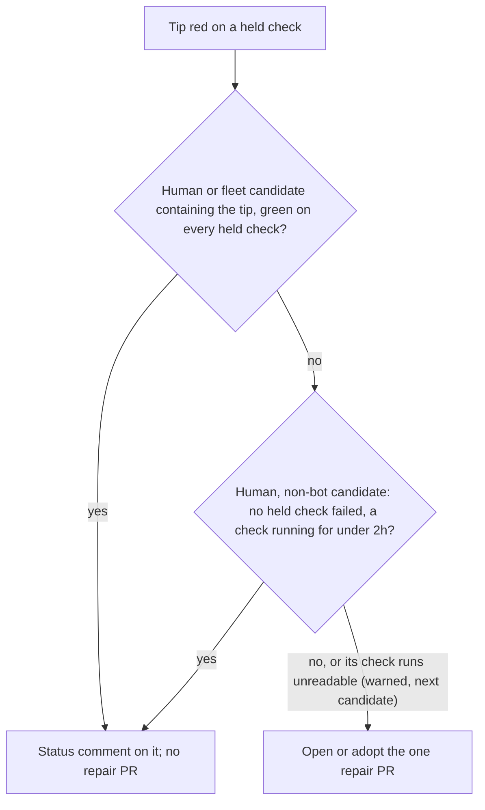

# PR Summary — Issue #5437

## Summary

This is the second PR for #5437. The first, #5459, already merged into
`milestone/red-main-recovery`, and it holds inherited red-main failures on sync
PRs, repairs the default branch once, refreshes the sync PRs and cleans the
shift-left count. This PR closes the gap that let the fix be written twice in
the incident: a human fix PR against the default branch whose CI is **still
running** (as #5434 was) is now adopted as the fix, so the worker opens no
repair PR of its own while that CI runs. It also names the repair-PR exception
in the CI-fix prompt's base-branch rule.

Part of #5437.

- **Running fix adopted:** `findGreenFixPr`
  (`worker/deno/lib/red_default_branch_repair.ts`) still takes a candidate
  green on every held check first. Failing that, it takes the first candidate
  that meets all four conditions: a human author, a head containing the red
  tip, no held check completed without `success`, `neutral` or `skipped`, and at
  least one check run still running that started within two hours
  (`RUNNING_FIX_WAIT_MS`). The status comment and the "repair PR waits" path
  are the same as for a green fix.
- **Not waited on:** a fleet login (`isFleetAuthor`, case-blind) or a bot
  account (`isBotAuthorForMaintenance` after `normaliseGhAppLogin`, so
  `app/dependabot` counts). A run with no usable start time does not count as
  running. A candidate whose check runs cannot be read is skipped with a
  warning quoting the error, and the search goes on to the next candidate.
- **Reader:** `fetchCheckRunStates` (`worker/deno/lib/pr_maintenance.ts`) reads
  a candidate's check runs in one `gh api …/check-runs` call. It validates each
  row and returns the failed and running names.
- **Prompt:** `prompts/ci_fix/prompt.md` "Base-branch failures" now says a
  `fix/red-default-branch-*` PR never defers to its red base. Before, it said
  every non-audit check red on the base defers, which disagreed with
  `_resolveBaseBranchDeferral` (`worker/deno/lib/pr_ci_processor.ts`) and
  `RED_DEFAULT_BRANCH_REPAIR_NOTE`.

## Spec

### Intent and Rationale

- During the incident #5434 was open with CI in flight, and only a green fix
  was recognised. So the worker would have opened its own repair PR and the
  CI-fix agent would have written the same fix a second time.
- A held check can be absent while CI runs, not only `in_progress`. On this
  repository `gate` is created about 13 minutes after the other checks. So
  "pending" means no held check has failed and some check is running, not that
  every held check is running.

### Essential Design Decisions

- A green candidate always wins over a running one, so a later green fix is
  never shadowed by an earlier pending PR.
- The wait is bounded at two hours from the running check's `started_at`, so a
  queued run that never starts cannot hold the repair forever. Fleet and bot
  PRs are never waited on, so fleet CI churn cannot starve the repair either.
- Any human PR that contains the red tip and has CI running counts as the
  pending fix. The worker cannot tell from GitHub whether a PR fixes the check.
  The cost is that the repair can wait for an unrelated human PR's CI, which
  is bounded by that CI's run time.

### Undiscoverable Facts

- `gh pr list --json author` spells a GitHub App as `app/<name>`, not
  `<name>[bot]`. `worker/deno/lib/trust_exclusions.ts` documents this, and
  `normaliseGhAppLogin` handles it.
- Check runs observed with
  `gh api repos/stSoftwareAU/VibeCoder/commits/<sha>/check-runs --jq '.check_runs[] | "\(.name) \(.status) \(.conclusion) \(.started_at)"'`
  on PR #5455's head: `gate completed success 2026-11-23T13:18:24Z`, while the
  other checks started at about `13:05`. This is the `gate`-created-late timing
  the design relies on. No running check run was open when I looked, so the
  `in_progress` shape comes from GitHub's REST check-runs documentation
  (`status`, `conclusion`, `started_at`).

## Evidence

Backend only, with no UI file touched.

- The 15 new tests in
  `worker/deno/tests/red_default_branch_repair_5437_test.ts` drive the real
  `findFailedCiChecks` scan, or `fetchCheckRunStates` directly. They run
  against a `gh` stub that answers each call from its arguments and fixture.
- The stub's check-run rows (`name`, `status`, `conclusion`, `started_at`) take
  the shape of the real `gh api` output above.

## Reproduction

- **symptom** — while a human fix PR's CI was still running against a red
  default branch, the scan ignored it and opened the worker's own repair PR,
  so the fix would be written twice (#5434 and the repair PR)
- **status** — `verified` — the regression test failed against the unfixed
  production code at `assertEquals(prCreateCalls(calls).length, 0)` (one repair
  PR create), and passes after the fix
- **regression test** —
  `worker/deno/tests/red_default_branch_repair_5437_test.ts::findFailedCiChecks - a human fix PR still running its CI, with the held check not yet created, is adopted: no repair PR, and its status is commented on it once (Issue #5437)`

## Acceptance Criteria

<!-- vibe-spec-review inputs="diff+issue-body" -->

- **met** — Detect a red default branch. Before running a ci-fix on a PR,
  check whether the same required check fails on the base commit it inherits
  from `main`. For a `sync/milestone-*` PR, the failing commit _is_ `main`. —
  evidence:
  `worker/deno/tests/red_default_branch_repair_5437_test.ts::findFailedCiChecks - a non-sync PR into main failing a check the tip and its merge base are both red on is held, not handed to the CI-fix agent (Issue #5437)`
  (delivered in #5459, at the head) — reviewer: met — reason: every failing
  check is compared, a superset of the required ones, so a required check red
  on the base is always detected
- **partial** — Repair once. If `main` is red, open or adopt **one** fix PR
  against `main` (or the existing one, like #5434), give it top priority, and do
  **not** ci-fix sync PRs for that failure. — evidence:
  `worker/deno/tests/red_default_branch_repair_5437_test.ts::findFailedCiChecks - a human fix PR still running its CI, with the held check not yet created, is adopted: no repair PR, and its status is commented on it once (Issue #5437)`
  — reviewer: met — reason: the reviewer judged it met but flagged that any
  human PR containing the tip counts as the fix. A check that scans only a
  PR's own commits (gitleaks on `base.sha..head.sha`) passes on an unrelated
  human PR, which can then be adopted as a green fix while `main` stays red.
  That rule came from #5459 and is not fixed here
- **met** — Re-sync after the repair. Once `main` is green, update or recreate
  the sync PRs so they pick up the repair, rather than leaving them on the stale
  red head. — evidence:
  `worker/deno/tests/red_default_branch_repair_5437_test.ts::findFailedCiChecks - a diverged sync PR is refreshed by merging main into it once the tip is green on its checks (Issue #5437)`
  (delivered in #5459) — reviewer: met
- **met** — Keep the shift-left count clean. Exclude failures that are
  inherited from a red base (including all sync PRs) from the shift-left
  recurrence counter. — evidence:
  `worker/deno/tests/shift_left_failures_test.ts::scan: a run on a milestone sync branch is not observed, while an identical feature-branch run is (Issue #5437)`
  (delivered in #5459) — reviewer: met — reason: every sync PR is excluded
  by branch. A non-sync PR is excluded when its merge base carries a failed
  run of the check. A merge base with no runs gives no evidence that the base
  is red, so the failure is counted
- **met** — Leave a single, visible "main is red: holding sync PRs, fix in #N"
  status (for example on the fix PR), so a human can see why streams are held. —
  evidence:
  `worker/deno/tests/red_default_branch_repair_5437_test.ts::findFailedCiChecks - a changed held set edits the one fleet status comment in place: one PATCH to its id, no new comment (Issue #5437)`
  (delivered in #5459) — reviewer: met
- **met** — Tests cover: a red `main` with N open sync PRs leads to exactly one
  fix PR against `main` and no ci-fix pushes to `sync/milestone-*` branches. —
  evidence:
  `worker/deno/tests/red_default_branch_repair_5437_test.ts::findFailedCiChecks - red main with three identical sync PRs hands none to the CI-fix agent and opens one repair PR (Issue #5437)`
  — reviewer: met
- **met** — Sync PRs are refreshed after `main` goes green. — evidence:
  `worker/deno/tests/red_default_branch_repair_5437_test.ts::findFailedCiChecks - three sync PRs on a red tip get one repair, then one fast-forward each once the repair lands (Issue #5437)`
  — reviewer: met
- **met** — Inherited failures are excluded from the shift-left counter. —
  evidence:
  `worker/deno/tests/shift_left_failures_test.ts::scan: a check that failed on the base commit is not observed, while the same check on a green base is (Issue #5437)`
  — reviewer: met
- **unrequested** — the two-hour `RUNNING_FIX_WAIT_MS` cap and the fleet and
  bot exclusions on the running-fix wait — reviewer: unrequested — reason: the
  guards that stop "adopt the existing fix" from holding the repair forever,
  which the reviewer traced to item 2
- **unrequested** — the `prompts/ci_fix/prompt.md` repair-PR paragraph —
  reviewer: unrequested — reason: the prompt contradicted the repair PR's
  never-deferred rule (item 2), and the reviewer traced it there

## Standards Review

<!-- vibe-standards-review inputs="diff+CODING-STANDARDS.md" -->

- **violation** — in-repo helper re-implemented, case-sensitively
  (`fleetLogins.includes`) instead of `isFleetAuthor` — evidence:
  `worker/deno/lib/red_default_branch_repair.ts` — reason: fixed in this diff
  (it now calls `isFleetAuthor`; test
  `findFailedCiChecks - a fleet PR whose login differs only in case is not waited on: the repair PR is opened (Issue #5437)`)
- **violation** — A Code Change Owes a Docs Change: the
  `red-default-branch-fix-adopted` skip reason and three doc comments still
  said the adopted PR "already passes the held checks" — evidence:
  `worker/deno/lib/pr_maintenance.ts` — reason: fixed in this diff (the skip
  reason, the `findFailedCiChecks` doc, the adoption comment and the
  `checkNames` doc in `worker/deno/lib/red_default_branch_repair.ts`)
- **violation** — the long-ago wait test could not tell a two-hour window from
  a 30-day one — evidence:
  `worker/deno/tests/red_default_branch_repair_5437_test.ts` — reason: fixed in
  this diff (direct `fetchCheckRunStates` tests with a fixed `now`, 60 seconds
  inside and 60 seconds outside `RUNNING_FIX_WAIT_MS`)
- **clean** — Fail Loud (a row without `name` or `status` throws naming the
  field; failed reads warn with the `gh` error); log levels; prompt claims
  checked against `worker/deno/lib/pr_ci_processor.ts` and
  `RED_DEFAULT_BRANCH_REPAIR_NOTE`; every restatement of the base-branch rule
  in `prompts/ci_fix/prompt.md` agrees. Review-enforced rules checked:
  Australian English, check where you insert, adding a member owes a docs
  change, dummy and "how" tests

## Test Plan

- 15 tests added in `worker/deno/tests/red_default_branch_repair_5437_test.ts`.
  The scan-level ones cover each path:
  - a running human fix with the held check not yet created is adopted
  - a fleet PR, a bot PR (`app/dependabot`) and a case-differing fleet login
    are not waited on
  - a held check that failed or timed out, and a running check started long
    ago, mean the repair PR is opened
  - a green candidate wins over a running one
  - an unreadable states read skips that candidate and still adopts a later
    green one
  - a single unreadable candidate warns with the `gh` error and opens the
    repair PR
- The five direct `fetchCheckRunStates` tests cover a run started 60 seconds
  inside and 60 seconds outside the window, no usable start time, `timed_out`
  as failed, and a nameless row throwing.
- Red before each fix: the running-fix, bot (`app/dependabot`), case-blind
  fleet, `timed_out` and skip-and-continue tests each failed against the code
  before their change. The fleet-PR test passed on the base code, as
  expected: the old code waited on no PR at all.
- Existing tests edited:
  - The test "with a green human fix PR adopted, the worker's repair PR failure
    is not handed to the CI-fix agent, and another PR's failure is" now expects
    the new `red-default-branch-fix-adopted` reason text. The old text ("already
    passes the held checks") is untrue for a running fix. The adoption and
    hand-off assertions are unchanged.
  - The direct test "findGreenFixPr - a PR row without its head commit fails the
    read, and the warn names headRefOid" gained the now-required `fleetLogins`
    and `readCheckRunStates` fields. Its assertions are unchanged.
- `deno task test:unit tests/red_default_branch_repair_5437_test.ts tests/pr_maintenance_test.ts`:
  157 passed, 0 failed. Eight other test files importing `pr_maintenance.ts`
  also passed: 147 passed, 0 failed.
- `./quality.sh` on `4500013bf` passed (`Result: PASSED (with skipped
  checks)`). Two checks were skipped because their tools are not on this host:
  config integration (no `.config.json`) and checkov (not on `PATH`).
- Docs and rules checked: the red default branch section of
  `docs/INTERNALS.md` (flowchart node, the adoption bullet, the "One repair PR"
  bullet), and `prompts/ci_fix/prompt.md` lines 10 and 198. I applied the
  prompt rule to this diff and found nothing more to change.

Not checked: the running-fix path has not run against real GitHub, only the
input-aware stub. The shift-left limit (a merge base with no check runs) and
the unrelated-human-PR adoption limit above remain.
