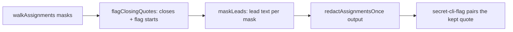

# PR Summary — Issue #5456

## Summary

A credential flag's single-quoted value could hold a lead-in credential label
whose bare value ran past the flag's closing quote, as in
`--token 'alpha beta credentials: TOKEN='tail`. The `secret-assignment` walk
masked that outer value whole, closing quote included, so `secret-cli-flag`
found no closing quote, masked only `'alpha` and published `beta credentials:`.
`redactSecrets` now keeps that quote in front of the outer mask's placeholder
when the flag's opening quote lies outside every assignment mask, so the flag
rule pairs the quotes and masks the whole value. When the masked text after a
kept quote ends in a credential label or flag name glued to the quote, as in
`credentials: x'password: mike` or `credentials: x'--password mike`, that name
is written back after the placeholder. The next walk pass, or the flag rule,
then masks the value that the outer mask left outside. Closes #5456.

## Spec

### Intent and Rationale

- The issue suggested two fixes: end the outer mask before the quote, or keep
  the quote in front of the placeholder. This PR takes the second, extending the
  Issue #5363 mechanism (`flagClosingQuotes`) instead of changing where the walk
  ends a mask, so `flagQuoteReaches` and main's walk results stay as they are.

### Essential Design Decisions

- A quote inside a bare mask is kept only when no later quote of the same kind
  survives the pass, or when the first such quote lies past the start of another
  credential flag whose value begins outside every mask (`maskLeads` in
  `worker/deno/lib/secret_redaction.ts`). Otherwise the quote is masked with the
  value and the flag rule pairs with the later quote, which is the outcome the
  Issue #5310 round 13 tests pin.
- The flag check stops a later flag's name being swallowed into an earlier
  flag's value, which would publish the rest of the later value.
- A kept quote ends the flag's value, so the mask's text after it is no longer
  that value. If that text ends in a credential flag name whose value starts
  outside every mask, or in a credential label ending in `:` or `=`, `gluedName`
  returns the name and `redactAssignmentsOnce` writes it after the placeholder.
  Without this, `--token 'a b credentials: x'password: mike --token z it's`
  published `mike`, which the base masked because its flag rule ran through to
  the later quote. A label with no separator, as in `x'Hunter2password`, is not
  written back: its text stays inside the mask.
- `maskLeads` walks the masks, closes and flag starts once, backwards, and scans
  each unmasked gap once. `gluedName` reads at most one bounded label per mask
  through `labelEndingAt`. The pass stays linear, as the module header requires.
  No regex quantifier was added.
- The shared `assertRedacts` helper moved from the #5363 test into
  `worker/deno/tests/support/secret_redaction_asserts.ts` so both suites call
  one copy.

### Undiscoverable Facts

- Two earlier attempts on this issue stopped with no PR. One hit the host disk
  floor; the other failed when Codex refused the content as a cybersecurity
  risk. This run continued from their checkpointed commits and merged
  `origin/main`, which had added Issues #5435 and #5457 to the same module. The
  only conflict was the `SECURITY.md` paragraph, and the 651 redaction tests
  pass on the merged tree.

## Evidence

Backend change only, with no UI files. The fix changes only where a mask's lead
quote is written:

Before and after, for the issue's shape and the glued-name shapes:

| Input                                                       | Base (main)                           | This PR                                          |
| ----------------------------------------------------------- | ------------------------------------- | ------------------------------------------------ |
| `--token 'alpha beta credentials: TOKEN='tail`              | `beta credentials:` published         | `--token ***REDACTED******REDACTED***`           |
| `--token 'a b credentials: x'password: mike --token z it's` | masked                                | `mike` masked after the written-back `password:` |
| `--token 'a b credentials: x'password: mike --token 'z y'`  | `z y` published                       | `mike` and `z y` masked                          |
| `--token 'a b credentials: x'password: mike`                | `b credentials:` and `mike` published | all masked                                       |

Code read for the doc claims: `maskLeads`, `gluedName` and `flagClosingQuotes`
in `worker/deno/lib/secret_redaction.ts`. `SECURITY.md` and the rule comment now
describe the case as covered.

Issue numbers cited:

- #5363: secret-assignment mask removes the closing quote of an earlier
  single-quoted credential flag value, so secret-cli-flag masks only its first
  word
- #5310: secret-assignment rule publishes a credential when its label is
  consumed as the value of an earlier credential label
- #5435: secret-cli-flag rule masks a quoted flag value only up to an escaped
  quote and publishes the rest
- #5457: An unclosed single-quoted secret-assignment value runs into the next
  line's credential flag and publishes that flag's quoted value

## Test Plan

- Added `worker/deno/tests/secret_redaction_outer_mask_flag_quote_5456_test.ts`
  with 26 tests. Each one asserts the exact `redactSecrets` output, that
  `containsSecret` is false on the output, that a second pass changes nothing,
  and that the named leaked words are gone. The cases cover:
  - the issue's shape, mid-line, after a command word, with no inner label, and
    with a newline or CRLF before the label;
  - a later flag, a later bare mask, a later surviving quote of the same kind,
    consecutive flags, and a quote inside a later quoted or bare flag value;
  - a later quote of the other kind;
  - a credential label glued after the kept quote with a bare value and with a
    quoted value, a glued flag name, a glued label before a later quoted flag,
    text before a glued label, and a glued label after a quote kept with no
    later quote or at the start of a bare value (Issue #5363);
  - four controls (a non-flag quote, an earlier-closed flag, a later quoted
    assignment, a flag opener inside a quoted assignment);
  - two output-only size cases of 20,000 repetitions, with no stopwatch.
- Red on base: with `worker/deno/lib/secret_redaction.ts` restored from
  `origin/main` and the new test file kept, 22 of the 26 tests failed and the 4
  controls passed. With the module from the commit before the glued-name fix,
  the 7 glued-name tests failed and the other 19 passed. On the head all 26
  pass.
- Edited `worker/deno/tests/secret_redaction_flag_closing_quote_5363_test.ts`.
  Its local `assertRedacts` moved unchanged to
  `worker/deno/tests/support/secret_redaction_asserts.ts` and is now imported.
  No assertion was removed or changed.
- Regression: `deno test -A tests/secret_redaction*_test.ts` at the head gave
  658 passed and 0 failed. That run includes the Issue #5310 round 13 cases in
  `worker/deno/tests/secret_redaction_label_as_value_5310_test.ts`.
- A differential fuzz of 40,000 random inputs built from flag, label, quote and
  word fragments compared the head with the base and with the commit before the
  glued-name fix. It found no glued-label shape where the head publishes a word
  that the previous commit masked. The words it did flag are fuzz words glued
  onto a flag name, such as `--passwordw0q`, and the flag rule always publishes
  a flag's name. One shape found by the fuzz is listed under Not checked.
- `./quality.sh < /dev/null` on the merged head, before the glued-name fix,
  passed. `config integration` was skipped because there was no `.config.json`,
  and `checkov` was skipped because it is not installed.

Not checked: beyond the two skipped gate stages above, `./quality.sh` was not
re-run after the glued-name fix. `deno fmt`, `deno lint` and `deno check` on the
changed files passed. The redaction suite gave 658 passed, and the 1,046 other
tests in files that use `redactSecrets` passed. The worker re-runs the gate.

Known gap, separate from this issue: on the base, `password:` followed by a
newline and `TOKEN=--password w0q x` publishes `w0q` on its own. When a kept
quote is followed by a glued `password:` and that text, the written-back label
now reaches the same base leak and `w0q` is published. The commit before this
fix masked it there only because the label stayed inside the mask.
