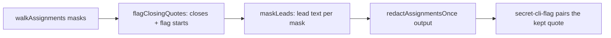

# PR Summary — Issue #5456

## Summary

A credential flag's single-quoted value could hold a lead-in credential label
whose bare value ran past the flag's closing quote, as in
`--token 'alpha beta credentials: TOKEN='tail`. The `secret-assignment` walk
masked that outer value whole, closing quote included, so `secret-cli-flag`
found no closing quote, masked only `'alpha` and published `beta credentials:`.
`redactSecrets` now keeps that quote in front of the outer mask's placeholder
when the flag's opening quote lies outside every assignment mask, so the flag
rule pairs the quotes and masks the whole value. When the masked text after a
kept quote ends in a credential label or flag name glued to the quote, as in
`credentials: x'password: mike` or `credentials: x'--password mike`, that name
stays inside the mask and the mask is extended through the value it labels, so
the value the outer mask left outside is masked in place. Nothing masked is
written back. Closes #5456.

## Spec

### Intent and Rationale

- The issue suggested two fixes: end the outer mask before the quote, or keep
  the quote in front of the placeholder. This PR takes the second, extending the
  Issue #5363 mechanism (`flagClosingQuotes`) instead of changing where the walk
  ends a mask, so `flagQuoteReaches` and main's walk results stay as they are.

### Essential Design Decisions

- A quote inside a bare mask is kept only when no later quote of the same kind
  survives the pass, or when the first such quote lies past the start of another
  credential flag whose value begins outside every mask (`maskLeads` in
  `worker/deno/lib/secret_redaction.ts`). Otherwise the quote is masked with the
  value and the flag rule pairs with the later quote, which is the outcome the
  Issue #5310 round 13 tests pin.
- The flag check stops a later flag's name being swallowed into an earlier
  flag's value, which would publish the rest of the later value.
- A kept quote ends the flag's value, so the mask's text after it is no longer
  that value. If that text ends in a credential flag name whose value starts
  outside every mask, or in a credential label ending in `:` or `=`, `gluedName`
  returns the name and `gluedValueEnd` extends the mask through the value it
  labels, read with the grammar that would read the name outside a mask: the
  assignment walk for a label and the `secret-cli-flag` pattern for a flag. Only
  a credential flag that starts inside that value and whose own value runs past
  it ends the extension early, at its `--`. Without this,
  `--token 'a b credentials: x'password: mike --token z it's` published `mike`,
  which the base masked because its flag rule ran through to the later quote.
  The name is never written back (PR #5607 review): an earlier version did, and
  published keyword runs such as `mypassword=` that the base masked, and let the
  written-back label take the next line's text as its value. A second version
  read the value with its own one-word scanner and gave up on `=`, `:`, `-`,
  escaped quotes and multiline quoted values after the label was already masked,
  publishing those values (PR #5607 review round 2); the walk's own grammar now
  reads them.
- A glued label's quoted value can hold an inner assignment that the walk masks
  on its own, as in `x'password: "mike password: hidden secretword"`. The read
  used to stop at that inner mask, so the value looked unclosed and the words
  after the inner mask were published (PR #5607 review round 3).
  `quotedValueReach` now finds where the quoted value really closes (the escaped
  forms the assignment pattern accepts, or the line end for a value that never
  closes), the walk reads the value up to there, and the extended mask takes
  over every later mask it covers (`MaskLead.covered`), so none of them writes
  its text out again. The quotes that survive for earlier masks resume from the
  first mask past the extension.
- `maskLeads` walks the masks, closes and flag starts once, backwards, and scans
  each unmasked gap once. `gluedName` reads at most one bounded label per mask
  through `labelEndingAt`, and `gluedValueEnd` reads the gap up to the next
  mask, or up to a glued quoted value's close when that lies further. The close
  is found by a plain character loop that stops at the next unescaped quote of
  the same kind, so the scans of different glued values do not overlap. The pass
  stays linear, as the module header requires. No regex quantifier was added.
- The shared `assertRedacts` helper moved from the #5363 test into
  `worker/deno/tests/support/secret_redaction_asserts.ts` so both suites call
  one copy.

### Undiscoverable Facts

- Two earlier attempts on this issue stopped with no PR. One hit the host disk
  floor; the other failed when Codex refused the content as a cybersecurity
  risk. This run continued from their checkpointed commits and merged
  `origin/main`, which had added Issues #5435 and #5457 to the same module. The
  only conflict was the `SECURITY.md` paragraph, and the 651 redaction tests
  pass on the merged tree.
- A later merge of `origin/main` brought Issue #5608, which ends an assignment
  value before a credential flag name that has a value after it. For
  `--token 'a b credentials: x'--password mike --token z it's` the outer mask
  now ends before `--password`, so the flag rule shows the flag's name and masks
  its value, as it does for every flag. This PR's test for that shape now
  expects `--password` to be shown; `mike` and `credentials` stay masked.

## Evidence

Backend change only, with no UI files. The fix changes only where a mask's lead
quote is written:

Before and after, for the issue's shape and the glued-name shapes:

| Input                                                       | Base (main)                           | This PR                                |
| ----------------------------------------------------------- | ------------------------------------- | -------------------------------------- |
| `--token 'alpha beta credentials: TOKEN='tail`              | `beta credentials:` published         | `--token ***REDACTED******REDACTED***` |
| `--token 'a b credentials: x'password: mike --token z it's` | masked                                | `password: mike` masked in place       |
| `--token 'a b credentials: x'password: mike --token 'z y'`  | `z y` published                       | `mike` and `z y` masked                |
| `--token 'a b credentials: x'password: mike`                | `b credentials:` and `mike` published | all masked                             |

Code read for the doc claims: `maskLeads`, `gluedName`, `gluedValueEnd` and
`flagClosingQuotes` in `worker/deno/lib/secret_redaction.ts`. `SECURITY.md` and
the rule comment now describe the case as covered.

Issue numbers cited:

- #5363: secret-assignment mask removes the closing quote of an earlier
  single-quoted credential flag value, so secret-cli-flag masks only its first
  word
- #5310: secret-assignment rule publishes a credential when its label is
  consumed as the value of an earlier credential label
- #5435: secret-cli-flag rule masks a quoted flag value only up to an escaped
  quote and publishes the rest
- #5457: An unclosed single-quoted secret-assignment value runs into the next
  line's credential flag and publishes that flag's quoted value

## Test Plan

- Added `worker/deno/tests/secret_redaction_outer_mask_flag_quote_5456_test.ts`
  with 45 tests. Each one asserts the exact `redactSecrets` output, that
  `containsSecret` is false on the output, that a second pass changes nothing,
  and that the named leaked words are gone. The cases cover:
  - the issue's shape, mid-line, after a command word, with no inner label, and
    with a newline or CRLF before the label;
  - a later flag, a later bare mask, a later surviving quote of the same kind,
    consecutive flags, and a quote inside a later quoted or bare flag value;
  - a later quote of the other kind;
  - a credential label glued after the kept quote with a bare value and with a
    quoted value, a glued flag name, a glued label before a later quoted flag,
    text before a glued label, and a glued label after a quote kept with no
    later quote or at the start of a bare value (Issue #5363);
  - the PR #5607 review regressions: a glued keyword run with no value, with a
    value, and at the bare value's opening quote (Issue #5363 shape), a glued
    label with no value before a next-line flag or assignment, a glued label
    whose value is a flag name, and a bare value glued to a flag name
  - the PR #5607 review round 2 regressions: a glued label's bare value with
    `=`, `:`, an internal hyphen and a leading hyphen, a double-quoted value
    with an escaped quote, and a closed multiline quoted value;
  - the PR #5607 review round 3 regressions: a glued label's quoted value that
    holds an inner `password:` or `TOKEN=` assignment, the same through
    `redactGhBodyArgs` as an outbound `--body`, an unclosed such value, a
    credential flag after such a value, and 20,000 repetitions of the shape;
  - four controls (a non-flag quote, an earlier-closed flag, a later quoted
    assignment, a flag opener inside a quoted assignment);
  - three output-only size cases of 20,000 repetitions, with no stopwatch.
- Red on base: with `worker/deno/lib/secret_redaction.ts` restored from
  `origin/main` and the new test file kept, 32 of the 39 tests failed. With the
  module from the commit before the glued-name fix, 16 failed; with the
  write-back version, 20 failed; with the first in-place version (one-word
  scanner), the 7 round-2 regressions failed. With the module from the merged
  tree before the round-3 fix, the 6 round-3 regressions failed. On the head all
  45 pass.
- Edited `worker/deno/tests/secret_redaction_flag_closing_quote_5363_test.ts`.
  Its local `assertRedacts` moved unchanged to
  `worker/deno/tests/support/secret_redaction_asserts.ts` and is now imported.
  No assertion was removed or changed.
- Regression: `deno test -A tests/secret_redaction*_test.ts` at the head gave
  658 passed and 0 failed. That run includes the Issue #5310 round 13 cases in
  `worker/deno/tests/secret_redaction_label_as_value_5310_test.ts`.
- PR #5607 review: the earlier fuzz claim did not hold. The write-back version
  published keyword runs (`mypassword=` after a kept quote) that the base
  masked, and the review's differential run found 7,376 such inputs in 120,000.
  After replacing the write-back with in-place extension, a differential fuzz of
  150,000 random inputs (a kept-quote prefix such as
  `--token 'alpha beta credentials: TOKEN='` followed by random flag, label,
  quote, keyword and word fragments) found no input where the head publishes a
  generated word that both the base and the commit before the glued-name fix
  masked. The same fuzz finds 10,103 in 80,000 against the write-back version.
  Against the base alone, about 1 in 5,000 inputs publish a word the base
  masked; every one is a word outside any label or flag value, after the kept
  quote, that the base masked only because its flag rule paired the opening
  quote with a distant one (such as the apostrophe in `it's`). The commit before
  the glued-name fix publishes the same words, so they come from keeping the
  quote, which is the shell's own reading of where the flag value ends.
- PR #5607 review round 3: a differential fuzz of 260,000 random inputs of the
  same kept-quote shape, now also drawing escaped quotes, found no input where
  the head publishes a generated word that the merged tree before the round-3
  fix masked.
- Round 3 regression: `deno test -A tests/secret_redaction*_test.ts` gave 702
  passed and 0 failed. The redaction-using test files that load without JSR
  packages (14 files, 249 tests) passed; the other 37 need `jsr:@std/yaml` or
  `jsr:@std/crypto`, which could not be fetched where round 3 was run, and the
  worker's gate runs them.
- `./quality.sh < /dev/null` on the merged head, before the glued-name fix,
  passed. `config integration` was skipped because there was no `.config.json`,
  and `checkov` was skipped because it is not installed.

Not checked: beyond the two skipped gate stages above, `./quality.sh` was not
re-run after the glued-name fix. `deno fmt`, `deno lint` and `deno check` on the
changed files passed. The redaction suite gave 658 passed, and the 1,046 other
tests in files that use `redactSecrets` passed. The worker re-runs the gate.

The shape the earlier version listed as a known gap (a kept quote, a glued
`password:`, then a newline and `TOKEN=--password w0q x`) is now masked: the
label is not written back, so it cannot take the next line as its value. A
regression test pins it.
