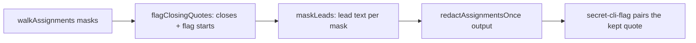

# PR Summary — Issue #5456

## Summary

A credential flag's single-quoted value could hold a lead-in credential label
whose bare value ran past the flag's closing quote, as in
`--token 'alpha beta credentials: TOKEN='tail`. The `secret-assignment` walk
masked that outer value whole, closing quote included, so `secret-cli-flag`
found no closing quote, masked only `'alpha` and published `beta credentials:`.
`redactSecrets` now keeps that quote in front of the outer mask's placeholder
when the flag's opening quote lies outside every assignment mask, so the flag
rule pairs the quotes and masks the whole value. Closes #5456.

## Spec

### Intent and Rationale

- The issue suggested two fixes: end the outer mask before the quote, or keep
  the quote in front of the placeholder. This PR takes the second, extending
  the Issue #5363 mechanism (`flagClosingQuotes`) instead of changing where the
  walk ends a mask, so `flagQuoteReaches` and main's walk results stay as they
  are.

### Essential Design Decisions

- A quote inside a bare mask is kept only when no later quote of the same kind
  survives the pass, or when the first such quote lies past the start of
  another credential flag whose value begins outside every mask
  (`maskLeads` in `worker/deno/lib/secret_redaction.ts`). Otherwise the quote
  is masked with the value and the flag rule pairs with the later quote, which
  is the outcome the Issue #5310 round 13 tests pin.
- The flag check stops a later flag's name being swallowed into an earlier
  flag's value, which would publish the rest of the later value.
- `maskLeads` walks the masks, closes and flag starts once, backwards, and
  scans each unmasked gap once, so the pass stays linear, as the module header requires. No
  regex quantifier was added.
- The shared `assertRedacts` helper moved from the #5363 test into
  `worker/deno/tests/support/secret_redaction_asserts.ts` so both suites call
  one copy.

### Undiscoverable Facts

- Two earlier attempts on this issue stopped with no PR. One hit the host disk
  floor; the other failed when Codex refused the content as a cybersecurity
  risk. This run continued from their checkpointed commits and merged
  `origin/main`, which had added Issues #5435 and #5457 to the same module. The
  only conflict was the `SECURITY.md` paragraph, and the 651 redaction tests
  pass on the merged tree.

## Evidence

Backend change only, with no UI files. The fix changes only where a mask's
lead quote is written:

Before and after for the issue's own shape:

| Input | Base (main) | This PR |
| --- | --- | --- |
| `--token 'alpha beta credentials: TOKEN='tail` | `beta credentials:` published | `--token ***REDACTED******REDACTED***` |

Code read for the doc claims: `maskLeads` and `flagClosingQuotes` in
`worker/deno/lib/secret_redaction.ts`. `SECURITY.md` and the rule comment now
describe the case as covered.

Issue numbers cited:

- #5363: secret-assignment mask removes the closing quote of an earlier single-quoted credential flag value, so secret-cli-flag masks only its first word
- #5310: secret-assignment rule publishes a credential when its label is consumed as the value of an earlier credential label
- #5435: secret-cli-flag rule masks a quoted flag value only up to an escaped quote and publishes the rest
- #5457: An unclosed single-quoted secret-assignment value runs into the next line's credential flag and publishes that flag's quoted value

## Test Plan

- Added `worker/deno/tests/secret_redaction_outer_mask_flag_quote_5456_test.ts`
  with 19 tests. Each one asserts the exact `redactSecrets` output, that
  `containsSecret` is false on the output, that a second pass changes nothing,
  and that the named leaked words are gone. The cases cover:
  - the issue's shape, mid-line, after a command word, with no inner label,
    and with a newline or CRLF before the label;
  - a later flag, a later bare mask, a later surviving quote of the same kind,
    consecutive flags, and a quote inside a later quoted or bare flag value;
  - a later quote of the other kind;
  - four controls (a non-flag quote, an earlier-closed flag, a later quoted
    assignment, a flag opener inside a quoted assignment);
  - two output-only size cases of 20,000 repetitions, with no stopwatch.
- Red on base: with `worker/deno/lib/secret_redaction.ts` restored from
  `origin/main` and the new test file kept, 15 of the 19 tests failed and the
  4 controls passed. On the head all 19 pass.
- Edited `worker/deno/tests/secret_redaction_flag_closing_quote_5363_test.ts`.
  Its local `assertRedacts` moved unchanged to
  `worker/deno/tests/support/secret_redaction_asserts.ts` and is now imported.
  No assertion was removed or changed.
- Regression: `deno test -A tests/secret_redaction*_test.ts` on the merged
  tree gave 651 passed and 0 failed. That run includes the Issue #5310 round 13
  cases in `worker/deno/tests/secret_redaction_label_as_value_5310_test.ts`.
- `./quality.sh < /dev/null` on the merged head passed. `config integration`
  was skipped because there was no `.config.json`, and `checkov` was skipped
  because it is not installed.

Not checked: none beyond the two skipped gate stages above.
