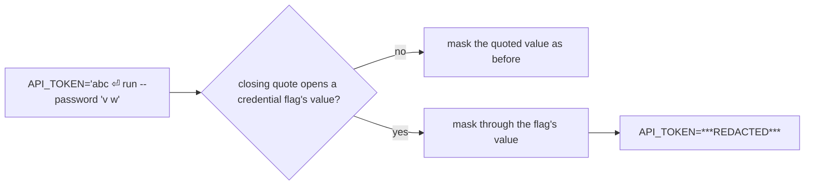

# PR Summary — Issue #5457

## Summary

The `secret-assignment` walk now masks a quoted value through a credential
flag's value when the value's closing quote is where the `secret-cli-flag` rule
opens that flag's value. Before, the mask stopped at that quote and covered the
flag's name, so the flag rule never saw the flag and published its value. This
fixes the issue's cross-line single-quoted shape and both same-line
double-quoted shapes from the issue comment. Closes #5457.

## Spec

### Intent and Rationale

- The issue offered two fixes: end the value before the flag, or mask through
  the flag's quoted value. Ending at a line break would not help the comment's
  same-line shapes (a Windows path ending in a backslash, a quoted message
  ending in `token:`), so the fix keys on the one fact all three shapes share:
  the closing quote opens a credential flag's value
- Masking through errs towards masking, and needs no change to the pattern's
  quoted branches. Narrowing those branches would change every legitimate
  multi-line quoted value

### Essential Design Decisions

- `flagValueThroughQuote` in `worker/deno/lib/secret_redaction.ts` applies only
  to a masked, closed quoted value, and only when `flagValueStartsAt` says the
  flag rule's own reading opens a value at the closing quote. The extension then
  reads that flag's value with the flag rule's own value alternatives
  (`CLI_FLAG_VALUE_AT`). Only credential flags extend the mask; a non-credential
  flag such as `--name` keeps the base behaviour
- The flag's value must be glued to the closing quote: whitespace, `,`, `:`, `]`
  or `}` after it (`OPENS_FLAG_VALUE_AT`) means the quote really closes the
  value. Without this, a JSON string ending in a credential flag and a space,
  `{"api_token":"run --password ","next":"v"}`, lost its quotes and the next
  member's `","`, because the flag rule's raw reading takes `","` as a quoted
  value. That broke the JSON-structure contract (Issue #4169). In every leak
  shape the flag's value is glued to the quote
- The extended mask is pushed into the walk's mask list and the walk resumes
  after it, so nothing inside the flag's value is judged again. The mask holds
  no quotes around the placeholder because the extended value is not a single
  quoted literal, so the output is `API_TOKEN=***REDACTED***`
- The read is bounded by the flag rule's own value match, and each closing quote
  is read at most once, so the walk stays linear (the module header's linearity
  rule)

### Undiscoverable Facts

- The commit message's own description of the shape was masked by the worker's
  git guard (`[GIT_MESSAGE_REDACTED]`). The masked text was only an example in
  the description, not a secret

## Evidence

Backend-only change; verified by tests.

- `SECURITY.md` gains a paragraph on the shape after the Issue #5363 paragraph,
  and the `secret-assignment` comment block in `RULES` gains the matching note
- Issue numbers this diff cites: #5457: An unclosed single-quoted
  secret-assignment value runs into the next line's credential flag and
  publishes that flag's quoted value; #4169: the JSON-structure contract the
  glued-value check keeps

## Test Plan

- New `worker/deno/tests/secret_redaction_quoted_flag_value_5457_test.ts`, 16
  tests:
  - Eight leak fixtures, each asserting the exact `redactSecrets` output,
    `containsSecret` true on the input and false on the output, idempotence, and
    the absence of the flag value's words:
    - the issue's cross-line single-quoted shape;
    - the same shape past the 4,096-character escape-aware bound, so the plain
      `'[^']+'` branch is exercised;
    - CRLF with text after the flag value left intact;
    - same-line single quotes;
    - a bare flag value glued to the closing quote;
    - the Windows-path escape;
    - the quoted message ending in `token:`;
    - a nested `DEPLOY_TOKEN: 'deploy --token '…'` label
  - Six controls keep the base output:
    - a closing quote on its own line, then the flag;
    - a closing quote that opens a non-flag string;
    - a non-credential `--name` flag;
    - a JSON string value ending in `--password` and a space, and one ending in
      a tab, each giving `{"api_token":"***REDACTED***","next":"v"}`;
    - the same value closed by each of `,`, `}`, `]`, `:` and a space keeps its
      quotes, and the redacted JSON still parses
  - Two hostile inputs, an unclosed 200,000-character flag value and 20,000
    repeats of the shape, assert their output masks the value
- Red on base: before the fix the file's first 13 tests gave 3 passed and 10
  failed (the eight leaks and both hostile tests; the controls pass). The three
  JSON controls pass on the base and failed on the previous head (the pre-PR
  verifier's finding). At the head: 16 passed, 0 failed
- Regression: every `worker/deno/tests/secret_redaction*_test.ts` and
  `secret_transform*_test.ts` file: 592 passed, 0 failed;
  `worker/deno/tests/prompt_delimiter_test.ts`: 44 passed, 0 failed. No existing
  test was edited
- `./quality.sh`: passed, with config integration (no `.config.json`) and
  checkov (not installed) skipped. It ran before the glued-value check; after
  that check, `deno fmt`, `deno lint` and `deno check` on the changed files are
  clean and the suites above were re-run. The worker re-runs the gate
- Not done or not checked: none beyond the two skipped gate stages
