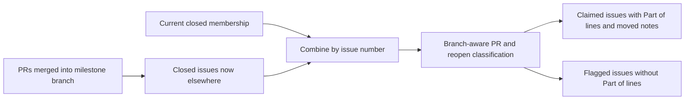

## Summary

Milestone rollups now include closed issues delivered into their branch after
those issues move to another milestone or lose their milestone. They retain
`Part of` lines and show their current milestone. Issues delivered only into
another milestone branch are flagged without a `Part of` line. Closes #5458.

The implementation and focused regressions are complete, and the full quality
gate passes on the final head (with the skips listed below).

## Spec

### Intent and Rationale

- Combine current closed membership with issues discovered from merged PRs based
  on the milestone branch, so moving an issue cannot hide its delivery.
- Reuse the existing claim classification and reopen safeguards for both sets.

### Essential Design Decisions

- Exclude PRs based on another milestone branch from delivery here. Other bases
  retain their previous eligibility, including the default branch. Holds, merge
  conditions and auto-merge code are unchanged.
- Deduplicate the combined list by issue number, preferring a live moved-issue
  row over stale cached membership. Both initial creation and existing-body
  refreshes use this list.
- Bump claim-verdict entries to `milestone_claim_verdict_v3_<N>` and the body
  fingerprint payload to `rollup-provenance-v3`. Verdict hits require the same
  issue update timestamp and branch. Fingerprints include milestone notes; the
  initial refresh can overwrite owner edits, as previous bumps could.
- Failed or malformed discovery reads skip that milestone for the scan. Missing
  selected PR fields or a missing issue milestone are errors; explicit
  `milestone: null` means no milestone. Discovered candidates are read live.

### Undiscoverable Facts

- The archived previous pre-push output and issue comment truncate the failure
  detail. They identify `deno task test:unit (2093 files)` exiting 1 but do not
  recover its failing test; this run does not attribute that earlier failure.
- A full-gate rerun hit a single-sample growth assertion at 1,876 ms against a
  1,865 ms allowance on this shared host. The test now uses its existing
  helper's default two interleaved samples; sizes, allowance and outcome
  assertions are retained.

## Evidence

Backend-only change; no UI files are touched.

The shared path is `getClosedIssues` in
`worker/deno/lib/milestone_completion.ts`, using
`worker/deno/lib/milestone_branch_deliveries.ts`. Operator documentation is
updated in `docs/INTERNALS.md` and `docs/workflows/milestones.md`; the new
module is registered in `docs/audits/lib-sweep-coverage/top-up-5458.json`.

Provenance titles checked with GitHub CLI in this run:

- #5458: Milestone rollup lists only its milestone's current closed issues, so
  an issue moved to another milestone after its PR merged into the branch ships
  unnamed (#5454).
- #3476: Milestone rollups claim sub-issues whose work is not on the branch:
  Closed-PR self-healing closes them on a sync PR or a stale attempt's PR
  (VibeCoder#3365 and two private fleet PRs).
- #3662: Milestone completion reads closed sub-issues from a 500-issue repo-wide
  batch, so an older milestone's rollup is skipped as empty.
- #4967: Milestone roll-up PR links only its unlabelled tracking issue, so the
  reviewer's test-change policy sends back every roll-up that changes a test (a
  private fleet PR).
- #3609: Milestone completion scan reads only the first page (30) of open
  milestones.
- PR #3640: Milestone rollups claim sub-issues whose work is not on the branch
  (#3476).

## Test Plan

- Added 18 tests in
  `worker/deno/tests/milestone_branch_deliveries_5458_test.ts`. The creation
  regression,
  `checkAndHandleMilestoneCompletions - a rollup claims
  an issue that moved to another milestone after merging here, and the other
  rollup flags it (Issue #5458)`,
  fails against `origin/main` production code because #5326 is missing, and
  passes with this branch.
- The same file's `refreshes moved-issue notes in an existing complete rollup`
  and `refreshes moved-issue notes in an existing incomplete rollup` cases also
  fail against base production code and pass here. They verify changed notes,
  removal of a milestone, retained provenance and unchanged-body scans.
- Its `deduplicates a moved issue still present in cached milestone membership`
  regression seeds the real cache through its production reader. It failed
  against the checkpoint with two issue entries; the fix gives one entry with
  the live title and milestone note. Malformed-response regressions also went
  red against the checkpoint before the validation repair.
- The two cache regressions in that file prove caching through their return
  values, not gh call counts.
  `fetchIssuesMovedOffBranch - serves the parsed
  merged-PR list from cache`
  asserts the stored `prs_base_merged_<branch>` record, then makes the live
  `--base` list throw and asserts the second call still returns the first run's
  moved issues.
  `classifyClosedIssues - a cached
  verdict for one milestone branch is not served for another`
  supplies a timeline with a reopen after the merge, which gives
  `predates-reopen` when classified live, and asserts the cached call still
  returns B's claimed verdict. Each failed when its cache read was disabled in
  production code, and passed with it restored.
- Existing assertions in `worker/deno/tests/milestone_completion_test.ts` are
  retained. Calls supply the required branch argument; failure fakes distinguish
  the new base-branch discovery read from the search they exercise. Existing
  sync, reopen, cache and retry protections remain.
- `worker/deno/tests/milestone_summary_pr_auto_merge_test.ts::summary PR arming - open children withhold arming with no second comment`
  retains its arming/comment assertions and gains a creation control. Its fake
  separates merged branch deliveries from open child PRs.
- `worker/deno/tests/dummy_test_scan_5016_test.ts` retains both
  large-registration growth tests and every existing assertion. Only their
  single-sample override is removed, restoring the helper default without
  reducing input sizes or increasing the growth allowance. Its focused run
  passed: **63 tests**.
- Focused milestone runs through `deno task test:unit`: **340 passed** across 12
  files. Formatting, lint, type checks and manifest checks passed. Named test
  paths were checked with `git ls-files`.
- Full-gate attempt 1 passed with skipped checks, before the cached-membership
  overlap repair. Attempt 2, after that repair, failed the growth assertion
  above; restoring default interleaved sampling passed the focused suite.
  Attempt 3 failed the babysitter test noted under Merge verification. A later
  run re-ran the focused milestone suites (**208 passed**) and the full gate,
  which passed.
- No prompt or standards rule changed. Classification has one implementation;
  initial creation, incomplete refresh and partial-rollup discovery reuse it.
- Summary gates passed with zero blocked or unchecked gates. Markdown lint and
  Mermaid validation passed for the replacement summary.

## Merge verification

- **Passed:** `./quality.sh < /dev/null` on code head `40667450f`:
  `Result: PASSED (with skipped checks)`, including `deno tests`, `deno lint`,
  `deno type check`, `deno fmt` and semgrep. The later commit changes only the
  two cache tests above. That test file passed (18 tests), as did its
  formatting, lint and type check. A run of all 14 `tests/*milestone*_test.ts`
  files gave 1,879 passed and 1 failed. The failure was
  `milestone_sync_gate_repair_test.ts::syncMilestoneBranchWithDefault - a clean merge's compiler failure is repaired before delivery`
  ("Found 1 not formatted file" in its temporary repository's push). That file
  fails the same way on `origin/main` and is untouched here. The worker re-runs
  the full gate on the new head.
- An earlier full-gate attempt failed once in
  `worker/deno/tests/babysitter_host_disk_admission_5105_test.ts::the production pass runs one repair container at a time`
  (`the second repair started beside the first`). This branch does not touch
  that test or its production code; it passed on its own (16 passed) and in the
  final full gate, so it is recorded as a load-dependent failure of that
  fixture, not attributed to this change.
- **Pending:** PR CI and code review.

## Not done / remaining risk

- Config integration was skipped because runtime configuration was unavailable;
  Checkov was skipped because no pinned executable or container route was
  available. These are skips, not passes.
- The babysitter fixture's intermittent failure under full-suite load was not
  investigated; it is outside this issue's scope.
- Branch discovery reads up to 1,000 merged PRs. Cached PR and membership reads
  can delay discovery until their TTL expires; discovered issue candidates incur
  uncached REST reads during classification.
