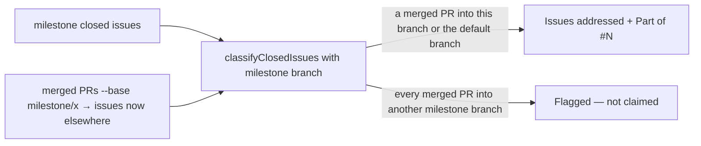

# PR Summary — Issue #5458

## Summary

A milestone rollup's "Issues addressed" list now follows what merged into its
branch, not only the milestone's current membership. Closes #5458.

- **Issue moved away after its PR merged here.** `getClosedIssues`
  (`worker/deno/lib/milestone_completion.ts`) now also reads the merged PRs
  based on the milestone branch, using the new
  `fetchIssuesMovedOffBranch` (`worker/deno/lib/milestone_branch_deliveries.ts`).
  It takes the issue each PR names (its `issue-N` head or a trailing
  `(#N)` / `(Issue #N)` title) and adds any closed issue that is no longer in
  the milestone. If that issue is claimed, it is listed with
  `(now in milestone "<title>")`, or `(no longer in a milestone)`, and it keeps
  its `Part of #N` line.
- **Issue whose PRs all went into another milestone's branch.**
  `classifyClosedIssues` now takes the rollup's branch. A merged PR based on a
  different `milestone/…` branch does not count as delivery there. If every
  merged PR went elsewhere, the issue goes under "Flagged — not claimed" with
  the reason "every merged PR went into another milestone's branch". A PR into
  the default branch still counts.

Only the body changes. No hold, merge condition or auto-merge behaviour
changed.

## Spec

### Intent and Rationale

- The worker closes an issue once its PR lands on a milestone branch, whatever
  milestone the issue sits in later. The rollup that ships the change must name
  it, and a rollup that does not ship it must not claim it.
- The branch side comes from GitHub's merged-PR list for the branch. This
  reuses the existing classification (title and branch lookups, reopen check)
  for the added issues, so no second claim rule exists.

### Essential Design Decisions

- A failed `--base` list read, or a failed issue read, makes the whole
  closed-issue read fail (`null`), as Issue #3662 does for the milestone read.
  The rollup is then skipped for that scan instead of being published with a
  shorter list.
- If a PR search was unreadable and the PRs found all went into another
  milestone, the verdict is `merged-pr-search-unreadable`, not
  `merged-into-other-milestone`. The missing search could hold this branch's
  PR.
- **Persisted shape: both keys bumped.**
  - The claim-verdict cache moves to `milestone_claim_verdict_v3_<N>`. The
    cached value now records the milestone branch, and a hit is served only for
    the same branch, because two rollups can classify the same issue.
  - The rollup fingerprint moves to `rollup-provenance-v3` and includes the
    moved-to-milestone note. Each open rollup is therefore rewritten once
    after deploy, which can replace owner edits, as the v2 bump did.
- REST `gh api repos/<repo>/issues/<N>` reads the added issues. A number that
  is really a pull request (its row has `pull_request`) is skipped, not treated
  as an error.

### Undiscoverable Facts

- From the issue: #5326 merged into `milestone/secret-assignment-rule-hardening`
  through PR #5433 and was then moved to "secret redaction follow-ups". Rollup
  #5454 shipped its change without naming it. The end-to-end test reproduces
  this shape.

## Evidence

This is a backend-only change; no UI files are touched.

- `worker/deno/tests/milestone_branch_deliveries_5458_test.ts::checkAndHandleMilestoneCompletions - a rollup claims an issue that moved to another milestone after merging here, and the other rollup flags it (Issue #5458)`.
  This is the issue's two requested tests, run end to end. Rollup A lists
  `#5326 … (now in milestone "secret redaction follow-ups")` with
  `Part of #5326`. Rollup B flags #5326 with the new reason and has no
  `Part of #5326`.
- Other tests in the same file:
  - `classifyClosedIssues` flags `merged-into-other-milestone`, and claims a PR
    into the asked branch or `main` as a control.
  - An unreadable search plus only another milestone's PR gives
    `merged-pr-search-unreadable`.
  - A cached verdict for one branch is not served for another.
  - An old v2 verdict is ignored.
  - `fetchIssuesMovedOffBranch` skips excluded, open, fork, sync-head and
    pull-request rows.
  - It throws on an unreadable list or issue read, and does not cache the
    failed list.
  - `buildMilestoneSummaryBody` renders both notes.
- Docs: `docs/INTERNALS.md` (closed-issue rollup classification) and
  `docs/workflows/milestones.md` (final PR, tracking issue, v3 keys).
- New ledger slice: `docs/audits/lib-sweep-coverage/top-up-5458.json` claims
  the new module.

## Test Plan

- Added `worker/deno/tests/milestone_branch_deliveries_5458_test.ts`, with 11
  tests.
- I ran the end-to-end test against the base `milestone_completion.ts`, with
  the new test and module kept in place. It failed: the body lists only
  `#5327`, so the assertion on `#5326` fails. With the fix it passes.
- Edited `worker/deno/tests/milestone_completion_test.ts`, with no assertion
  removed or changed:
  - 13 `classifyClosedIssues` calls gained the new required branch argument.
    The v1-cache fixture uses `milestone/recovery`, which matches its PR base.
  - Three fakes now answer the new `pr list --base … --state merged` read with
    `[]`. Without that answer, the injected failure each fake carries was spent
    on the new read and never reached the step its test checks.
- Targeted runs, all on the final head:
  - `deno test --allow-all tests/milestone_completion_test.ts tests/milestone_branch_deliveries_5458_test.ts`:
    194 passed, 0 failed.
  - The related milestone suites (cache, partial rollup, deadlock, route
    restore, tracker identity, security ingestion and others): 161 passed.
  - `tests/lib_sweep_coverage_test.ts`: 39 passed.
- `./quality.sh < /dev/null` on the head: `Result: PASSED (with skipped checks)`.
  Only `config integration` and `checkov` were skipped.
- Twinned rules: none found. The claim reasons and the verdict cache each have
  one copy, in `milestone_completion.ts`.

## Not done / remaining risk

- An issue moved off the branch costs one REST issue read on each scan that
  builds or refreshes that rollup. These reads are not cached. The `--base`
  list is cached for the issue cache's TTL, so a PR merged inside that window
  appears on a later scan.
- An issue whose PR merged into a milestone branch that already rolled up, and
  which was then moved to a newer milestone, is flagged in the newer rollup.
  That holds even if the newer branch has the change by way of the default
  branch. It is listed for review, not hidden.

🤖 Generated with [Claude Code](https://claude.com/claude-code)
