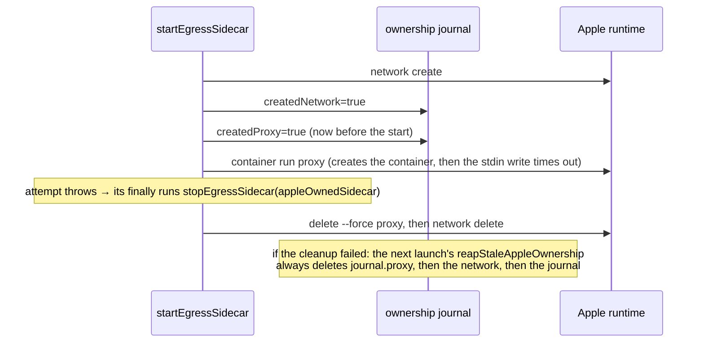

## Summary

A failed Apple egress proxy start no longer leaks a stopped
`vibe-egress-owned-*-proxy` container. The proxy is now recorded in the
ownership journal **before** `container run`. That lets the failed attempt's own
cleanup remove the proxy and then the network before `retryAppleEgress` retries.
The stale-journal reaper also now always deletes the journal's own proxy name
before its network, so journals written before this fix (`createdProxy:false`
for a proxy that exists) heal on the next launch. Closes #5488.

## Spec

### Intent and Rationale

- `startEgressSidecar` called `created("proxy")` only after `run(proxyRunArgs)`
  returned. A stdin-write timeout or throw after the runtime had made the
  container left `createdProxy:false`. The per-attempt cleanup and the reaper
  both skipped the proxy, and `network delete` was then refused while the
  stopped container stayed attached.
- I did both fixes the issue offers, pre-recording and an unconditional reaper
  delete. Pre-recording stops new leaks. Only the reaper change can clean up
  journals that already exist on hosts with the old shape.

### Essential Design Decisions

- The proxy name is `${network}-proxy` for the journal's own nonce
  (`staleAppleOwnership` checks this), so deleting it unconditionally never
  reaches a resource another launch owns. A "not found" delete is still treated
  as success.
- The live-owner guard is unchanged: if the launcher or the supervisor PID is
  alive, the reaper issues no runtime command.
- Persisted shape: the journal's shape is unchanged. The reaper reads the old
  shape too: a pre-fix journal's `createdProxy:false` no longer stops the proxy
  delete. I did not bump any key.
- The stale-journal loop and the journal write were moved out of
  `apple_egress_launch_main.ts` (a script entry point) into the exported
  `reapStaleAppleOwnership`, `recordAppleOwnership` and `appleOwnedSidecar` in
  `worker/deno/lib/apple_egress_launch.ts`, so tests drive the production code.

### Undiscoverable Facts

- From the issue: on GRQ-23, five leaked proxies of about 8.8 GB each came from
  launches 1789 and 18379, and every journal read
  `"createdNetwork":true,"createdProxy":false`.
- I could not observe Apple `container` here (Linux host). If the start fails
  _before_ the runtime creates the container and `container delete --force`
  exits non-zero on a missing name, the failed attempt logs one cleanup problem
  and keeps its journal. The next reaper pass then removes it, because it treats
  "not found" as success.

## Evidence

Backend only, no UI files touched.

## Test Plan

- Added `worker/deno/tests/apple_egress_proxy_leak_5488_test.ts`. It uses a
  stateful fake runtime: `run` with stdin adds the container and then rejects
  with the stdin-timeout error, and `network delete` is refused while
  `<network>-proxy` exists, as the issue describes.
  - `a proxy start that throws after the container exists still records proxy ownership`
  - `the failed attempt's own cleanup removes its proxy before its network`:
    uses the real `recordAppleOwnership` against a temp journal, then
    `stopEgressSidecar(appleOwnedSidecar(...))`.
  - `stale cleanup removes the leaked proxy, then the network, then the journal`
    runs for a pre-fix journal (`createdProxy false`) and a new one. It also
    checks that an unrelated `other.json` survives.
  - `stale cleanup never touches resources of a live pid 42` / `43`: the
    converse. No runtime call is made and the journal is kept.
  - `stale cleanup retains the journal and logs when the runtime errors`:
    asserts that the log line quotes the runtime's cause
    (`XPC connection error`).
- Red against base: in a scratch worktree I restored
  `worker/deno/lib/egress_sidecar.ts` from `origin/main` and made the reaper
  honour `createdProxy` as the base loop did. The record, own-cleanup,
  pre-fix-journal and runtime-error tests failed (4 failed, 3 passed). At the
  head, all 7 pass.
- `deno test --allow-all tests/apple_egress_proxy_leak_5488_test.ts tests/apple_egress_controls_test.ts tests/egress_sidecar_test.ts`
  passed: 26 passed, 0 failed. No existing test was edited.
- `deno fmt --check`, `deno lint` and `deno check` on the changed files: clean.
- `./quality.sh` on the final head: `Result: PASSED (with skipped checks)`. The
  skipped checks were config integration and checkov. Deno tests, lint, type
  check, fmt, semgrep and gitleaks all passed.

## Not done / risks

- The retry-path cleanup is tested at the helper level (`stopEgressSidecar` +
  `appleOwnedSidecar`), not by running the `apple_egress_launch_main.ts` script,
  which needs a real Apple runtime.
- Apple `container`'s exit code for `delete --force` on a missing name was not
  observed (see Undiscoverable Facts).

🤖 Generated with [Claude Code](https://claude.com/claude-code)
