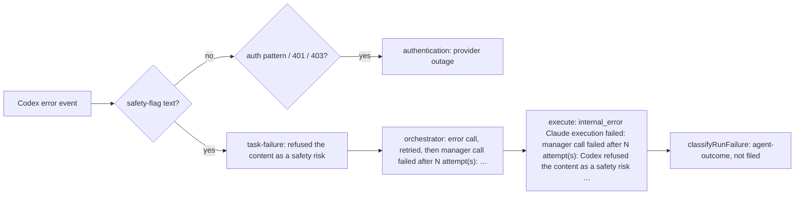

# PR Summary — Issue #5506

## Summary

Two separate faults released runs with no PR and were classed `worker-crash`.
This PR fixes both. Closes #5506.

1. **GRQ-AutoTraderBackTesting#443 (completion phase):** the full-tree Mermaid
   scan (`collectMarkdownFiles` in `worker/deno/lib/mermaid_check.ts`) walked
   into a Rust repo's `target/` directory. A test there had generated a tree
   deeper than PATH_MAX, so `readdir` threw `File name too long (os error 36)`
   from the baseline-aware gate's `collectDiffableGateFindings`, and the
   completion phase threw. `target` (Cargo/Maven build output) is now in
   `SKIP_DIRECTORIES`.
2. **VibeCoder#5456 (execute phase):** Codex refused the task content as a
   cybersecurity risk. Its refusal text says "authorized security work", and
   `classifyCodexFailure` matched that against its `auth` pattern, so the
   refusal was read as a rejected credential. That records an automatic provider
   outage, and the run's `internal_error` was then classed `worker-crash`. The
   adapter now checks the safety-flag text before the authentication match and
   returns `task-failure` with the headline
   `Codex refused the content as a safety risk`. On the orchestrated path the
   #5456 run took, the orchestrator maps that to an `error` call, retries it,
   and ends the run with `<role> call failed after N attempt(s): <message>`. The
   execute phase reason is therefore
   `Claude execution failed: manager call failed after N attempt(s): Codex refused the content as a safety risk — evidence: …`.
   `classifyRunFailure` answers `agent-outcome` (`not_code_fixable`) for an
   `internal_error` whose worker text opens with `Claude execution failed:`,
   then optionally that orchestrator prefix, then the headline.

## Spec

### Intent and Rationale

- Each fix goes where the fault started: the walker that reached a build tree,
  and the provider classifier that misread a content refusal. A catch-all in the
  completion phase would hide other real crashes.
- Skipping `target/` by name follows the existing `SKIP_DIRECTORIES` pattern
  (`node_modules`, `vendor`, `_site`). The tree that crashed was build output,
  not repository documentation.

### Essential Design Decisions

- The safety check runs **before** the authentication match. Moving it after
  would bring the false provider outage back.
- The run-classifier rule (`CODEX_SAFETY_REFUSAL_RE`) is anchored to the start
  of the worker's own text and accepts the orchestrator roles in `TARGET_ROLES`. The only text it allows before the headline
  is the orchestrator's own prefix. The same headline quoted later in a message,
  or in agent output, cannot trigger it. The headline is one exported constant,
  so the adapter and the classifier cannot drift apart.
- It reuses the existing `agent-outcome` slug. No new `RUN_FAILURE_CLASSES`
  entry was added, so no open run-failure issue is orphaned. The category stays
  `internal_error`.
- A walk error in a directory that is not skipped still throws (fail loud). The
  walker was not changed to swallow `readdir` errors.

### Undiscoverable Facts

- Cause 1 comes from `worker-20261124-013733.log.gz` on host `vibe-coder-58713`:
  `Phase completion threw an unexpected error error=File name too long (os error 36): readdir '/home/vibe/auto-issue-work/worktrees/s2/GRQ-AutoTraderBackTesting/target/grq-calibrate-relative-925792/history/inner.building-925792/inner.building-925792/…'`.
- Cause 2 comes from the archived 5456 session transcript:
  `{"type":"error","message":"This content was flagged for possible cybersecurity risk. If this seems wrong, try rephrasing your request. If you’re doing authorized security work …"}`.
  The worker log for that run reads
  `Claude execution failed: Codex refused the credential — evidence: error This content was flagged …`.
- The issue's third comment (a `host-disk` release) is already its own
  `not_code_fixable` class and needs no change.

## Evidence

This is a backend-only change; no UI files are touched.

- `worker/deno/tests/mermaid_check_test.ts::collectMarkdownFiles - skips target/ even when its tree exceeds PATH_MAX (#5506)`
- `worker/deno/tests/mermaid_check_test.ts::collectMarkdownFiles - skips target/ by directory name, keeps docs/ (#5506)`
- `worker/deno/tests/codex_output_adapter_1695_test.ts::codex adapter - a safety-flag refusal is a task failure, never an authentication refusal (Issue #5506)`
- `worker/deno/tests/codex_output_adapter_1695_test.ts::codex adapter - a hostile safety-flag prefix with no risk word returns and is not the safety refusal (Issue #5506)`
- `worker/deno/tests/run_outcome_classifier_test.ts::codex safety refusal - an internal_error opening with the safety headline is an agent-outcome (Issue #5506)`
- `worker/deno/tests/run_outcome_classifier_test.ts::codex safety refusal - a credential refusal is still a worker-crash (Issue #5506)`
- `worker/deno/tests/run_outcome_classifier_test.ts::codex safety refusal - the headline only later in a message does not trigger the rule (Issue #5506)`
- `worker/deno/tests/codex_safety_refusal_5506_test.ts::codex safety refusal - manager refusal is an agent-outcome (Issue #5506)`.
  This is the end-to-end test. It runs the Codex adapter's real classification
  of the #5456 refusal through the real `runOrchestratedIssueRun` (Codex roles,
  faked provider process only) and the real execute phase. It asserts the reason
  opens `Claude execution failed: manager call failed after N attempt(s):` and
  that `classifyRunFailure` returns `agent-outcome`.
- `worker/deno/tests/codex_safety_refusal_5506_test.ts::codex safety refusal - the orchestrator's prefix around another failure is still a worker-crash (Issue #5506)`
- Documentation: `docs/INTERNALS.md` has a new section, "A Codex safety refusal
  is a task failure, not a credential refusal or `worker-crash` (Issue #5506)".

## Reproduction

- **symptom** — runs released with no PR and auto-filed `worker-crash`. The
  completion phase threw
  `File name too long (os error 36): readdir '<repo>/target/…'`, and a Codex
  cybersecurity refusal was reported as "Codex refused the credential".
- **status** — `verified` — each regression test was seen failing against the
  unfixed base code and passing after the fix:
  - The deep-tree test failed with
    `Error: File name too long (os error 36): readdir '/tmp/mermaid_check_…/target/…'`
    at `walkMarkdown`.
  - The shallow test collected `target/notes.md` and `target/debug/build.md`.
  - The adapter test got `authentication` (expected `task-failure`).
  - The classifier test got `worker-crash` (expected `agent-outcome`).
  - The end-to-end orchestrated test, run against the previous `startsWith`-only
    rule, got `worker-crash` (expected `agent-outcome`).
- **regression test** —
  `worker/deno/tests/mermaid_check_test.ts::collectMarkdownFiles - skips target/ even when its tree exceeds PATH_MAX (#5506)`,
  `worker/deno/tests/codex_output_adapter_1695_test.ts::codex adapter - a safety-flag refusal is a task failure, never an authentication refusal (Issue #5506)`
  and
  `worker/deno/tests/codex_safety_refusal_5506_test.ts::codex safety refusal - manager refusal is an agent-outcome (Issue #5506)`

## Test Plan

- Added the nine tests listed under Evidence. No existing test was edited or
  removed. The new tests are appended, or sit in the new file
  `tests/codex_safety_refusal_5506_test.ts`.
- Controls:
  - The existing 401 → `authentication` test still passes.
  - A credential refusal still classes `worker-crash`.
  - The safety headline appearing only later in a message does not fire the
    rule, with or without the orchestrator's prefix.
  - `docs/guide.md` is still collected next to a skipped `target/`.
- Hostile input: a safety-flag prefix followed by 50,000 spaces and no `risk`
  word. The bounded `[a-z -]{0,40}` regex returns quickly and does not match it.
- Targeted runs, all passing:
  - `tests/mermaid_check_test.ts`: 23 passed.
  - `tests/codex_output_adapter_1695_test.ts` and
    `tests/run_outcome_classifier_test.ts`: 74 passed.
  - After the orchestrated-path fix: `tests/codex_safety_refusal_5506_test.ts`,
    `tests/run_outcome_classifier_test.ts`,
    `tests/codex_output_adapter_1695_test.ts`,
    `tests/orchestration_3642_gate_test.ts`, `tests/run_failure_issue_test.ts`
    and `tests/failure_diagnosis_test.ts`: 244 passed.
  - `tests/claude_runner_test.ts`, `tests/run_failure_issue_test.ts`,
    `tests/failure_diagnosis_test.ts`, `tests/coding_failure_ladder_test.ts` and
    `tests/collect_self_diagnostic_candidates_test.ts`: all passed.
- `./quality.sh < /dev/null` ran on the head and finished
  `Result: PASSED (with skipped checks)`. Only `config integration` and
  `checkov` were skipped.
- The directory exclusion applies to the Mermaid walker. Other whole-tree
  walkers maintain their own exclusion sets.

## Not done / remaining risk

- `internal_error` still takes the flat transient retry, so a safety refusal is
  retried rather than labelled. The issue does not ask for that to change.
- A directory too deep for `readdir` outside a skipped directory still throws,
  which is deliberate (fail loud).

🤖 Generated with [Claude Code](https://claude.com/claude-code)
