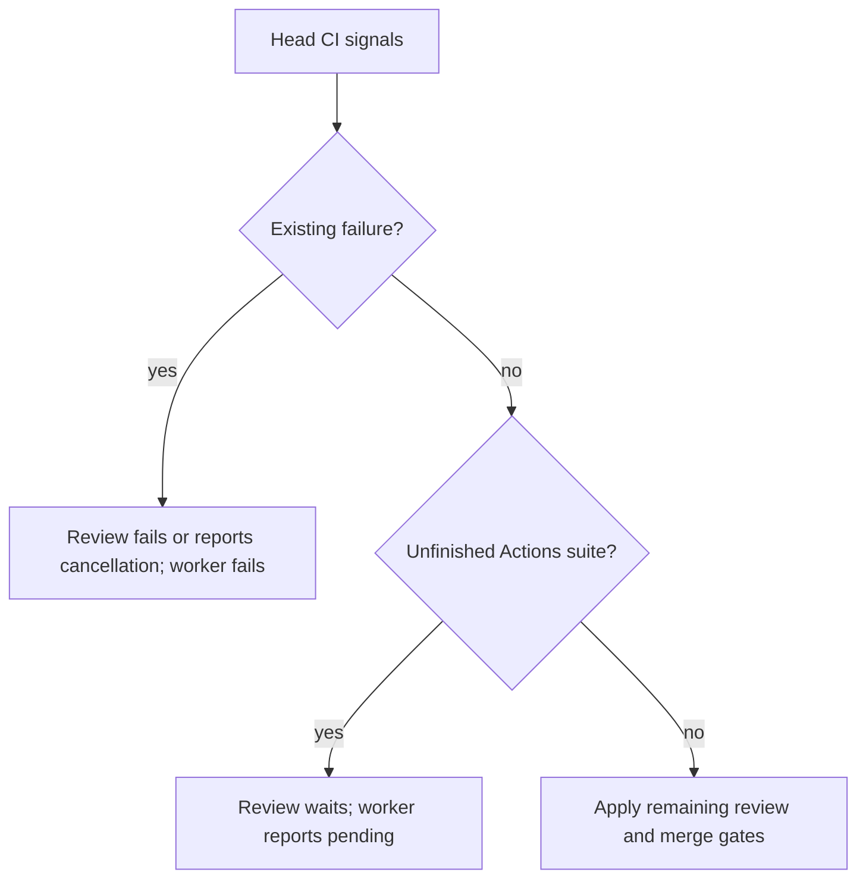

## Summary

Keep unfinished GitHub Actions suites pending in the review and worker merge
readers, even when the check-run rollup is green. Closes #5507.

## Spec

### Intent and Rationale

- A workflow can have a suite before its first check run exists. Reading suite
  status closes that gap using data both readers already fetch.

### Essential Design Decisions

- Failure and cancellation decisions retain precedence. Unfinished Actions
  suites wait regardless of run count; other apps retain their existing
  treatment.
- Correct the worker reader too: its merge gate and lifecycle observations share
  `determineCiStatus`. An active suite prevents the `no_checks` override.
- Do not expire suites into success. The observed long-lived queued suites still
  have queued workflow runs; no abandoned Actions suite without a workflow run
  was established by these reads.

### Undiscoverable Facts

- Read-only GitHub observations on 24 November 2026 found queued Actions suites
  with zero jobs still linked to queued workflow runs after 13 days.
- A rerun used the same suite id for a failed first attempt and a successful
  second attempt. Suite status, rather than an earlier conclusion, decides
  whether CI is unfinished.
- Pushing this implementation branch before opening a PR produced no workflow
  runs and no Actions suites; only three other-app queued zero-run suites
  existed.

## Evidence

Backend/CLI change; deterministic API fixtures and real gate/ledger calls
provide evidence. No visual surface changed.

- Existing failure-rule provenance, #4347: CI reads green when a new workflow
  fails at startup with no check run. Its completed-suite rule remains intact.
- #5507: review-fleet-prs gate reports a PR ready while a GitHub Actions
  workflow on its head has not finished: an incomplete check suite with no check
  run reads as green (a private fleet PR).
- [Queued Quality run](https://github.com/stSoftwareAU/VibeCoder/actions/runs/43098258195):
  head `ad1a8f7611e69ba89425ef38ac91eed9b514bbe3`, suite `116713898254`,
  `queued`, zero check runs and zero jobs; created 11 November. Cargo Audit and
  Dependency Review on that head had the same queued/zero-run shape. A separate
  completed startup failure on the head must retain failure precedence.
- [Running Quality run](https://github.com/stSoftwareAU/VibeCoder/actions/runs/45485690506):
  suite `123078752080` was `in_progress` with 18 check runs while two smaller
  workflow suites on its head were completed green.
- [Rerun](https://github.com/stSoftwareAU/VibeCoder/actions/runs/44992743976):
  attempts 1 and 2 share suite `121765666295`; their conclusions were `failure`
  and `success`. Existing completed-rerun tests remain unchanged.

- No-workflow push: head `4da8f9aaebe21e223bba5d0485b396b5a88eeed6` returned
  `actions/runs.total_count: 0`; its three suites belonged to other apps, with
  no `github-actions` suite. Read-only queries did not establish an orphan
  Actions suite to exempt. Workflow concurrency groups were inspected; no live
  concurrency wait was isolated independently of other scheduler delays.

## Test Plan

- [x] Reproduce against unfixed base code.
- [x] Fix both readers, review-pass exclusion and worker override handling.
- [x] Update skill, design principles and merge manual.
- [x] Complete the full quality gate and summary gate.

- Red: the final regression fixtures against `origin/main` production yielded 99
  passed and 9 failed in the three gate/worker/parity files. The review pass
  actually returned the pending PR in `ready`; GraphQL and REST returned
  `passed`, and the override allowed it. The lifecycle regression separately
  yielded 29 passed and 1 failed: quality was recorded as `pass` instead of
  `skipped`. Restoring the fix made the targeted suite green.
- Green: `deno task test:unit` across the following eight files passed 276
  tests: `worker/deno/tests/review_fleet_prs_gate_4347_test.ts`,
  `worker/deno/tests/actions_suite_predicate_4347_test.ts`,
  `worker/deno/tests/direct_merge_test.ts`,
  `worker/deno/tests/lifecycle_pr_observation_test.ts`,
  `worker/deno/tests/review_fleet_prs_gate_2675_test.ts`,
  `worker/deno/tests/review_fleet_prs_gate_audit_3116_test.ts`,
  `worker/deno/tests/merge_gate_fail_closed_test.ts`,
  `worker/deno/tests/check_runs_batch_test.ts`.
- Review regressions in `worker/deno/tests/review_fleet_prs_gate_4347_test.ts`:
  `skipReason: unfinished Actions suites wait despite a green rollup` covers
  queued/running suites, nonzero counts and stale conclusions;
  `skipReason: failures and cancellations precede unfinished Actions suites`
  preserves precedence;
  `pass: unfinished Actions heads never enter the ready list` drives the review
  pass with a completed-green control.
- Worker regressions in `worker/deno/tests/direct_merge_test.ts`:
  `direct_merge - checkCiStatus waits for an unfinished github-actions suite (QUEUED)`
  covers GraphQL;
  `direct_merge - REST fallback waits for unfinished Actions suites` covers
  REST;
  `direct_merge - pending suites cannot mask red rollups, runs, statuses or suites`
  covers failure precedence;
  `direct_merge - no-checks override cannot bypass unfinished Actions CI` drives
  the real CI reader through the merge gate with a completed control.
- Changed expectations: unfinished-suite assertions that formerly expected
  ready/passed now expect waiting/pending, as required by the issue. No other
  behaviour assertions were removed. Existing tests in those two files retain
  completed success/skipped/neutral, zero-run failure, cancellation, completed
  rerun, other-app and absent-suite coverage.
- The twinned rules are `skipReason` in the standalone review script and
  `determineCiStatus` in the worker. The parity test
  `the worker and review gate agree on unfinished suites beside green checks`
  exercises both readers, including case folding, other apps and nonzero counts.
  `recordLifecyclePrSnapshot` is the additional existing caller: its regression
  `PR observations do not record quality passed while an Actions suite is unfinished`
  checks the real ledger records pending CI as unverified. The no-checks retry
  wording was checked against `worker/deno/lib/merge_block_escalation.ts`,
  `classifyMergeAttempt` (`no_checks` returns `retry`).
- Targeted formatting, lint and type checks passed. The initial type check found
  a union narrowing error in the lifecycle test; it was corrected and rerun
  green.
- `./quality.sh < /dev/null`: passed with skipped checks. Tests, lint, type
  checks, formatting, completeness, Mermaid, Markdown, Semgrep and gitleaks
  passed. Config integration skipped because the container has no worker config;
  local Checkov skipped because neither its pinned binary nor image is
  available.
- `deno task pr-summary-check --base main`: passed, zero blocked and zero
  not-checked gates. Closure, independent review and bug-label reproduction
  sections were not applicable to this issue's labels and body.
- Related skill rules checked: CI green/pending, cancelled checks and the red
  dependency-audit exception. The changed CI rule was applied to this diff; the
  skill, code comments, design principles, manual and tests agree that an
  unfinished Actions suite waits, with failures taking precedence.

## Merge verification

Remote CI and independent code review are pending.

## Remaining checks and risks

Config integration and local Checkov were skipped by the full gate; remote CI
and independent review have not been verified. No live concurrency delay was
recreated, and no abandoned Actions suite without a workflow run was
established. An API-reported unfinished Actions suite remains pending regardless
of age.
