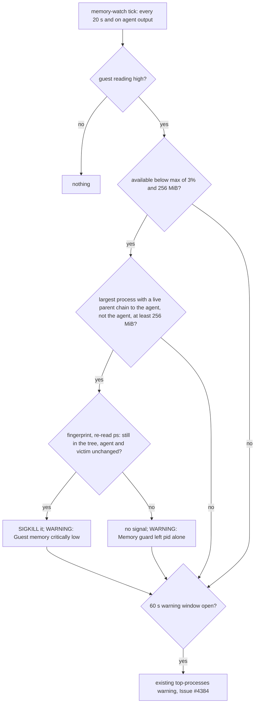

# PR Summary — Issue #5529

## Summary

The recurring `hard-kill-watchdog-setup` reports say "Last step logged:
`setup: default branch sync`". That label was wrong, and the cause behind it was
not handled. This PR fixes both. Closes #5529.

- **The label.** After `default branch sync`, a milestone issue's setup goes on
  to open the milestone branch and run the milestone pre-sync. The pre-sync can
  run a merge-conflict agent for the whole `claudeTimeout`. Every issue then
  runs the checkpoint and stream-session resume. None of these logged a
  `[setup-step]` line, so a wedge in any of them was reported as
  `default branch sync`. `SETUP_STEPS` (`worker/deno/lib/setup_steps.ts`) gains
  `milestone branch`, `milestone pre-sync` and `session resume`.
  `workOnIssueSetupBranch` (`worker/deno/lib/phases/setup_branch_phase.ts`) logs
  each one as it starts. The hard-kill report labels them with no other change,
  because it reads `SETUP_STEPS`.
- **The wedge.** The guest VM has no swap. A heavy build in one agent run's tree
  uses up guest memory before the kernel's OOM killer acts. The guest stops
  answering, and the launcher reaps every lane. The runner's memory watch
  (`claude_runner.ts`, Issue #4384) used to only log. It now acts as an early
  OOM guard. It checks on every memory-watch tick, which is not held back by the
  60 s warning window. When the guest's available memory is below the greater of
  3% of total and 256 MiB, it sends SIGKILL to the largest process in that agent
  run's own tree, and logs a `Guest memory critically low` warning. The agent
  CLI itself is never killed, and neither is a process under 256 MiB. The signal
  is identity-gated through `pid_guard.ts`: the victim must still be the process
  chosen and still have a live parent chain to the agent, or it is left alone
  and a `Memory guard left pid=… alone` warning is logged. The selection and the
  gated kill are in the new `worker/deno/lib/memory_guard.ts`.

## Spec

### Intent and Rationale

- The #5161 early reap shortens the time a wedged guest holds the host, but the
  guest still dies and takes every lane with it. Killing one build step costs
  far less, and only a process inside the guest can do it before the guest stops
  scheduling.
- The guard is added to the existing memory watch, which already has the probe,
  the `ps` table and the agent's descendant snapshot. No new timer or process is
  added.

### Essential Design Decisions

- The guard kills only inside the agent run whose watch fired, and never the
  agent itself. Each agent run's watch guards its own tree, so a hog in another
  lane's agent tree is killed by that lane's watch. A hog outside every agent
  tree is not killed. Examples are a quality gate the worker runs itself, or a
  pre-setup command.
- A reading without byte counts never triggers the guard. That covers the macOS
  pressure level and an unreadable probe. The guard is therefore Linux-only in
  practice, which means the container guest or a Linux host run.
- While the reading stays below the floor, each tick (every 20 s, and on agent
  output) can kill the next-largest member. There is no cool-down, because a
  guest still below the floor is still at risk.
- The guard never signals a pid it cannot prove is still its own
  (CODING-STANDARDS.md, "Never signal a pid you cannot prove is still yours").
  `killMemoryGuardVictim` fingerprints the victim with `captureProcessIdentity`
  and re-reads the `ps` table, which must show a live parent chain from the
  victim to the agent. It then re-verifies the agent against its spawn
  fingerprint and the victim against its own with `isSameProcess`, immediately
  before the SIGKILL. A victim whose start time is unchanged across that span is
  the process the re-read placed in the tree. Any check that fails means no
  signal.
- The guard does not use the agent's descendant snapshot (Issue #4382) for
  membership. A snapshot pid with no live chain to the agent may have been
  reaped and given to a stranger since the snapshot, and the table cannot tell
  the two apart. So a process re-parented away from the agent is not killed.

### Undiscoverable Facts

- Archived evidence on GRQ-25 (`hard-kill-vibe-coder-55123`, 24 November,
  `default branch sync`, guest silent 1070 s) shows the setup lane was in fact
  inside the milestone pre-sync's merge-conflict agent.
  - Its log continued with `Milestone routing active` and
    `handing the
    remaining conflicts to the agent` after the last
    `[setup-step]` line.
  - The guest log then showed six `/usr/bin/ld` processes at about 1.9 GiB RSS
    each, available memory going from 1.1 GiB to 168 MB in ten seconds, and then
    the guest went silent.
  - None of those linkers were tagged as the other lane's agent tree.
- `CARGO_BUILD_JOBS=2` (`container/entrypoint.sh`, Issue #4225) did not keep the
  linkers to two. Which tool started the six is not known from the evidence.
- The `GRQ-3` evidence named in the issue stays on that host, so it was not
  read. That the GRQ-3 recurrences have the same cause is an inference from the
  matching step and the guest probe, not a reading.

## Evidence

Backend-only change; no UI files are touched.

- `worker/deno/tests/setup_step_log_test.ts::#5529 - a milestone setup inside
  the pre-sync agent reports milestone pre-sync, and a completed milestone setup
  logs the milestone steps in order`.
- `worker/deno/tests/memory_guard_5529_test.ts`:
  - Floor and victim selection: the largest tree member wins over the agent and
    over a larger unrelated linker, with a 1.1 GiB control. A snapshot-only pid
    with no live chain to the agent is never chosen.
  - The gated kill (`killMemoryGuardVictim`): a proven victim is killed. Nothing
    is signalled for a pid whose start time changed between selection and the
    kill, a victim that is gone, a reused pid that the re-read table places
    outside the tree, or an agent that is changed or was never fingerprinted.
  - The kill line.
  - Five tests through the real `runClaudeWithRetry`. A critical reading kills
    and logs. A high reading above the floor only warns. A kill that throws is
    logged. A pid that changed hands is left alone and the refusal is logged.
    The window test: with `memoryWatchMinIntervalMs: 60_000`, the first tick
    reads above the floor and logs the pressure warning. The second tick, inside
    the window, reads below the floor and kills the tree member, with one
    `Guest memory critically low` line. A third critical tick kills again, and
    the pressure warning is still logged once.
- New ledger slice: `docs/audits/lib-sweep-coverage/top-up-5529.json` claims
  `worker/deno/lib/memory_guard.ts`.
- Docs: `docs/TROUBLESHOOTING.md` (step labels, plus a guard paragraph) and
  `docs/CALLBACKS.md` (step labels).

## Reproduction

- **symptom** — a wedge in a milestone issue's setup was reported as
  `setup: default branch sync`, and the guest VM wedged under memory exhaustion
  instead of losing one process.
- **status** — `partial` — reason: the label was reproduced. The new setup-step
  test failed on the unfixed code (`- setup: default branch sync` /
  `+ setup: milestone pre-sync`) and passes after the fix. The guest wedge
  itself needs a real VM and was not reproduced. The guard rests on the archived
  GRQ-25 evidence and on the base code, where the memory watch only logs. Its
  tests show it kills the right process, not that a guest survives.
- **regression test** —
  `worker/deno/tests/setup_step_log_test.ts::#5529 - a
  milestone setup inside the pre-sync agent reports milestone pre-sync, and a
  completed milestone setup logs the milestone steps in order`.

## Test Plan

- Added `worker/deno/tests/memory_guard_5529_test.ts`. Its first run, before the
  module existed, failed type checking
  (`'memoryGuardKill' does not exist
  in type 'RunClaudeOptions'`).
- Added the #5529 test to `worker/deno/tests/setup_step_log_test.ts`, red on
  base as quoted above.
- Edited existing tests, with no behaviour assertion removed:
  - `worker/deno/tests/setup_step_log_test.ts`: the completed-setup test now
    expects eight lines (it adds `session resume`, which every setup now logs)
    and is renamed "all eight". The issue makes "seven" untrue. The other seven
    lines and the final-label assertion are unchanged.
  - `worker/deno/tests/hard_kill_report_test.ts`: three new steps are added to
    the step list the label test loops over.
  - `worker/deno/tests/claude_runner_killed_test.ts`: `capturingLogger`,
    `chunkSignals` and `waitForFile` moved to
    `worker/deno/tests/support/claude_runner_harness.ts`, so the new test
    imports them rather than copying them. No test changed.
- Mutation checks on the head, each reverted afterwards:
  - Restoring the base gate (`if (!warnDue) return;`) fails the window test
    (`timed out waiting for the first guard line`).
  - Making `killMemoryGuardVictim` kill before any check fails the four
    unproven-pid unit tests and the runner refusal test.
- `formatProcessTable`'s tree walk was extracted unchanged into
  `agentTreeMembership` (`kill_diagnostics.ts`), which the guard reuses.
  `formatProcessTable`'s existing tests cover it.
- Twinned rules: none found. The tree walk now has one copy.
- On the final head, from `worker/deno`:
  `deno test --allow-all tests/setup_step_log_test.ts tests/hard_kill_report_test.ts tests/setup_deadline_5128_test.ts tests/memory_guard_5529_test.ts tests/claude_runner_killed_test.ts tests/kill_diagnostics_test.ts tests/memory_pressure_test.ts tests/lib_sweep_coverage_test.ts tests/setup_branch_presync_test.ts`
  gave 208 passed and 0 failed. Adding `tests/pid_guard_test.ts` gave 267 passed
  and 0 failed.
- `./quality.sh < /dev/null` on the head before the identity-gate change:
  `Result: PASSED (with skipped checks)`. Only `config integration` (no
  `.config.json`) and `checkov` (not on PATH) were skipped. On the final head,
  `deno check mod.ts`, `deno lint` and `deno fmt --check` on the changed files
  are clean. The worker re-runs the full gate.

## Not done / remaining risk

- A memory hog outside every agent run's tree is not guarded. Examples are the
  worker's own quality-gate run and a pre-setup command. The same holds for a
  tree member whose parent has exited, because it is re-parented away from the
  agent.
- Whether the guard fires before a real guest stops scheduling has not been seen
  on a VM. The next `hard-kill-watchdog-*` recurrence, or a
  `Guest memory critically low` line in a worker log, will show it.
- The GRQ-3 archives named in the issue were not read: they are on that host.
