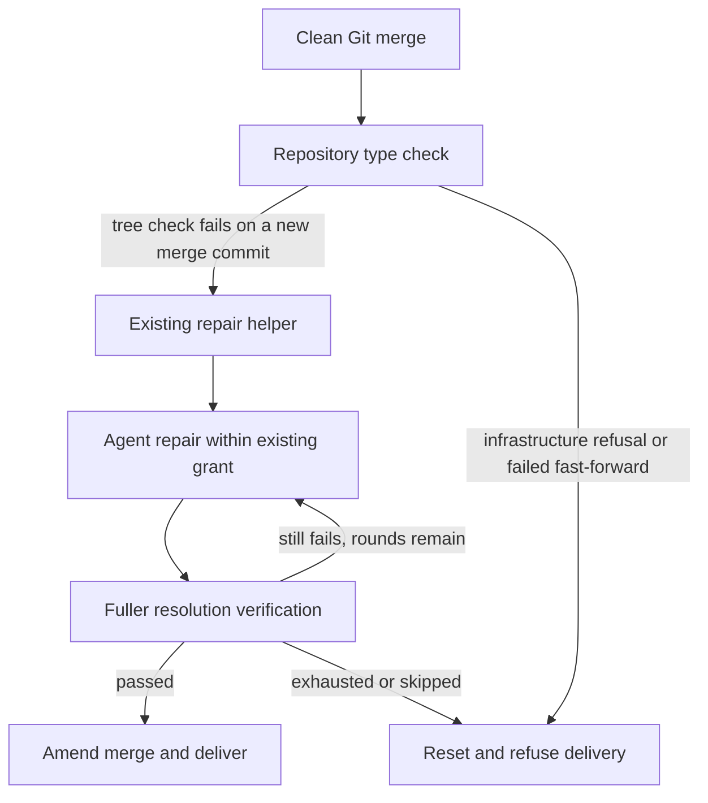

## Summary

Send a clean milestone merge's failing type check through the existing bounded
repair helper before discarding the merged tree. Repaired trees must pass the
fuller resolution verification before delivery. Closes #5530.

## Spec

### Intent and Rationale

- Git can merge an interface change and a milestone implementor without a
  textual conflict, leaving a tree that does not compile. The clean-merge path
  previously reset that tree without offering the repair rung.
- Reuse `runGateWithRepair`, including its diagnostics, staging safety, two-round
  limit and amend handling, rather than introducing another repair loop.
  Repair-mode prompts describe the committed merge and an empty conflict list
  as a verification repair.

### Essential Design Decisions

- On the clean-merge path, repair requires a failed check, readable merge/default
  tips and a new local merge commit. Initial known infrastructure causes and
  fast-forward failures remain refused without repair; existing attempt
  classification stays intact.
- The initial type-check verdict is reused. Agent edits then run through
  `resolutionGate`, including the repository's supported checks and unit suite;
  skipped re-verification cannot authorise delivery.
- Existing agent grants still bound repair. Passing or initially skipped clean
  merges retain their delivery policy. An uncommittable repair is reset and
  refused even after verification passed.
- Clean gate/delivery exits now log stage timings, with repairs charged to the
  agent stage. No persisted ledger or fallback-record format changes.

### Undiscoverable Facts

- The available logs and sync ledger on `vibe-coder-36627`, and the accessible
  run archive, contained no records for the source hosts `vibe-coder-13535`
  (09:31:25.947Z) or `vibe-coder-78347` (10:23:12.899Z and 10:43:30.864Z)
  on 24 November 2026. This is a single-host investigation with an archive
  lookup, not a fleet-wide reconstruction.
- The original check command, diagnostic, branch tips and repair history could
  not be recovered. The confirmed defect below does not establish which
  compiler error occurred in those private runs.
- The unfixed clean-merge path also omitted its timing log. Its typed gate
  refusal still has no fallback timing payload; the historical missing timings
  were not used to diagnose a compiler failure.

## Evidence

- Backend change. `worker/deno/lib/git_pull.ts` now calls the existing helper in
  `worker/deno/lib/milestone_gate_repair.ts` for eligible clean-merge failures.
  `judgeSyncFailure` in `worker/deno/lib/milestone_branch_sync.ts` continues to
  classify persistent tree failures and infrastructure refusals.
- The new regression in
  `worker/deno/tests/milestone_sync_gate_repair_test.ts` runs a real
  `deno task check`: both input trees compile, their clean merge reports
  `TS2420 [ERROR]: Class 'Worker' incorrectly implements interface 'Service'.`
  with a missing `stop` method, and the supplied repair reaches the remote as
  one merge commit retaining both parents.
- The check runner invokes the fixture's discovered Deno command; it replaces
  the host account drop, not the compiler. The tests require no private source.
- `worker/deno/tests/milestone_gate_repair_prompt_test.ts` drives the real agent
  binding with an empty conflict list and a first repair request. It verifies
  the diagnostic reaches repair-mode text, the grant applies and the attempt
  announces once, with an ordinary-resolution control. This regression also
  failed before the prompt correction and passed afterwards.
- Existing private-fallback redaction tests pass. No private repository names,
  refs, source paths or original replies are added to this public record.
- #5530: Merge fallback: the merge gate refused the merged tree (the
  repository's check failed).

## Reproduction

- **symptom** — a clean milestone merge reaches the merge gate, fails the
  repository check and falls towards fallback without offering semantic repair.
- **status** — `partial` — reason: the synthetic clean-merge regression failed
  against unfixed base code at `1d59c9feb` and passes with this fix; the private
  historical diagnostics and source trees were unavailable.
- **regression test** —
  `worker/deno/tests/milestone_sync_gate_repair_test.ts::syncMilestoneBranchWithDefault - a clean merge's compiler failure is repaired before delivery`.

## Test Plan

- Added twelve cases in
  `worker/deno/tests/milestone_sync_gate_repair_test.ts`: successful compiler
  repair/delivery, persistent failure after two rounds, fuller-suite failure,
  four initial infrastructure causes, exhausted repair grant, fast-forward
  refusal, unavailable agent, skipped re-verification and failed amend.
  The persistent-failure case also asserts timing attribution and charged
  attempt classification. No existing assertions were removed or changed.
- Added the first-repair prompt regression in
  `worker/deno/tests/milestone_gate_repair_prompt_test.ts`; existing prompt
  assertions were retained. Related descriptions checked: the repair-mode
  override in `worker/deno/lib/prompt_builder.ts`, the conflicted-file and
  no-side-pick rules in `prompts/merge_conflict/prompt.md`, and the shared
  grant/announcement binding. The descriptive change agrees with those rules
  and this diff's clean-merge case; no new agent rule was introduced.
- The final targeted `deno task test:unit` run passed 260 tests across fifteen
  suites: that suite and
  `worker/deno/tests/milestone_gate_repair_test.ts`,
  `worker/deno/tests/milestone_gate_repair_land_unverified_4326_test.ts`,
  `worker/deno/tests/milestone_sync_merge_gate_test.ts`,
  `worker/deno/tests/milestone_merge_gate_cause_test.ts`,
  `worker/deno/tests/milestone_merge_gate_verdict_test.ts`,
  `worker/deno/tests/milestone_branch_sync_test.ts`,
  `worker/deno/tests/milestone_sync_already_synced_test.ts` and
  `worker/deno/tests/milestone_sync_dirty_clone_test.ts`,
  `worker/deno/tests/merge_fallback_issue_test.ts`,
  `worker/deno/tests/merge_fallback_vibecoder_4456_test.ts`,
  `worker/deno/tests/milestone_gate_repair_prompt_test.ts`,
  `worker/deno/tests/merge_conflict_prompt_v2_test.ts`,
  `worker/deno/tests/merge_conflict_prompt_fence_1377_test.ts` and
  `worker/deno/tests/merge_conflict_agent_test.ts`.
- Targeted Deno formatting, lint and type checks passed. `deno task
  check:manifests` passed: 876 tests passed, one existing test ignored.
- Existing clean-delivery guards remain: ref validation, clone/history checks,
  pre-merge SHA and sibling-sync checks, staging safety, rollback and the
  ruleset-aware push. Textual conflict triage is inapplicable when Git reports
  no conflicted files. The changed route still uses the existing delivery
  function; no alternative push or attempt-accounting path was introduced.
- Documentation sweep updated the merge step and verification/timing section in
  `docs/workflows/milestones.md` and the corresponding description in
  `docs/workflows/merge-conflicts.md`. No duplicated implementation was found.

## Merge verification

CI and routine code review remain pending.

## Remaining limitations

Original private-run diagnostics, tips and repairs remain unverified. No live
private-repository sync was performed.
