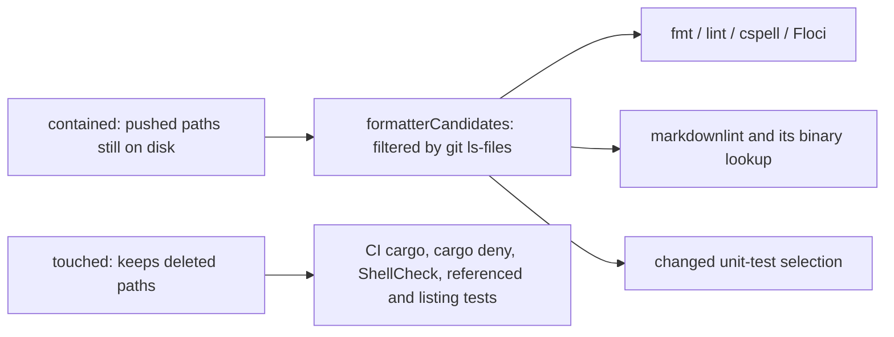

# PR Summary — Issue #5538

## Summary

The pre-push gate no longer hands a pushed path that git no longer tracks
(removed with `git rm --cached`, left on disk) to markdownlint or to the changed
unit-test selection. `runPrePushGate` now passes `formatterCandidates`, the
pushed paths filtered against `git ls-files -z` that Issue #5410 already built
for the formatter, lint, cspell and Floci selection, as `validationChanged`. It
also uses that list for `needsMarkdownlint`, so an index-removed Markdown file
no longer blocks the push on its lint violations or makes the gate refuse when
`markdownlint-cli2` is not found. Closes #5538.

## Spec

### Intent and Rationale

- A file the push no longer carries must not block it. Otherwise the recovery
  turn is asked to repair a file outside the branch, and its `git add -A`
  commit can put that file back on the branch.
- The change reuses the tracked set the gate already builds instead of adding a
  second filter, so every per-file check that reads the pushed paths now shares
  one scope.

### Essential Design Decisions

- The unfiltered `touched.value` list still feeds the triggers that must see
  deleted or renamed-away paths: the CI cargo checks, cargo deny, ShellCheck,
  the referenced-test and directory-listing scans, and the full-suite decision.
  A tracked test whose text names an index-removed file therefore still runs,
  because it may read that path.
- The sibling-test lookup in `plannedUnitTestFiles` already ran only tracked
  test files. The fix stops an index-removed source from pulling in its tracked
  `tests/<name>_test.ts` sibling.

### Undiscoverable Facts

None.

## Evidence

Backend only, with no UI files.

- Code: `worker/deno/lib/pre_push_gate.ts`, the `needsMarkdownlint` and
  `validationChanged:` lines in `runPrePushGate`, plus the `validationChanged`
  doc comment in `planChangedFileChecks`.
- Docs: `docs/CONFIGURATION.md`, in the sentence on files git no longer tracks
  (the `formatBeforeGate` paragraph), now names markdownlint and the changed
  unit-test selection.
- Issue numbers cited: #5538: Pre-push gate still runs markdownlint and
  unit-test selection on a pushed path git no longer tracks. #5410: Repository
  formatters commit nothing when a branch-changed file is no longer tracked but
  is still on disk.

## Test Plan

- New: `worker/deno/tests/pre_push_gate_untracked_validation_5538_test.ts`, six
  real-git tests through `runPrePushGate`, each with a stub runner that fails a
  markdownlint command only when it names the file with the violation:
  - `markdownlint leaves out a pushed Markdown file git no longer tracks (Issue #5538)`:
    the gate passes, and its one markdownlint command names `notes/kept.md` but
    not `scratch.md`. Control:
    `markdownlint still fails on a tracked Markdown file with a violation (Issue #5538 control)`
    fails with a `PreFlightGateError` whose command names `scratch.md`.
  - `an index-removed Markdown file does not demand a markdownlint binary (Issue #5538)`:
    with no binary found, the gate passes and runs no markdownlint. Control:
    `a tracked Markdown file with no markdownlint binary is still refused (Issue #5538 control)`
    is refused with `markdownlint-cli2 could not be found`.
  - `unit-test selection leaves out a pushed source git no longer tracks (Issue #5538)`:
    the `deno task test:unit` command names `tests/kept_test.ts` but not
    `tests/gen_test.ts`. Control:
    `unit-test selection still names the test for a tracked source (Issue #5538 control)`
    names both.
- Red on base: against the unfixed `pre_push_gate.ts`, the three index-removed
  tests failed and the three controls passed. The markdownlint command named
  `notes/scratch.md` and blocked, the no-binary case was refused, and the unit
  command named `tests/gen_test.ts`. All six pass at the head.
- No existing test was edited. The new file with
  `worker/deno/tests/repo_formatters_5410_test.ts` and
  `worker/deno/tests/pre_push_gate_test.ts` (from `worker/deno`, stdin from
  `/dev/null`): 222 passed, 0 failed.
- `./quality.sh < /dev/null` on the code commit: `Result: PASSED (with skipped
  checks)`. Config integration and checkov were skipped, and every other stage
  passed.

Not checked: none beyond the two gate stages `./quality.sh` itself skipped.
