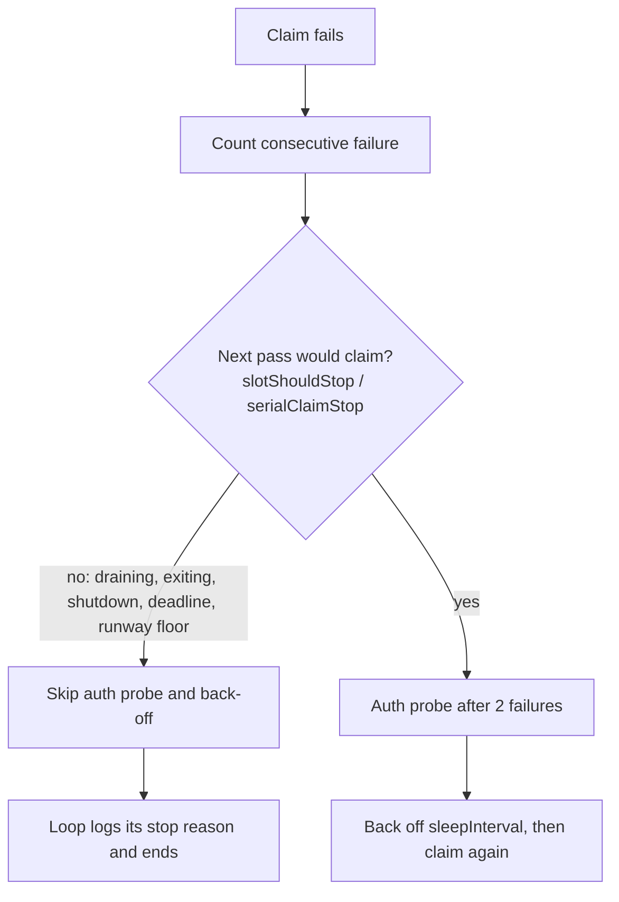

## Summary

Once no further claim can follow, a failing claim no longer runs the fresh auth
probe or the consecutive-failure back-off. This covers both the slot pool and
the serial scan. The GRQ-23 incident's last worker-log line was exactly that
wait: slot s2 backing off 300s "before the next claim" while the pool was
already draining and the finish deadline had passed. The live-container wedge as
a whole is still not reproduced. Part of #5544.

## Spec

### Intent and Rationale

- The incident log, as quoted in the GRQ-23 runs' session transcripts in the
  shared `GRQ-VibeCoder-logs` mirror, shows this order:
  - 09:31:12: s1 logged
    `stop reason=drain — the pool is draining; no further claims.`
  - 09:39:57: s2 ran `Running Claude Code health check (30s timeout)...` (the
    auth probe).
  - 09:39:57: s2 then logged
    `2 consecutive issue failures — backing off 300s
    before the next claim.`,
    the archive's `lastLogLine`.

  The run's finish deadline (09:20:59) had already passed.
- `runSlotIssue` and `runIssueScanLoop` in `worker/deno/lib/run_core.ts` applied
  the probe and the back-off unconditionally. The slot loop's own stop check
  only runs after the back-off, so a slot that would never claim again spent the
  probe and the full `sleepInterval` first.
- The fix reuses each loop's existing stop owner rather than adding a new rule.
  The pool uses `slotShouldStop`. The serial loop uses a new helper,
  `serialClaimStop`, which owns the deadline and runway-floor checks previously
  inline at the loop top.

### Essential Design Decisions

- The failure is still counted (`consecutiveFailures` and
  `pool.consecutiveFailures` are incremented first). Only the probe and the
  sleep are skipped. The loop's next stop check then logs the existing stop
  reason.
- Assumption: skipping the auth probe there is safe. Its only effect is to stop
  claims for the cycle, and claims are stopping anyway. The next cycle's health
  gate re-checks the credential.
- No timeout, cancellation or main-loop wait was changed. The main loop's
  pending await after the 09:24:53 liveness line remains unidentified (see
  Acceptance Criteria).

### Undiscoverable Facts

- The incident's log lines come from command output quoted in GRQ-23 session
  transcripts for runs `vibe-mwwwcdg3-d90210` and `vibe-mwwt65ra-8a3ceb`. Those
  transcripts are under `runs/GRQ-23/2026-11-26/` in the shared log mirror; this
  run was on another host, and private log text is not committed.
- The guest `ps` captured at reap time showed PID 1 with an elapsed time of
  36:00, about 3h13m after the launch (`launch-1795504641`). The guest clock may
  therefore have stopped for part of the run. This was observed only; it was not
  investigated further.

## Evidence

Backend/CLI-only change. Issues cited in this diff: #5544: Hard kill: container
wedged in follow-up-label-strip (watchdog).

Docs: `docs/TROUBLESHOOTING.md` (#5544 section) no longer says per-issue slot
back-offs keep their bounds. It names the states that skip the probe and
back-off, and records the archived run's last line.

## Reproduction

- **symptom** — after the pool began draining past the finish deadline, slot s2
  logged
  `2 consecutive issue failures — backing off 300s before the next
  claim.`.
  That was the last worker-log line before the 10:31:11 watchdog reap.
- **status** — `partial` — reason: the regression test was observed failing
  against the unfixed code and passing after the fix, for the post-drain probe
  and back-off. The live-container wedge, and the main loop's pending await
  after 09:24:53, are still unreproduced.
- **regression test** —
  `worker/deno/tests/run_core_slot_pool_test.ts::slot pool - a slot whose pool will not claim again spends no probe or back-off time (Issue #5544)`

## Original trigger closed

The original trigger is closed, and static reasoning over the changed code path
finds no trivial bypass. The trigger was a failing claim that ran the auth probe
and the `sleepInterval` back-off after the pool had begun draining and the
finish deadline had passed.

- **Pool:** `runSlotIssue` now calls `slotShouldStop` right after it counts the
  failure. It returns before `recheckAgentAuth` and the back-off `deps.sleep`.
  `slotShouldStop` covers exit, shutdown, draining, the deadline and the runway
  floor, so the incident's state (draining, past the deadline) can no longer
  reach either call.
- **Serial:** `runIssueScanLoop` calls `serialClaimStop` (deadline, then runway
  floor) at the same point, before its probe and back-off. The loop-top check
  uses the same helper, so the two checks cannot disagree.
- **Other callers:** a search of `worker/deno/lib/` found only these two calls
  to `recheckAgentAuth()` and these two `backing off … before the next claim`
  back-offs. No other path reaches them.
- **Remaining window:** this is not a bypass of the original trigger, but a
  drain or deadline that begins _during_ a probe or back-off that has already
  started still waits for that call to finish. The wait is at most
  `sleepInterval` and is not interrupted.

## Acceptance Criteria

<!-- vibe-spec-review inputs="diff+issue-body" -->

- **partial** — a container wedged and the launcher watchdog reaped it, so the
  run never released its claim — evidence:
  `worker/deno/tests/run_core_slot_pool_test.ts::slot pool - a slot whose pool will not claim again spends no probe or back-off time (Issue #5544)`
  — reviewer: partial — reason: the diff removes the slot back-off that was the
  run's last logged wait, but the main loop's end-of-cycle path, where the run
  actually stalled, is unchanged, so a run in this state still has nothing that
  makes it exit on its own. The archived log shows the main loop's last line was
  `[liveness] tick=1` at 09:24:53. No `End-of-cycle sleep skipped` or
  `Run ending with N slot run(s)` line followed. The 300s back-off logged at
  09:39:57 should have ended by 09:44:57 with `[s2] stop reason=drain`, which
  never appeared either. Both claims were logged as released (09:23:29, and
  09:31:06 / 09:31:29). The pending await is still unidentified, and the
  guest-level wedge is not reproduced.

## Test Plan

- New tests run through `runCoreLoop` on a clock that advances only by the waits
  actually taken (`sleep` adds its duration; the auth probe, an external call,
  takes 5 s). They assert outcomes — claims taken and elapsed time — not hook
  call counts. Each "past the deadline" test was observed red on the unmodified
  `run_core.ts` (the clock ran past `cycleMs + 1` by the probe and back-off
  time) and green after the fix:
  - `worker/deno/tests/run_core_auth_breaker_test.ts::failure back-off - a failure streak that ends past the deadline spends no further time and claims no more (Issue #5544)`
    (serial): two claims only, and no time elapses after the deadline.
  - `worker/deno/tests/run_core_slot_pool_test.ts::slot pool - a slot whose pool will not claim again spends no probe or back-off time (Issue #5544)`
    (pool): the same two assertions.
- Controls, green on both trees:
  `worker/deno/tests/run_core_auth_breaker_test.ts::failure back-off - a failure streak before the deadline waits the back-off before the next claim (Issue #5544)`
  and
  `worker/deno/tests/run_core_slot_pool_test.ts::slot pool - a slot that will claim again waits the back-off before its next claim (Issue #5544)`.
  Each asserts a third claim is taken, and starts at least
  `sleepInterval * 1000` after the second ended.
- Edited test: in `worker/deno/tests/run_core_spend_guards_3648_test.ts`,
  `SEC-769865133420 -
  the failure path backs off before the next claim`. It
  used to end the cycle inside the second claim and still expect the back-off.
  That behaviour is the one this issue removes. The back-off sleep now ends the
  cycle instead. The test still asserts that a consecutive failure backs off by
  `sleepInterval * 1000` before the next claim. No assertion was removed.
- The existing auth-breaker tests (#4167) pass unchanged. Their failures happen
  inside the cycle, so they still reach the probe.
- Ran `deno task test:unit` on the auth-breaker, slot-pool, after-target and
  spend-guards test files: 105 passed, 0 failed.
- Ran `timeout 1500 ./quality.sh < /dev/null` on the code commit:
  `Result: PASSED (with skipped checks)`. Config integration was skipped
  (`deno or .config.json not available`), and Checkov was skipped (no binary or
  image on this host).
- Twinned rule: the serial and pool failure paths are the two copies of the
  back-off policy, and both changed. No other caller of `recheckAgentAuth` or
  the `backing off` back-off was found.

## Merge verification

Required CI and fleet review have not been observed for this branch.

## Remaining risk

- The main loop's pending await after 09:24:53, and the possible guest-clock
  stall, are unexplained. This change does not prevent a repeat wedge from
  another cause.
- Checkov and config integration were not run locally.
- Not pushed by this pass.
