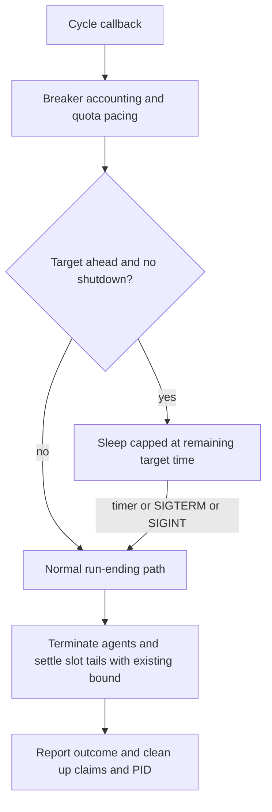

## Summary

Bound and cancel the main loop's end-of-cycle sleep, preserve the checkpointed
linear follow-up reference scanner, and distinguish signal shutdown from
duration expiry in completion logs. The narrower defects are reproduced; the
original watchdog cause remains unidentified. Part of #5544.

## Spec

### Intent and Rationale

- Prevent a pacing or breaker sleep from delaying shutdown beyond the target,
  including when a signal arrives after the sleep starts.
- Keep reference detection responsive on long failed owner/repository runs
  without truncating model output or changing reference selection.

### Essential Design Decisions

- Callbacks, breaker accounting and quota pacing still precede sleep admission.
  Only that end-of-cycle sleep is capped at the target and cancelled on signals;
  other cycle operations and per-issue slot backoffs keep their existing bounds.
- Pass the shutdown signal through production dependencies to the existing
  `systemClock.sleep` helper. Normal run-ending termination, slot settlement,
  telemetry and claim/PID cleanup remain on the same path.
- Preserve reference order, case-insensitive same-repository preference, other
  full-reference fallback, bare-reference fallback and nested slash handling.
- Keep watchdog budgets unchanged: the archived phase name does not identify
  which main-loop operation remained pending.

### Undiscoverable Facts

- The accessible GRQ-23 facts archive and matching launcher log identify
  container `vibe-coder-70601`, run `vibe-mwud88ss-874459`, build
  `1d5828280d7c`. The final snapshot shows the Deno driver alive with ample
  available memory and an orphaned `sleep 900`; it supplies no stack identifying
  a pending await.
- Later retries reporting `GUEST_MEMORY_FLOOR` are separate incidents. They do
  not establish the cause of the original watchdog kill.

## Evidence

Backend/CLI only. #5544: Hard kill: container wedged in follow-up-label-strip
(watchdog), checked with `gh issue view`; the final issue-body fetch used
`gh api` after the shared GraphQL quota was exhausted.

The archived 24 November 2026 timeline separates the main loop from slot tails:

| UTC                | Recorded activity                                                                           |
| ------------------ | ------------------------------------------------------------------------------------------- |
| 09:20:59           | Configured finish deadline                                                                  |
| 09:23:29           | Drain abandons both claims and records their release                                        |
| 09:24:47           | Main loop's post-scan auto-merge sweep completes                                            |
| 09:24:53           | Main loop records liveness; no later run-completion line appears                            |
| 09:26:53, 09:31:05 | Slot label strips each complete in 0s                                                       |
| 09:31:12           | Slot 1 stops because the pool is draining                                                   |
| 09:39:57           | Slot 2 finishes release bookkeeping, refuses a health-check spawn and starts a 300s backoff |
| 10:31:11           | Launcher captures evidence and reaps the container                                          |

After liveness, `worker/deno/lib/run_core.ts` awaits the cycle callback, breaker
operations, quota pacing on a successful cycle, and sleep. The production
callback in `worker/deno/lib/run_core_production_deps.ts` refreshes subscription
allocation before an optional hook script. Run-ending logic then terminates
active agents, bounds slot-tail settlement and runs accounting/cleanup;
`worker/deno/lib/run_worker.ts` performs driver cleanup. The archive does not
identify which await prevented those completion records. A slot's late backoff
is not proof that the main loop awaited it, nor does the orphan prove a pipe
held the driver open.

## Reproduction

- **symptom** — `The launcher's watchdog deadline expired.` after 51m 14s of
  silence, attributed to `follow-up-label-strip`.
- **status** — `partial` — reason: completed strips and claim-release records
  are visible, but the original pending main-loop operation is unidentified.
  Controlled dependencies reproduce sleep admission, overshoot and cancellation
  defects; a hostile string reproduces scanner cost, not the container wedge.
- **regression test** —
  `worker/deno/tests/run_core_after_target_test.ts::run_core - SIGTERM wakes an admitted cycle sleep (Issue #5544)`.
  Target/deadline, SIGINT and running controls cover the adjoining cases.
- **scanner regression** —
  `worker/deno/tests/escape_hatch_reference_scan_5544_test.ts::detectEscapeHatch - long name run with bare fallback (Issue #5544)`.
  The actual base detector exceeded a five-second manual reproduction bound on
  the million-character input; the head detector completed the same command.
  This is reproduction evidence on a shared host, not a unit-test timing gate.

## Acceptance Criteria

- **missing** — a container wedged and the launcher watchdog reaped it, so the
  run never released its claim — reason: the archive records claim release and
  completed strips, but lacks evidence identifying the original main-loop stall.
  The reproduced defects do not establish that watchdog cause.

## Test Plan

- `worker/deno/tests/run_core_after_target_test.ts`: target reached, finish
  exceeded, shutdown already requested and running controls, with/without
  progress; one-millisecond remaining runway; SIGTERM/SIGINT during an admitted
  sleep. Assertions cover callbacks, breaker accounting, completion text,
  termination and claim/PID cleanup. Existing base assertions are retained.
- `worker/deno/tests/run_core_production_deps_test.ts`: cancellation reaches the
  real sleep adapter; existing requested-duration/default-duration controls
  pass.
- Against `origin/main` production files, the loop/adapter command produced 50
  passes and 11 expected failures before correction. The fixed files pass all 61
  cases. Four additional completion-message assertions failed before the wording
  correction and passed afterwards.
- `worker/deno/tests/escape_hatch_reference_scan_5544_test.ts`: hostile input
  outcomes, reference boundaries/order and deterministic character-read bounds
  for six families at N and 4N; wrapped wording preserves the existing
  heuristic.
- `worker/deno/tests/escape_hatch_label_strip_test.ts`: long text reaches the
  real strip while retaining self-reference, repository and configured
  label-applier guards. The fake now reflects successful label removal in its
  state; no base assertions were removed. Existing escape-hatch, verification,
  label-strip, loop, production-dependency, worker and clock suites also ran.
- Final affected `deno task test:unit` command: 651 passed, zero failed (649
  parallel, two serial). Formatting, lint and targeted type checks passed.
  `deno task check:manifests` passed: 876 passed, one ignored by its existing
  configuration; no new ignore was added.
- Base/head compatibility corpus: 1,625 files and 3,250 comparisons per tree,
  two repository slugs; zero mismatches and zero added positives/negatives
  relative to the old detector. Corpus: PR summaries, prompt Markdown and
  escape-hatch/reserved-label test sources. This checks compatibility, not
  independent accuracy of the prose heuristic.
- No twinned full-reference scanner or separate end-of-cycle sleep
  implementation was found. No new regex, persisted shape, destructive
  operation, failure ledger or privileged external operation was introduced.

- `timeout 1080 ./quality.sh < /dev/null` passed on final code commit
  `9e49966b6`, including both unit-test passes, lint, type/format, completeness,
  Mermaid, Markdown lint, Semgrep and Gitleaks. Configuration integration was
  skipped (`deno or .config.json not available`); Checkov was skipped because no
  pinned binary or container image was available. Subsequent edits only finalise
  operator documentation and this summary.

- Final Markdown/Mermaid checks and `deno task pr-summary-check` passed: zero
  blocked gates and zero not checked. Acceptance-criteria closure and two-axis
  review were not applicable because the issue has no criteria list.

## Merge verification

- Required CI and independent code review are not yet verified.

## Deno regression avoided

The corpus and manual reproduction use `deno run --no-config --no-lock`;
validation adds no Node tooling or dependency.

## Remaining risk

The original watchdog's stuck await and live-container shutdown remain
unreproduced. Private evidence was not committed. Push was not assigned.
