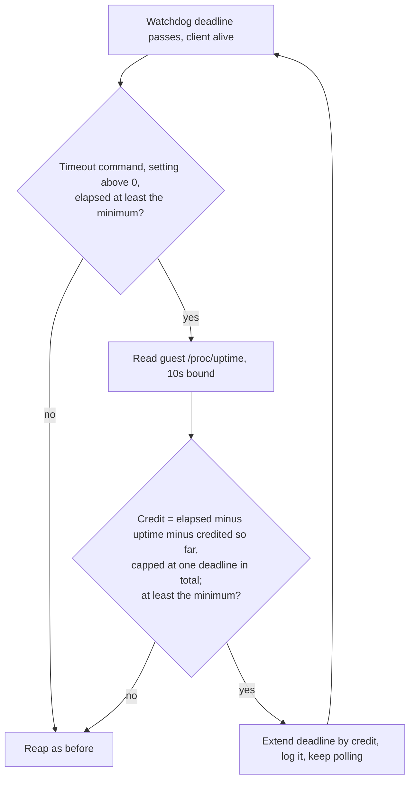

## Summary

The #5544 hard kill was not a worker wedge. The host suspended the container's
VM for most of the run, and `run.sh`'s watchdog counted that suspended time
against its deadline, because bash `$SECONDS` is host wall-clock time. Now, when
the deadline passes with the client still running, `run.sh` reads the guest's
`/proc/uptime`. If the uptime is at least `VIBE_WATCHDOG_SUSPEND_MIN_SECONDS`
(default 120) below the elapsed time, the watchdog extends its deadline by the
suspended time and keeps waiting. The total extension is at most one more
watchdog deadline, so a guest that stays suspended is still reaped.
Closes #5544.

## Spec

### Intent and Rationale

- The incident's archived facts on GRQ-23
  (`hard-kill-vibe-coder-70601-1795516271.facts.json`) show the guest's PID 1
  had `ELAPSED 36:00` at capture, and the worker (PID 161) `35:59` at 0.9% CPU.
  The launcher had waited its full 11400s deadline, so the VM ran for about 36
  of roughly 190 minutes. The guest still answered exec and had about 15 GB
  free.
- That explains what earlier PRs (#5623, #5627, #5628) could not find. Slot s2's
  300s back-off, logged at 09:39:57 guest time, never finished because the
  guest's timers stood still while the host clock ran on. No pending await in
  the main loop was holding the worker.
- The fix is at the decision that was wrong: the launcher reaped a container for
  time the container never had. The worker's own deadlines are unchanged.

### Essential Design Decisions

- The probe runs only once the deadline has passed, through `bounded 10`. It is
  skipped when the host has no timeout command (a hung exec would be the wedge
  itself), when the setting is `0`, or when less than the minimum has elapsed.
  Any exec failure or unparsable output gives no credit, so the container is
  reaped as before.
- On Docker or Podman, `/proc/uptime` is the shared host kernel's uptime. That
  is never below the elapsed time, so behaviour there is unchanged.
- The credit is capped at one extra deadline, so the launcher still always
  returns. `VIBE_HARD_KILL_AT_EPOCH` is not moved. After an extension, the real
  kill is later than the epoch the worker reads, never earlier.
- The guest boots slightly after the watchdog starts. The 120s minimum absorbs
  that gap, so a normal run is never credited.

### Undiscoverable Facts

- The facts file and launch log exist only on GRQ-23. This run was on another
  host. It read them from command output that earlier GRQ-23 runs of this issue
  had quoted in their session transcripts in the shared `GRQ-VibeCoder-logs`
  mirror (`runs/GRQ-23/2026-11-26/`).
- A GRQ-23 run at about 18:58 UTC on 26 November reached the same diagnosis
  and a similar fix. Its branch failed the pre-push unit-test gate and was never
  pushed, so this PR re-implements it.
- What suspended the VM is not known; host sleep on the macOS host is the
  likely cause. It could not be checked from inside a container.

## Evidence

This change is to the launcher and its tests only; no UI is touched.

Docs: `docs/DEPLOYMENT.md` adds a row for the new setting and updates the
`VIBE_HARD_KILL_AT_EPOCH` row. `docs/TROUBLESHOOTING.md` describes the credit
and records the cause in the #5544 section. The outer-watchdog item in
`docs/workflows/resilience-and-concurrency.md` gains one sentence.

## Reproduction

- **symptom** — the launcher reaped container `vibe-coder-70601` at its 11400s
  deadline (`[run.sh] watchdog: vibe-coder-70601 is still running after 11400s
  - reaping it (Issue #4173)`), although the guest still answered and had been
  up only 36 minutes.
- **status** — `partial` — reason: the regression tests were observed failing
  against the base `run.sh` and passing after the fix, but the suspension is
  simulated by the stub runtime reporting a low guest uptime. No real VM was
  suspended.
- **regression test** —
  `worker/deno/tests/run_sh_launcher_test.ts::run.sh - a guest the host suspended gets its lost time back before the deadline (Issue #5544)`

## Test Plan

- `worker/deno/tests/fixtures/launcher_harness.ts`: the stub's `exec` prints
  `STUB_GUEST_UPTIME` when asked for `/proc/uptime`. Otherwise it is unchanged.
- New tests in `worker/deno/tests/run_sh_launcher_test.ts`:
  - `run.sh - a guest the host suspended gets its lost time back before the deadline (Issue #5544)`:
    exit 0, the extension is logged, nothing is killed, and no hard-kill record
    is written. On the base `run.sh` it failed (exit 87).
  - `run.sh - a guest suspended for ever is still reaped after one extra deadline (Issue #5544)`:
    reaped with reason `the launcher's 8s watchdog deadline expired`. On base it
    failed (`4s`).
  - Controls, green on both trees:
    `run.sh - a guest whose uptime covers the elapsed time is reaped at the deadline (Issue #5544)`
    and
    `run.sh - a deadline shorter than the suspension minimum reaps without probing the guest (Issue #5544)`.
    Both are reaped at 6s with no extension. The second runs on the default
    120s minimum. Its title says "without probing", but it asserts the outcome
    only, because the stub's exec log cannot tell this probe from the reaper's
    own exec calls.
- No existing test was edited. Results:
  - the whole `run_sh_launcher_test.ts` passed: 128 passed, 0 failed;
  - `deno task test:unit` on the launcher-parity, container-watchdog,
    loop-parity and launcher-source tests passed: 87 passed;
  - the four docs-drift tests passed: 70 passed;
  - `bash -n` and `shellcheck` on `run.sh` were clean.
- `timeout 1300 ./quality.sh < /dev/null` on the final code returned
  `Result: PASSED (with skipped checks)`. Config integration and Checkov were
  skipped by the gate itself.

## Remaining risk

- `run.ps1` gives no credit. The parent shell's exit-87 message still prints the
  original deadline after an extension.
- The `resilience-and-concurrency.md` flowchart shows the deadline leading
  straight to the kill and does not show the extension step.
- What suspended the VM was not identified. A slow image pull longer than 120s
  before the guest boots would also be credited, but the one-deadline cap
  bounds that.
- No spec or standards reviewers ran, because the issue has no acceptance
  criteria. Not pushed: this pass did not assign the push.
