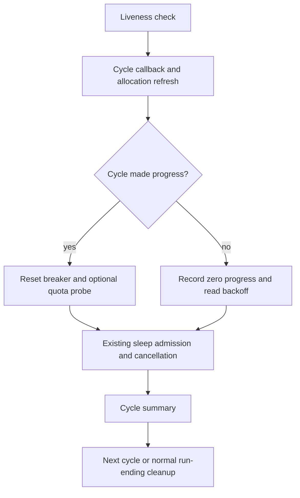

## Summary

Add named progress records for the main loop's end-of-cycle waits and the
production callback's allocation refresh. This fixes the diagnostic gap after
the last liveness record; the historical stalled await remains unidentified.
Part of #5544.

## Spec

### Intent and Rationale

- The incident archive records completed label strips and released claims,
  followed by silence from the main loop. Its last phase cannot identify the
  operation that stalled.
- Reuse the existing phase-progress ticker so a pending cycle-end operation
  leaves start, periodic progress and settlement records in the worker log.

### Essential Design Decisions

- Preserve #5623's capped, interruptible sleep and reference-scanner changes.
  This diff adds diagnostics without changing timeout, cancellation, breaker,
  quota-pacing or claim-release policy.
- `withPhaseProgress` owns ticker cleanup and retains the wrapped result or
  rejection. A completed dispatch can contain a handled fault; existing callback
  and telemetry error records remain authoritative.
- Scope the main-loop records to final callback dispatch, breaker reset or
  zero-progress accounting/interval, the optional successful-cycle quota read,
  admitted sleep and cycle summary. The production cycle callback also records
  its allocation refresh, including callbacks on early cycle exits.

### Undiscoverable Facts

- Read-only evidence was available on this run: GRQ-23's facts archive for
  `vibe-coder-70601`, its rotated worker log and matching launcher log. The
  build stamp is `1d5828280d7c`; that commit's callback and subprocess paths
  were also inspected.
- The matching `GRQ-VibeCoder-logs` metadata records no archived worker log;
  its failure entry contains an agent session. It supplies no driver stack.
- The worker automatically checkpointed the implementation during validation.
  No manual push was assigned or performed.

## Evidence

Backend/CLI diagnostics only. #5544: Hard kill: container wedged in
follow-up-label-strip (watchdog), checked with `gh issue view`. PR #5623 was
verified merged and its implementation remains on this branch unchanged.
Private logs and transcripts are not committed.

The incident's main-loop and slot activity are distinct:

| UTC, 24 November 2026 | Observation |
| --- | --- |
| 09:23:29 | Drain records both claims abandoned/released |
| 09:24:53 | Last main-loop liveness record |
| 09:26:53 and 09:31:05 | Each slot's follow-up label strip completes in 0s |
| 09:39:57 | Slot 2 records a 300s backoff |
| 10:31:11 | Launcher captures facts and reaps the container |

Inspection traced the remaining waits through `worker/deno/lib/run_core.ts`
and `worker/deno/lib/run_core_production_deps.ts`:

- `refreshSubscriptionAllocation` in
  `worker/deno/lib/subscription_allocation_runtime.ts` precedes the optional
  hook. Its evaluation reads evidence/state files and uses the existing file
  lock, whose default acquisition timeout is 10s; that timeout does not bound
  the entire evaluation.
- `invokeCycleCallback` in `worker/deno/lib/run_callbacks.ts` logs hook entry
  and uses `runWithTimeout`/`waitForChildExit` in
  `worker/deno/lib/subprocess_timeout.ts`. Those existing subprocess bounds
  remain intact.
- `worker/deno/lib/circuit_breaker.ts` uses the in-process state mutex for
  mutations and filesystem reads/writes. Successful-cycle quota pacing reads
  through `probeGraphqlQuota` and the existing `gh_spawn.ts` runner.
- None of those inspections establishes the incident's pending await. The new
  records identify entered waits; they do not reconstruct the old stack or
  distinguish an await from event-loop starvation inside that operation.

The waits after liveness now use the existing phase-progress mechanism.
Operator guidance and the step vocabulary are in `docs/TROUBLESHOOTING.md`.
The run-loop and callback manual sections were checked for conflicting claims;
no old timeout or shutdown statement required replacement. Both changed
production callers use `withPhaseProgress`, which calls `startPhaseProgress`.

## Reproduction

- **symptom** — `The launcher's watchdog deadline expired.` with the last
  recorded phase `follow-up-label-strip`, without a main-loop completion record.
- **status** — `partial` — reason: controlled pending dependencies reproduce
  missing diagnostic records, which fail on unfixed main and pass here. The
  original live-container wedge and its triggering dependency are unreproduced.
- **regression test** —
  `worker/deno/tests/run_core_after_target_test.ts::run_core - pending callback is identifiable after liveness, shutdown=false (Issue #5544)`.
  The adjoining cases cover breaker reset, zero-progress accounting/interval,
  quota probing, summary writing and admitted sleep.

## Acceptance Criteria

- **missing** — a container wedged and the launcher watchdog reaped it, so the
  run never released its claim — reason: the archive contains claim-release and
  strip-completion records but no stack or operation record identifying the
  historical main-loop stall. The diagnostic gap is fixed; a cause-specific
  wedge fix remains unverified.

## Test Plan

- `worker/deno/tests/run_core_after_target_test.ts`: adds 14 diagnostic cases.
  Deferred dependencies establish that each named wait is pending before its
  completion record; normal and SIGTERM controls assert returned shutdown
  outcomes and cleared simulated agent, claim and PID-lock state. Callback
  failure retains its specific error; SIGINT wakes an admitted sleep. The
  existing 20 tests and their assertions remain intact.
- `worker/deno/tests/subscription_allocation_3646_test.ts`: adds a production
  cycle-callback test using real allocation evaluation and temporary files.
  It checks progress on a successful hold and on missing evidence, retains the
  held-state warning and proves the prior state file survives. Existing
  assertions are unchanged.
- `worker/deno/tests/phase_progress_test.ts`: adds return-value and rejection
  controls, asserting pending/settled log output with an injected clock reading.
  Deno's resource/operation sanitisation remains enabled. Existing assertions
  are unchanged.
- Before implementation, the core suite passed its 20 existing tests and failed
  all 14 new diagnostic cases. The adapter suite passed 11 existing tests and
  failed its new case. With the final test fixtures copied into an isolated
  archive of unfixed main `f9fba9b34345`, the same command again passed 31 and
  failed 15 on the missing records. On this head it passed all 46. No current
  production files were reverted for that check.
- Focused `deno task test:unit` run: 214 parallel and two serial tests passed
  (216 total). Besides the three changed files, it included
  `worker/deno/tests/run_core_production_deps_test.ts`,
  `worker/deno/tests/escape_hatch_reference_scan_5544_test.ts`,
  `worker/deno/tests/escape_hatch_label_strip_test.ts`,
  `worker/deno/tests/claude_runner_model_unavailable_fallback_test.ts`,
  `worker/deno/tests/run_core_signal_cleanup_test.ts`,
  `worker/deno/tests/run_core_callbacks_test.ts`,
  `worker/deno/tests/circuit_breaker_test.ts` and
  `worker/deno/tests/budget_pacing_test.ts`.
- Targeted formatting, lint and type checks passed. The foreground command
  `timeout 900 ./quality.sh < /dev/null` returned
  `Result: PASSED (with skipped checks)`. Its unit-test stage passed in 678.2s;
  completeness, Markdown, Mermaid, Semgrep, gitleaks, lint, type checking and
  formatting passed. Configuration integration was skipped with
  `deno or .config.json not available`; Checkov was skipped because the pinned
  binary/image was unavailable. No failed check remains.
- `deno task pr-summary-check` with the actual issue body and labels passed:
  zero blocked gates and zero not checked. The criteria/reviewer gates reported
  not applicable because the issue states no acceptance-criteria heading.
- No new regex, persisted shape, destructive operation, failure
  ledger or privileged operation was introduced. The diagnostic labels contain
  worker-written names; no incident log text is added to the new records.

## Merge verification

Required CI and fleet approval have not been observed for this branch.

## Remaining risk

The original stuck await and live-container wedge remain unverified. The new
records add observability and retain existing bounds; they do not abandon a
pending dependency. Configuration integration and Checkov were not run; private
incident evidence was not committed. No manual push was performed.
