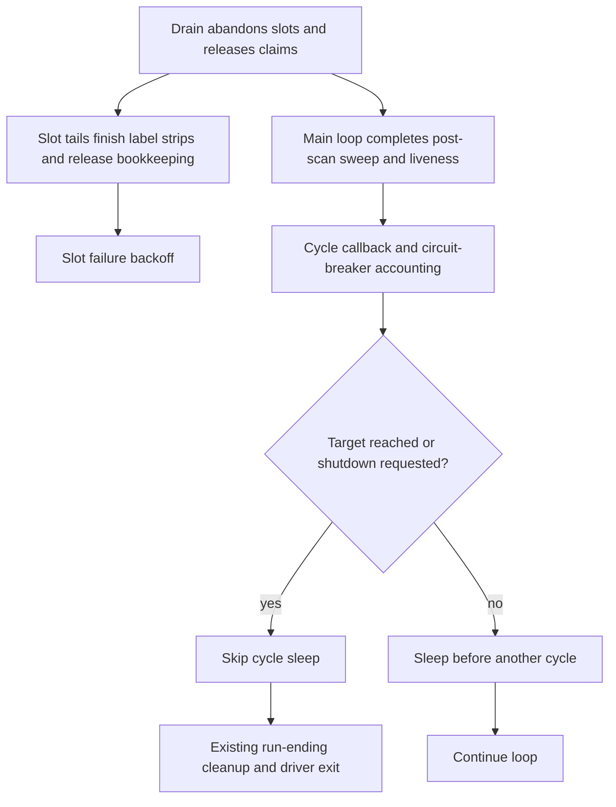

## Summary

Skip the main loop's end-of-cycle sleep when its target has passed or shutdown
was requested, retaining callbacks and circuit-breaker accounting. Preserve the
checkpointed linear follow-up reference scanner. Both narrower defects have
regression coverage; the original watchdog cause remains unverified. Part of
#5544.

## Spec

### Intent and Rationale

- Remove a reproduced delay before shutdown without changing watchdog budgets
  or attributing the incident to a phase that had completed.
- Retain the independently reproduced scanner improvement and its matching
  semantics instead of truncating model output.

### Essential Design Decisions

- Recheck the clock and shutdown flag immediately before starting the cycle
  sleep. This does not interrupt a sleep already in progress or bound other I/O.
- Keep cycle callbacks, circuit-breaker updates, fleet telemetry and the
  existing run-ending cleanup path. Claim release and label guards are unchanged.
- Preserve reference order, case-insensitive same-repository preference, other
  full-reference fallback, bare-reference fallback and nested slash handling.
- Count scanner work through its production character reader; use injected
  clocks for shutdown tests, with no timing assertions or real waits.

### Undiscoverable Facts

- Read the GRQ-23 facts archive for container `vibe-coder-70601`, run
  `vibe-mwud88ss-874459`, and its corresponding launcher log. Its running build
  was `1d5828280d7c`; the final process snapshot contains the Deno driver under
  the bash entrypoint and an orphaned `sleep 900` parented to PID 1.
- Later retries' issue comments record `GUEST_MEMORY_FLOOR` with 460 MiB
  available against an 806 MiB floor. Those are separate runs, not evidence
  about the original watchdog cause.

## Evidence

Backend only; no visual surface changed. #5544: Hard kill: container wedged in
follow-up-label-strip (watchdog), confirmed through `gh api` after GraphQL quota
exhaustion prevented `gh issue view`.

The archived timeline on 24 November 2026 distinguishes the main loop from
abandoned slot tails:

| UTC | Recorded activity |
| --- | --- |
| 09:20:59 | Configured finish deadline |
| 09:23:29 | Drain abandons both claims and records their release |
| 09:24:47 | Main loop's post-scan auto-merge sweep completes |
| 09:24:53 | Main loop records liveness; no later fleet/run-completion line appears |
| 09:26:53, 09:31:05 | Slot label strips each complete in 0s |
| 09:31:12 | Slot 1 stops because the pool is draining |
| 09:39:57 | Slot 2 finishes release bookkeeping, refuses a health-check spawn and starts a 300s failure backoff |
| 10:31:11 | Launcher captures evidence and reaps the still-running container |

`worker/deno/lib/run_core.ts` places cycle callbacks, circuit-breaker accounting
and sleep after liveness. The archive has no stack or per-await markers to
identify which of these remained pending. The late slot backoff does not prove
the main loop awaited it: the drain had already abandoned the slots. Shutdown
would next terminate active agents, settle remaining slot tails with the finish
bound, report totals and run cleanup in `worker/deno/lib/run_worker.ts`.
`worker/deno/mod.ts` explicitly exits after command completion;
`container/entrypoint.sh` waits for that driver. No completion or cleanup is
recorded, and the snapshot still shows the driver alive. This is insufficient
to attribute the wedge to an orphan holding the launcher's output pipe.

## Reproduction

- **symptom** — `The launcher's watchdog deadline expired.` after 51m 14s of
  silence, attributed to `follow-up-label-strip`.
- **status** — `partial` — reason: the archive confirms completed strips and
  released claims, but does not identify the pending main-loop await. Tests
  reproduce the narrower final-cycle sleep defect and independent scanner
  cost defect, not the original container wedge.
- **regression test** —
  `worker/deno/tests/run_core_after_target_test.ts::run_core - final cycle does not delay shutdown for deadline, progress=false (Issue #5544)`.
  A disposable `origin/main` worktree with the new tests failed all six
  target/deadline/shutdown cases; both running controls and eight existing
  cases passed. The fixed branch passes all sixteen cases.
- **scanner regression** —
  `worker/deno/tests/escape_hatch_reference_scan_5544_test.ts::detectEscapeHatch - long name run with bare fallback (Issue #5544)`.
  The checkpoint records the unfixed detector exceeding a five-second command
  bound with 100,000 and 1,000,000 name characters, while 10,000 completed.
  The fixed million-character case passes. These shared-host bounds describe
  reproduction, not a benchmark claim or a unit-test timing assertion.

## Acceptance Criteria

- **missing** — a container wedged and the launcher watchdog reaped it, so the
  run never released its claim — reason: claims were actually released; the
  main-loop await responsible for the original silence cannot be identified
  from the preserved evidence. The shutdown delay and scanner cost fixes do
  not establish that cause.

## Test Plan

- Added eight cases in `worker/deno/tests/run_core_after_target_test.ts`: exact
  target, beyond finish, SIGTERM and a running control, each with and without
  progress. They assert sleep admission, callback outcome, breaker updates and
  eventual run completion. Existing assertions and fixtures are retained.
- Final affected loop/worker suites: 239 passed, including
  `worker/deno/tests/run_core_test.ts`,
  `worker/deno/tests/run_core_slot_pool_test.ts`,
  `worker/deno/tests/run_core_callbacks_test.ts`,
  `worker/deno/tests/run_core_run_timeline_test.ts`,
  `worker/deno/tests/run_core_post_scan_auto_merge_test.ts` and
  `worker/deno/tests/run_worker_test.ts`. No existing fixture changes were needed.
- Scanner/label suites: 87 passed across
  `worker/deno/tests/escape_hatch_test.ts`,
  `worker/deno/tests/escape_hatch_reference_scan_5544_test.ts`,
  `worker/deno/tests/escape_hatch_label_strip_test.ts` and
  `worker/deno/tests/reserved_label_strip_test.ts`. These retain self-reference,
  repository and configured label-applier safeguards, and check linear reads
  for six hostile input families at N and 4N. No existing assertions removed.
- Compatibility corpus rerun against actual base and head detectors: summaries,
  prompt Markdown and relevant test sources, 1,623 files / 3,246 comparisons per
  tree, two repository slugs. Zero mismatches or added positives/negatives.
  This establishes compatibility, not independent accuracy of the existing
  prose heuristic. Wrapped-wording and boundary cases pin existing behaviour.
- Formatting, lint and targeted type checking passed. An initial scanner-suite
  command named a nonexistent test file and failed before execution; the
  corrected command produced the 87 passing results above.
- No twinned full-reference scanner or separate end-of-cycle sleep implementation
  was found. The serial/pooled per-issue backoffs remain unchanged. No new regex,
  persisted shape, destructive operation or failure ledger was introduced.
- Full quality gate has not yet run on the added shutdown change.

## Remaining risk

The original watchdog cause remains unverified; no watchdog behaviour was
changed. Archive stacks, an actual stuck-await reproduction and live container
shutdown verification are missing. Private evidence was not committed. No push
or issue/PR lifecycle change was performed.
