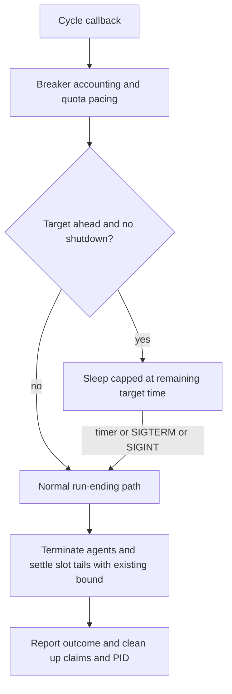

## Summary

Bound and cancel the main loop's end-of-cycle sleep, preserve the checkpointed
linear follow-up reference scanner, and distinguish signal shutdown from
duration expiry in completion logs. The narrower defects are reproduced; the
original watchdog cause remains unidentified. Part of #5544.

## Spec

### Intent and Rationale

- Prevent a pacing or breaker sleep from delaying shutdown beyond the target,
  including when a signal arrives after the sleep starts.
- Keep reference detection responsive on long failed owner/repository runs
  without truncating model output or changing reference selection.

### Essential Design Decisions

- Callbacks, breaker accounting and quota pacing still precede sleep admission.
  Only that end-of-cycle sleep is capped at the target and cancelled on signals;
  other cycle operations and per-issue slot backoffs keep their existing bounds.
- Pass the shutdown signal through production dependencies to the existing
  `systemClock.sleep` helper. Normal run-ending termination, slot settlement,
  telemetry and claim/PID cleanup remain on the same path.
- Preserve reference order, case-insensitive same-repository preference, other
  full-reference fallback, bare-reference fallback and nested slash handling.
- Keep watchdog budgets unchanged: the archived phase name does not identify
  which main-loop operation remained pending.

### Undiscoverable Facts

- The accessible GRQ-23 facts archive and matching launcher log identify
  container `vibe-coder-70601`, run `vibe-mwud88ss-874459`, build
  `1d5828280d7c`. The final snapshot shows the Deno driver alive with ample
  available memory and an orphaned `sleep 900`; it supplies no stack identifying
  a pending await.
- Later retries reporting `GUEST_MEMORY_FLOOR` are separate incidents. They do
  not establish the cause of the original watchdog kill.

## Evidence

Backend/CLI only. #5544: Hard kill: container wedged in follow-up-label-strip
(watchdog), checked with `gh issue view`; the final issue-body fetch used
`gh api` after the shared GraphQL quota was exhausted. The retry independently
read the issue through the connected GitHub service.

Operator sections checked: Troubleshooting, hard kills; GH API Optimisation,
budget pacing; Internals, idle-task filing. The branch updates those manuals,
Configuration, the issue-processing and resilience workflows, and Design
Principles to describe capped/cancellable end-of-cycle sleep and the scanner
without attributing the archived wedge to an unproved cause.

The archived 24 November 2026 timeline separates the main loop from slot tails:

| UTC                | Recorded activity                                                                           |
| ------------------ | ------------------------------------------------------------------------------------------- |
| 09:20:59           | Configured finish deadline                                                                  |
| 09:23:29           | Drain abandons both claims and records their release                                        |
| 09:24:47           | Main loop's post-scan auto-merge sweep completes                                            |
| 09:24:53           | Main loop records liveness; no later run-completion line appears                            |
| 09:26:53, 09:31:05 | Slot label strips each complete in 0s                                                       |
| 09:31:12           | Slot 1 stops because the pool is draining                                                   |
| 09:39:57           | Slot 2 finishes release bookkeeping, refuses a health-check spawn and starts a 300s backoff |
| 10:31:11           | Launcher captures evidence and reaps the container                                          |

After liveness, `worker/deno/lib/run_core.ts` awaits the cycle callback, breaker
operations, quota pacing on a successful cycle, and sleep. The production
callback in `worker/deno/lib/run_core_production_deps.ts` refreshes subscription
allocation before an optional hook script. Run-ending logic then terminates
active agents, bounds slot-tail settlement and runs accounting/cleanup;
`worker/deno/lib/run_worker.ts` performs driver cleanup. The archive does not
identify which await prevented those completion records. A slot's late backoff
is not proof that the main loop awaited it, nor does the orphan prove a pipe
held the driver open.

## Reproduction

- **symptom** — `The launcher's watchdog deadline expired.` after 51m 14s of
  silence, attributed to `follow-up-label-strip`.
- **status** — `partial` — reason: completed strips and claim-release records
  are visible, but the original pending main-loop operation is unidentified.
  Controlled dependencies reproduce sleep admission, overshoot and cancellation
  defects; a hostile string reproduces scanner cost, not the container wedge.
- **regression test** —
  `worker/deno/tests/run_core_after_target_test.ts::run_core - SIGTERM wakes an admitted cycle sleep (Issue #5544)`.
  Target/deadline, SIGINT and running controls cover the adjoining cases.
- **scanner regression** —
  `worker/deno/tests/escape_hatch_reference_scan_5544_test.ts::detectEscapeHatch - long name run with bare fallback (Issue #5544)`.
  The actual base detector exceeded a five-second manual reproduction bound on
  the million-character input; the head detector completed the same command.
  This is reproduction evidence on a shared host, not a unit-test timing gate.

## Acceptance Criteria

<!-- vibe-spec-review inputs="diff+issue-body" -->

- **missing** — a container wedged and the launcher watchdog reaped it, so the
  run never released its claim — reviewer: missing — reason: the executor and
  independent Spec reviewer checked the incident archive and matching launcher
  log. Both record claim release and completed strips, but neither identifies
  the original main-loop stall. The narrower reproduced defects do not establish
  that watchdog cause.

## Standards Review

<!-- vibe-standards-review inputs="diff+CODING-STANDARDS.md" -->

- **violation** — internal character-read counts and an instrumentation-only
  production parameter — evidence:
  `worker/deno/tests/escape_hatch_reference_scan_5544_test.ts` and
  `worker/deno/lib/escape_hatch.ts` — reason: fixed in this diff; tests assert
  reference outcomes and the parameter is removed.
- **violation** — breaker/sleep interactions and cleanup call order — evidence:
  `worker/deno/tests/run_core_after_target_test.ts` — reason: fixed in this diff;
  controlled-clock tests assert completion, returned results and released
  agent/claim/PID state.
- **violation** — timer-request assertions instead of sleep settlement — evidence:
  `worker/deno/tests/run_core_production_deps_test.ts` — reason: fixed in this
  diff; tests assert promise settlement for cancellation and deadlines.
- **clean** — independent Standards reviewer checked the full diff against
  `CODING-STANDARDS.md`: behavioural coverage, preservation of existing
  assertions, KISS/DRY, reuse of the clock helper, no new dependencies or
  test-only production seams, benchmark separation, Australian English and
  relevant operator documentation. No outstanding code/test violation found.

## Test Plan

- `worker/deno/tests/run_core_after_target_test.ts`: twelve #5544 cases cover
  target reached, finish exceeded, shutdown already requested and a running
  control, with/without progress; one-millisecond runway; SIGTERM/SIGINT during
  an admitted sleep. Stateful external-boundary fakes start with live agents,
  a claim and a held PID lock. Assertions establish completion at the controlled
  instant, the returned shutdown result, final released state and completion
  text. All eight pre-existing tests and their assertions remain unchanged.
- `worker/deno/tests/run_core_production_deps_test.ts`: the production adapter's
  sleep resolves immediately for an already-aborted signal and on cancellation
  after admission. An unaborted control stays pending until its deadline.
  Requested-duration and default-duration controls now assert settlement before
  and at the deadline, replacing timer-request assertions.
- `worker/deno/tests/escape_hatch_reference_scan_5544_test.ts`: hostile-input
  outcomes, reference boundaries/order and six input families at N and 4N
  remain covered. Only internal character-read assertions were removed;
  wrapped wording retains the existing heuristic. No test timing gate replaces
  those assertions. Historical performance reproduction is recorded separately
  under Reproduction above; no benchmark was run in this retry because the
  host runs parallel work. Timings belong behind the repository's benchmark
  command on a quiet machine, per Coding Standards, Benchmarks.
- `worker/deno/tests/escape_hatch_label_strip_test.ts`: long text reaches the
  real strip while retaining self-reference, repository and configured
  label-applier guards. The fake reflects successful label removal in its
  state; no base assertions were removed.
- Focused red checks in isolated copies with the base production files:
  the loop suite passes its eight pre-existing cases and fails all twelve
  #5544 cases on completion outcomes; the adapter suite passes 40 cases and
  fails both cancellation regressions. These fail without hanging and pass
  against the corrected head. No shared production files were reverted.
- `deno task test:unit` over the scanner, label-strip, loop, production adapter
  and real signal-cleanup suites, with stdin from `/dev/null`: 107 passed, zero
  failed (105 parallel, two serial). The Spec reviewer independently reran this
  command and confirmed the result. Formatting, lint and targeted type checks
  passed. `deno task check:manifests` also passed; its existing ignored case was
  retained, with no new ignore.
- Earlier base/head compatibility corpus: 1,625 files and 3,250 comparisons
  per tree, two repository slugs; zero mismatches and zero added
  positives/negatives relative to the old detector. Corpus: PR summaries, prompt
  Markdown and escape-hatch/reserved-label test sources. This checks
  compatibility, not independent accuracy of the prose heuristic.
- No twinned full-reference scanner or separate end-of-cycle sleep
  implementation was found. No new regex, persisted shape, destructive
  operation, failure ledger or privileged external operation was introduced.
- An earlier attempt's pre-push gate reported `deno task test:unit (2103
  files)` failing with exit code 1 on another host; that host's test output was
  not available here. On this branch head, a full `deno task test:unit
  < /dev/null` passed (36,871 parallel and 940 serial tests, 0 failed), and
  the four #5544 test files passed 105 of 105 on each of three repeated runs.
  The earlier failure was not reproduced, so its cause is unknown.
- `timeout 2400 ./quality.sh < /dev/null` on the branch head gave
  `Result: PASSED (with skipped checks)`. Configuration integration was skipped
  (`deno or .config.json not available`), and Checkov was skipped because
  neither the pinned binary nor its container image was available. The only
  later edit records these results in this summary.
- Final `deno task pr-summary-check` with the actual issue body and labels:
  zero blocked gates and zero not checked. Independent two-axis review and
  reproduction checks passed; the incident criterion above remains missing.

## Merge verification

- Required CI and fleet PR approval are not yet verified.

## Deno regression avoided

The earlier corpus and manual reproduction used `deno run --no-config
--no-lock`; this retry adds no Node tooling or dependency.

## Remaining risk

The original watchdog's stuck await and live-container shutdown remain
unreproduced. Private evidence was not committed. Push was not assigned.
