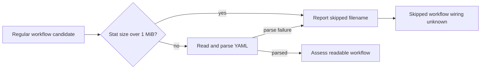

## Summary

Skip workflow files over 1 MiB before reading and parsing them, reporting the
filename and size-limit diagnostic through `onUnparseable`. AWS scans record
these workflows as unreadable, keeping unknown wiring from producing a
missing-wiring finding. Closes #5559.

## Spec

### Intent and Rationale

- Bound ordinary workflow inputs using the same 1 MiB scale as the AWS
  scanner's existing input limits, without changing YAML parsing.

### Essential Design Decisions

- `loadWorkflows` owns the private workflow limit. A stat size of exactly
  1,048,576 bytes remains eligible; larger files are skipped before reading.
- Reuse `onUnparseable` and `unreadableWorkflows` for oversized inputs, so the
  existing AWS consumer handles unknown wiring without another result shape.
- Preserve filename sorting, symlink-entry filtering and filesystem-error
  handling. The zero-load diagnostic now says none loaded rather than empty.

### Undiscoverable Facts

- The oversized regression fails against the base production loader, where
  `oversized.yml` appears in the loaded filenames. The exact-limit control
  passes in that run (48 passed, 1 failed).

## Evidence

- #5559: linter_in_ci_check: `loadWorkflows` reads each workflow file whole,
  with no size limit.
- Backend scanner change; deterministic temporary-file tests cover the loader,
  AWS scanner and best-practices consumer. No browser evidence applies.
- Read and updated the workflow-loading and AWS-emulator sections of
  `docs/BEST-PRACTICES-SCAN.md`, the corresponding explanation in
  `DESIGN-PRINCIPLES.md`, and loader/scanner/template comments.

## Test Plan

- `worker/deno/tests/linter_in_ci_check_test.ts`: added
  `loadWorkflows — loads valid YAML at exactly 1 MiB` and
  `loadWorkflows — skips valid YAML over 1 MiB with a size diagnostic`.
  Assert loaded content/invocations, omitted filename, callback cause and
  zero-load wording, including omission without a callback.
- `worker/deno/tests/aws_emulator_in_ci_check_test.ts`: added
  `checkAwsEmulatorInCI - oversized workflows are unreadable while readable wiring is assessed`.
  Covers mixed workflows, only oversized workflows and an exact-limit control;
  readable wiring evidence identifies the readable file.
- `worker/deno/tests/best_practices_template_test.ts`: added
  `runTask - oversized workflows suppress missing AWS wiring through the real detector`.
  The production detector suppresses filing and logs unknown wiring with an
  oversized file; reducing that file to the limit permits the missing-wiring
  finding. The scan continues in both cases.
- `deno task test:unit` on the three test files above: **447 passed, 0
  failed** at the head. With only `worker/deno/lib/linter_in_ci_check.ts`
  restored from `origin/main`, the loader test file ran 48 passed, 1 failed
  (the over-1 MiB test).
- The zero-loaded diagnostic still goes to `console.warn`; the test stubs and
  restores it rather than adding a test-only option to `loadWorkflows`.
- Every test file that reads the changed docs or modules (25 files): **1,866
  passed, 0 failed**.
- `timeout 1500 ./quality.sh < /dev/null` on the head: **passed with skipped
  checks**. Deno unit tests, lint, type checking, formatting, completeness,
  Mermaid, Markdown, Semgrep and gitleaks passed.
- Workflow-size corpus audit at base and head: 15 files on each, largest
  39,945 bytes; none exceeded the cap. No invocation matcher changed.
- `deno task pr-summary-check --base origin/main` with the fetched issue body
  and labels: passed, zero blocked and zero unchecked gates.
- No existing test assertions were removed or changed. No duplicate workflow
  loader or twinned workflow-size rule was found; existing callers retain the
  shared loader.

## Merge verification

CI and independent code review have not been observed in this run.

## Remaining limitations

The stat-before-read check does not bound a file that grows after the stat.
The full gate skipped configuration integration because local configuration
was unavailable, and Checkov because neither its pinned binary nor container
image was available. Its unit-test runner excludes integration suites.
No memory-exhaustion benchmark or concurrent-growth test was run.
