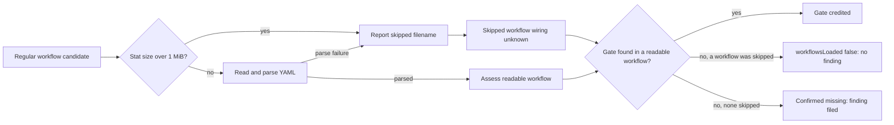

## Summary

Skip workflow files over 1 MiB before reading and parsing them, reporting the
filename and size-limit diagnostic through `onUnparseable`. AWS scans record
these workflows as unreadable, keeping unknown wiring from producing a
missing-wiring finding. `checkLinterInCI` and `checkLanguageValidityGates` now
also collect skipped workflows: a gate not found while any workflow was skipped
returns `workflowsLoaded: false` (unknown), so a gate living only in an
oversized file is never filed as missing. Closes #5559.

## Spec

### Intent and Rationale

- Bound ordinary workflow inputs using the same 1 MiB scale as the AWS scanner's
  existing input limits, without changing YAML parsing.

### Essential Design Decisions

- `loadWorkflows` owns the private workflow limit. A stat size of exactly
  1,048,576 bytes remains eligible; larger files are skipped before reading.
- Reuse `onUnparseable` and `unreadableWorkflows` for oversized inputs, so the
  existing AWS consumer handles unknown wiring without another result shape.
- Preserve filename sorting, symlink-entry filtering and filesystem-error
  handling. The zero-load diagnostic now says none loaded rather than empty.
- `checkLinterInCI` and `checkLanguageValidityGates` pass `onUnparseable` and,
  when a gate is not found and any workflow was skipped, return the existing
  `workflowsLoaded: false` fail-safe with the skipped filenames appended to
  `details` (shared `skippedWorkflowsDetail`). The best-practices,
  github-actions-audit and bash-syntax-audit templates already honour that flag,
  so no template changed. A gate found in a readable workflow is still credited.
  The same rule now covers unparseable workflows, which these two callers
  previously dropped silently.

### Undiscoverable Facts

- The oversized regression fails against the base production loader, where
  `oversized.yml` appears in the loaded filenames. The exact-limit control
  passes in that run (48 passed, 1 failed).

## Evidence

- #5559: linter_in_ci_check: `loadWorkflows` reads each workflow file whole,
  with no size limit.
- Backend scanner change; deterministic temporary-file tests cover the loader,
  linter and validity-gate detectors, AWS scanner and best-practices consumer.
  No browser evidence applies.
- Read and updated the workflow-loading, AWS-emulator and zero-workflows
  fail-safe sections of `docs/BEST-PRACTICES-SCAN.md`, the fail-safe bullet of
  `docs/BASH-SYNTAX-AUDIT-SCAN.md`, the linter-in-CI and AWS explanations in
  `DESIGN-PRINCIPLES.md`, and loader/detector/scanner/template comments.

## Test Plan

- `worker/deno/tests/linter_in_ci_check_test.ts`: added
  `loadWorkflows — loads valid YAML at exactly 1 MiB` and
  `loadWorkflows — skips valid YAML over 1 MiB with a size diagnostic`. Assert
  loaded content/invocations, omitted filename, callback cause and zero-load
  wording, including omission without a callback.
- `worker/deno/tests/aws_emulator_in_ci_check_test.ts`: added
  `checkAwsEmulatorInCI - oversized workflows are unreadable while readable wiring is assessed`.
  Covers mixed workflows, only oversized workflows and an exact-limit control;
  readable wiring evidence identifies the readable file.
- `worker/deno/tests/best_practices_template_test.ts`: added
  `runTask - oversized workflows suppress missing AWS wiring through the real detector`.
  The production detector suppresses filing and logs unknown wiring with an
  oversized file; reducing that file to the limit permits the missing-wiring
  finding. The scan continues in both cases.
- `worker/deno/tests/linter_in_ci_check_test.ts`: added
  `checkLinterInCI — a gate only in an oversized workflow is unknown, not missing (#5559)`
  (rust, with a control that the readable workflow alone is confirmed missing),
  `checkLinterInCI — actionlint only in an oversized workflow is unknown, not missing (#5559)`
  and
  `checkLinterInCI — a gate found in a readable workflow stays configured beside an oversized one`.
- `worker/deno/tests/language_validity_gate_test.ts`: added
  `rust — a gate only in an oversized workflow is unknown, not missing (#5559)`,
  with an exact-limit control that credits the gate.
- `worker/deno/tests/best_practices_template_test.ts`: added
  `runTask - a linter gate only in an oversized workflow files no BP-LINTER through the real detector (#5559)`.
  No BP-LINTER issue is filed with the oversized file present; removing it files
  `BP-LINTER-rust`.
- Red check for the four caller tests above: with
  `worker/deno/lib/linter_in_ci_check.ts` and
  `worker/deno/lib/language_validity_gate.ts` restored to the previous head
  (`58efda4fc`), all four failed (163 passed, 4 failed); at the head they pass.
- `deno test -A` on the 30 test files that import the changed modules or read
  the changed docs: **1,044 passed, 0 failed** at the head.
- With only `worker/deno/lib/linter_in_ci_check.ts` restored from `origin/main`,
  the loader test file ran 48 passed, 1 failed (the over-1 MiB test).
- The zero-loaded diagnostic still goes to `console.warn`; the test stubs and
  restores it rather than adding a test-only option to `loadWorkflows`.
- `deno lint` and `deno check` on the changed modules and tests passed;
  `markdownlint-cli2` on the changed docs reported 0 issues.
- An earlier `timeout 1500 ./quality.sh < /dev/null` run, before the caller fix,
  passed with skipped checks; the worker re-runs the full gate on this head.
- Workflow-size corpus audit at base and head: 15 files on each, largest 39,945
  bytes; none exceeded the cap. No invocation matcher changed.
- `deno task pr-summary-check --base origin/main` with the fetched issue body
  and labels: passed, zero blocked and zero unchecked gates.
- No existing test assertions were removed or changed. No duplicate workflow
  loader or twinned workflow-size rule was found; existing callers retain the
  shared loader.

## Merge verification

CI and independent code review have not been observed in this run.

## Remaining limitations

The stat-before-read check does not bound a file that grows after the stat. The
full gate skipped configuration integration because local configuration was
unavailable, and Checkov because neither its pinned binary nor container image
was available. Its unit-test runner excludes integration suites. No
memory-exhaustion benchmark or concurrent-growth test was run.
