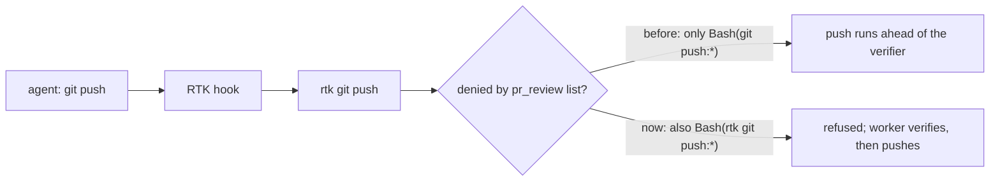

# PR Summary — Issue #5571

## Summary

A `pr_review` feedback run now denies `git push`, `gh pr merge` and `gh api`
both as the agent types them and in the `rtk`-prefixed form RTK's hook rewrites
them to (`rtk git push`). The feedback prompt no longer tells a review pass to
push: on that pass the agent commits each fix and cites it, and the worker
verifies, pushes and checks that the push landed. Closes #5571.

## Spec

### Intent and Rationale

- The issue inferred, without running it, that the hook's rewrite was why the
  denial did not match. Run here first: with rtk 1.0.1, `rtk hook claude` turns
  `git push origin foo` into `rtk git push origin foo`. It does the same for
  `gh pr merge 5` and `gh api repos/x/y`, and prefixes every part of
  `git add -A && git commit -m x && git push`. A `Bash(git push:*)` rule does
  not match a command that starts `rtk`
- The fix adds the rewritten form of each prefix to the same list
  (`PR_REVIEW_DISALLOWED_BASH_TOOLS`), so every provider that takes the list,
  and the Gemini policy file built from it, carries both forms. No new gate or
  check
- The prompt is shared by every feedback comment type and has no comment-type
  variable, so the reworded passages key on the system prompt line a review pass
  already gets ("Do not push or dismiss the review…"). The push, fetch and
  `merge-base --is-ancestor` check is kept for every other pass

### Essential Design Decisions

- The `rtk` forms are denied whether or not the hook is wired. They are harmless
  when it is not, and they also stop an agent that types `rtk git push` itself
- `PR_REVIEW_DISALLOWED_BASH_TOOLS` is derived from one list of three commands
  (plain forms first, then the `rtk` forms) and `RTK_REWRITE_PREFIX` in
  `worker/deno/lib/rtk_output.ts`, so the two forms cannot drift apart
- Scope is the `pr_review` run only, as the issue asks. Other `git push` denials
  (the pre-PR verifier, the idle scans) are unchanged

### Undiscoverable Facts

- The issue's incident (a private fleet PR, 2026-11-24) was not observed from
  this run. The rewrite behaviour above was observed on this host with
  `rtk 1.0.1`

## Evidence

Backend and prompt change; verified by tests.

- `worker/deno/lib/pr_feedback_processor.ts`: `PR_REVIEW_DISALLOWED_BASH_TOOLS`
  is now six entries, derived from `PR_REVIEW_DENIED_COMMANDS` and
  `RTK_REWRITE_PREFIX`
- `prompts/pr_feedback/prompt.md`: three passages reworded so that a pass told
  not to push commits and cites its fixes instead:
  - the "Confirm the fix is on the remote" paragraph;
  - the `pre-push` hook sentence;
  - "apply it and push" in "No change is not an answer"
- `docs/INTERNALS.md` (the `pr_review` verifier paragraph) and
  `docs/PROVIDER-PARITY.md` (the Gemini tool-denials row) describe the `rtk`
  forms
- The push-landed check the reworded prompt names is `verifyPushLanded`
  (`worker/deno/lib/pr_feedback_processor.ts`, the Issue #579 block)
- Related rules checked include the system and recovery prompts in
  `pr_feedback_processor.ts`, the feedback prompt, and
  `REVIEWER_NO_CHANGE_RETRY_NOTE`. The retry note and the operator guide in
  `docs/workflows/pr-feedback.md` now describe the same worker-owned push.
- The deadline added by `finishDeadlinePromptLine`, both deadline rules in
  `prompts/coding_guidelines/prompt.md` and their copy in `CODING-STANDARDS.md`
  condition the push on the pass. The quality-budget record tells a review pass
  to commit locally for the worker to verify and push. Other passes retain their
  existing instruction to push.
- On `bfc039682`, the revised deadline regression
  (`worker/deno/tests/claude_runner_finish_deadline_4244_test.ts`) and the
  review-pass budget regression
  (`worker/deno/tests/quality_gate_budget_test.ts`) both failed. The budget test
  covers a fitting and a refused gate and checks the other four push guarantees.
  After the repair, 56 tests passed across the deadline, budget, PR-side
  guarantee, retry, guideline-layer, docs-consistency and RTK denial suites.
- Issue numbers this diff cites: #5571: Review-fix pass: the agent's own git
  push gets past the Bash(git push:*) denial once RTK rewrites it, so a head the
  verifier refuses is already published and reviewed (a private fleet PR)

## Test Plan

- New `worker/deno/tests/pr_review_rtk_denials_5571_test.ts`, 3 tests:
  - the real `processPrFeedback`, with RTK wired through the healthy seam, on a
    `pr_review`:
    - the spawn carries the RTK hook (positive control) and all six denials;
    - the rewritten commands observed from the real hook, including the compound
      commit-and-push, are denied, and so are the plain forms;
    - `rtk git status` and `rtk git commit -m x` stay allowed;
  - the same path on an ordinary `review` comment carries none of the six
  - the real `rtk hook claude` rewrites `git push`, `gh pr merge` and `gh api`
    into commands the list denies. Skipped where the `rtk` binary is not
    installed; it ran here
- Red on base: before the library change, 1 passed and 2 failed. The `pr_review`
  test failed with `missing denial Bash(rtk git push:*)` and the real-hook test
  with `git push origin b became rtk git push origin b, which is not denied`.
  The ordinary-comment control passed. At the head: 3 passed
- Edited `worker/deno/tests/gemini_policy_denials_5524_test.ts`:
  - **Changed:** the `processPrFeedback`-on-Gemini test now expects
    `PR_REVIEW_RUN_POLICY`, which names six prefixes, because the issue asks
    that "the Gemini policy file gets it too";
  - **Kept:** the builder tests still feed the three plain prefixes and still
    expect `PR_REVIEW_POLICY`, so the builder's contract is unchanged
- Regression, all passed:
  - `worker/deno/tests/pr_feedback_processor_rtk_test.ts`;
  - `worker/deno/tests/pr_feedback_verifier_3784_test.ts`;
  - `worker/deno/tests/earlier_findings_3784_test.ts`;
  - `worker/deno/tests/pr_feedback_finding_resolution_2917_test.ts`, which still
    requires the fix on the remote before "addressed";
  - `worker/deno/tests/pr_feedback_no_hand_back_4304_docs_test.ts`;
  - `worker/deno/tests/pr_feedback_fix_branch_remote_test.ts`
- No test reads the reworded prompt passages' review-pass wording. They are
  prose for the agent and are checked by reading
- `./quality.sh`: passed, with config integration (no `.config.json`) and
  checkov (not installed) skipped
- Not done or not checked:
  - Claude Code's prefix matcher was not run. The test's `deniedBy` models its
    documented `Bash(<prefix>:*)` rule
  - Codex was not exercised. It takes the same denial list
