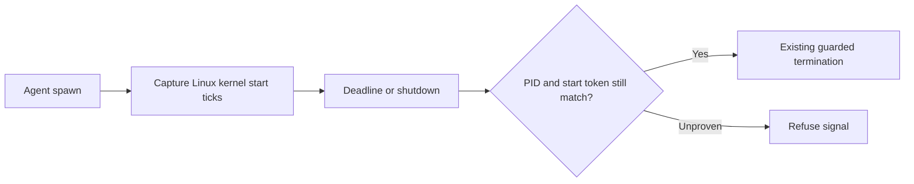

## Summary

Linux process identities now use kernel start ticks, so a calendar-clock or
timezone change cannot make the existing termination path reject the same
live process. Closes #5572.

## Spec

### Intent and Rationale

- Repair the demonstrated unstable identity check at the termination boundary.
  The archived agent continued running after identity verification refused a
  signal; increasing watchdog deadlines would leave that refusal in place.

### Essential Design Decisions

- Reuse `getStartTime` and its bounded subprocess helper. Linux reads field 22
  of `/proc/<pid>/stat` through `cat`; direct Deno procfs reads were observed
  failing under the worker's `--allow-read` permissions.
- Keep the existing identity rechecks, process-group leadership checks,
  reaped-child protection and owner-scoped termination. Unreadable or malformed
  identity data still refuses signalling.
- Start tokens are opaque, process-local values. Other platforms retain their
  existing `ps -o lstart=` reader; no persisted identity format is involved.

### Undiscoverable Facts

- Inspected the private archive, complete worker and launcher logs, retained
  agent transcript, boot logs and guest probes for `vibe-mwuqkdjy-797c70` on
  GRQ-23. Raw evidence remains private.
- The archive records a scheduled claim release before the outer reap, even
  though the agent continued running. The generic auto-filed description's
  claim-release statement does not describe that logged sequence.
- Guest elapsed times and wall timestamps diverged. The archive lacks the
  compared start fingerprints, so the original timekeeping mechanism and the
  precise cause of that particular refusal remain unverified.

## Evidence

- #5572: Hard kill: container wedged in issue (watchdog).
- The completion agent had a 1,391-second budget and 30-second grace. Its hard
  timeout reported firing 2,756 seconds late; identity verification then
  refused signalling while subsequent agent output was still recorded. The
  launcher ultimately reaped the guest under its 11,400-second watchdog.
- The archived worker build stamp identifies `1d5828280d7c`. Compared its
  launcher, container watchdog, deadline reporting, progress-extension wiring,
  subprocess bounds and PID guard with the issue branch's base. The PID guard
  was unchanged; subsequent runner protections had not replaced its calendar
  identity reader. The repair is confined to that shared reader.
- An additional production-default probe against untouched base source
  `06afaf162123` rejected its own live PID after a per-process timezone change.
  The same probe passed on this branch. The committed regression uses real
  process probes and fake signal seams, without changing the host clock or
  sending real signals.
- The procfs fixture was captured from a real local `cat /proc/self/stat`.
  Field 22's contract is documented in
  [proc_pid_stat(5)](https://man7.org/linux/man-pages/man5/proc_pid_stat.5.html).
  This is a backend change; process and runner tests provide the evidence.

## Reproduction

- **symptom** — the launcher reaped a guest whose in-flight agent had not
  completed internal termination.
- **status** — `partial` — reason: the calendar-identity refusal was observed
  failing with the unfixed reader and passing with kernel ticks; the original
  VM timing event and complete hard-kill sequence were not recreated.
- **regression test** — `worker/deno/tests/pid_guard_identity_501_test.ts`,
  the `pid_guard - a Linux process remains signalable after its calendar start time shifts (Issue #5572)` case.

## Test Plan

- Added the calendar-offset regression, procfs parsing cases and invalid-PID
  checks in `worker/deno/tests/pid_guard_identity_501_test.ts`. The unchanged
  display is the allowed control. Cases cover embedded parentheses and
  whitespace in `comm`, zero ticks, a different PID, missing fields and an
  invalid tick. Invalid identifiers retain their existing refusal contract.
- Existing identity, reuse and timeout contracts passed in
  `worker/deno/tests/pid_guard_test.ts` and
  `worker/deno/tests/spawn_timeout_callers_4251_test.ts`.
- Affected runner and ownership suites passed: 74 targeted tests across
  `worker/deno/tests/claude_runner_kill_bound_test.ts`,
  `worker/deno/tests/agent_run_termination_test.ts`,
  `worker/deno/tests/handler_watchdog_scope_test.ts`,
  `worker/deno/tests/memory_guard_5529_test.ts` and
  `worker/deno/tests/agent_leftover_reaper_4815_test.ts`. These retain the
  bounded wait, successful child result, reused-PID refusal and sibling-slot
  isolation checks.
- The final targeted identity and hook run passed 105 tests, including
  `worker/deno/tests/token_economizer_plugin_test.ts` and
  `worker/deno/tests/token_economizer_plugin_wiring_test.ts`.
- Removed no existing behaviour assertions. The memory-guard test edit changes
  its reader's description only. Existing fixtures needed no changes for the
  PID precondition; live-process and real-child tests still reach termination.
- Formatting, lint, type checks and `deno task check:manifests` passed; the
  manifest task reported 876 passed and one ignored. No twinned identity
  reader was found. Updated the live manuals and reader comments found by the
  `lstart` and absolute-start-time documentation sweep.
- `DENO_JOBS=2 ./quality.sh < /dev/null` passed, including the unchanged unit
  timing gate. The first two runs passed both semantic test passes but failed
  timing checks in unchanged suites:
  `worker/deno/tests/log_level_prefix_lint_test.ts`,
  `worker/deno/tests/parallel_safety_cap_test.ts`, and, on the first run,
  `worker/deno/tests/host_workdir_guard_test.ts`. All ten tests passed when
  rerun alone. The final run reduced concurrency through Deno's existing
  supported setting; no test, threshold or manifest was weakened.
- The full gate reported configuration integration skipped for unavailable
  configuration, and Checkov skipped because its binary or pinned runtime
  image was absent. Other configured gate stages passed. Launcher behaviour
  was not changed, so no separate launcher-harness run was required.

## Merge verification

- CI and independent review remain pending.

## Remaining limitations

The original VM timekeeping event and non-Linux execution were not reproduced.
Configuration integration and Checkov were not checked locally.
