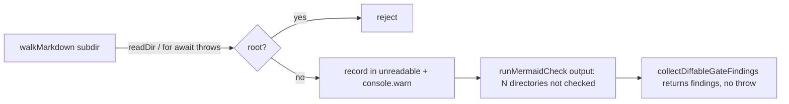

# PR Summary — Issue #5593

## Summary

`walkMarkdown` in `worker/deno/lib/mermaid_check.ts` wrapped only the
`Deno.readDir` call in its `try`. `Deno.readDir` is lazy, so a directory that
could not be opened threw on the first `for await` step, outside the `try`. One
over-long or unreadable directory outside `SKIP_DIRECTORIES` therefore made
`collectMarkdownFiles` throw, `collectDiffableGateFindings` propagate it, and
the completion phase crash. The loop now sits inside the `try`. An unreadable
subdirectory is skipped, logged with a warning that names it, and listed in the
check's output as not checked. An unreadable root still rejects. Closes #5593.

## Spec

### Intent and Rationale

- The issue left the contract open: tolerate an unreadable directory, or fail
  loud. This PR tolerates it and reports it. One stray build tree should not
  crash the completion phase or fail the Mermaid gate (#5506 was this crash),
  and reporting the skipped directory means it is never a silent pass.

### Essential Design Decisions

- The skip is reported, never silent. It prints a `console.warn` line, adds a
  `; N directories not checked` suffix to the status line, and appends a
  `Directories not checked (could not be read):` list naming each directory and
  its error. This applies whether the result is `PASSED`, `FAILED` or `SKIPPED`.
- The status stays as the readable files decide it. A skipped directory does not
  turn `PASSED` into `FAILED`, and it never hides a bad block found elsewhere.
- An unreadable **root** still rejects (`relDir === ""` rethrows), because then
  nothing at all could be checked.
- `collectMarkdownFiles(rootDir, unreadable = [])` records skips through an
  optional out-parameter, so its existing callers keep their signature.

### Undiscoverable Facts

- On Linux the PATH_MAX failure reads
  `File name too long (os error 36): readdir '…'`. The new tests reproduce that
  exact error with a 25-level, 5 KB directory chain built relative to each
  parent.

## Evidence

This is a backend change with no UI. The new tests drive the production walker,
`runMermaidCheck`, and `collectDiffableGateFindings` with the real Mermaid
runner over a directory chain past PATH_MAX.

Issue numbers this diff cites as provenance:

- #5593: Mermaid full-tree scan: the try/catch around Deno.readDir is dead, so
  any unreadable directory crashes the completion phase
- #5506: fix(worker): worker-crash — runs releasing with no PR

## Test Plan

New tests, all of which went red against `origin/main`'s
`worker/deno/lib/mermaid_check.ts` with
`File name too long (os error 36): readdir '…/build/ddd…'` and pass at the head:

- `worker/deno/tests/mermaid_check_test.ts::collectMarkdownFiles - skips an over-long directory outside the skip list and keeps walking (#5593)`
  checks that the readable files are still returned, that `build/…` is recorded
  with its cause text, and that a warning names it.
- `worker/deno/tests/mermaid_check_test.ts::runMermaidCheck - reports an unreadable directory as not checked (#5593)`
  checks for `PASSED` with `not checked`, the directory and the cause in the
  output.
- `worker/deno/tests/mermaid_check_test.ts::runMermaidCheck - an unreadable directory does not mask a bad block elsewhere (#5593)`
  checks for `FAILED` with the one failure in `docs/bad.md`.
- `worker/deno/tests/baseline_gate_test.ts::collectDiffableGateFindings - an unreadable directory does not throw; the real mermaid runner still reports a bad block (#5593)`
  covers the completion-phase entry point with the production Mermaid runner. It
  went red on base (`FAILED | 0 passed | 1 failed`) and passes at the head.
- `worker/deno/tests/mermaid_check_test.ts::collectMarkdownFiles - rejects when the root itself cannot be read (#5593)`
  pins the root contract. It is green on base too, because base also throws
  there.

Edited existing tests:

- `runMermaidCheck - PASSES on clean repo` gains two assertions: the output
  carries no `not checked` text, and it equals the unchanged single status line.
  No assertion was removed.
- `worker/deno/tests/mermaid_check_test.ts` moves `makeDeepTree` and
  `removeTree` into `worker/deno/tests/support/deep_tree.ts`, so the two test
  files share them. Their behaviour is unchanged, and the existing `target/`
  test (#5506) still uses them and passes.

Results on the final head:

- `deno task test:unit tests/mermaid_check_test.ts tests/baseline_gate_test.ts < /dev/null`
  passed, 44 tests and 0 failed.
- `./quality.sh < /dev/null` gave `Result: PASSED (with skipped checks)`. It
  skipped config integration (no `.config.json`) and checkov (not installed).
  Every other check passed, including `mermaid`, `deno tests`, `deno lint`,
  `deno type check` and `deno fmt`.

## Merge verification

- CI on the pull request is pending.
- Routine code review is pending.

## Limitations

- The unreadable-directory case is tested with a PATH_MAX chain only. A
  permission-denied directory is not tested, because the worker may run as root,
  where `chmod 000` does not block reads. Both cases go through the same
  `catch`.

🤖 Generated with [Claude Code](https://claude.com/claude-code)
