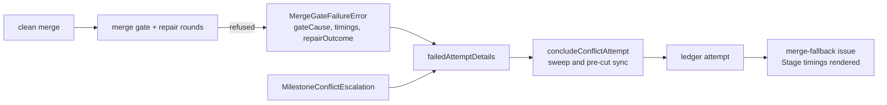

# PR Summary — Issue #5595

## Summary

A clean milestone merge that the merge gate refuses now concludes its ledger
attempt with its stage timings and a short gate-repair account. Before this
change, only a conflict escalation carried them, so the `merge-fallback` issue
printed `Stage timings: not recorded` for every such run.

The clean-merge path in `syncMilestoneBranchWithDefault` already rendered the
timings and then dropped them. It now sets them on the typed refusal beside
`gateCause`, with the repair outcome when a repair was offered. The sweep and
the pre-cut sync both read the refusal through one shared helper. Closes #5595.

## Spec

### Intent and Rationale

- The clean-merge exit in `worker/deno/lib/git_pull.ts` called `recordTimings()`
  and discarded the result. Carrying the rendered line on the
  `MergeGateFailureError` it returns (the issue's suggested fix) needs no new
  ledger field.
- Both conclude sites (`worker/deno/lib/milestone_branch_sync.ts` sweep and
  `worker/deno/lib/milestone_presync.ts`) now call one helper,
  `failedAttemptDetails`, in `worker/deno/lib/milestone_fallback_flag.ts`. The
  two paths cannot drift apart again.

### Essential Design Decisions

- A conflict escalation keeps exactly its old record: its `timings` when set,
  and `describeConflictAnalyses` as `analysis`. A clean-merge gate refusal
  records `timings`, and records its repair outcome as `analysis`. Any other
  error records neither, as before.
- The repair outcome (`summariseRepairOutcome` in
  `worker/deno/lib/milestone_gate_repair.ts`) is short:
  - one status line, then the files each round changed;
  - no gate output, because the refusal message already carries that;
  - no line starting with the `Concluded` prefix that `merge_fallback_issue.ts`
    parses as the dedup key.
- Persisted shape: `ConflictAttemptRecord` already had optional `timings` and
  `analysis` strings, so the stored shape is unchanged and no key bump is
  needed.
- Redaction is unchanged. `worker/deno/lib/merge_fallback_issue.ts` renders a
  private source's run as host, timings and the conclusion line only, so the
  repair account (with its file paths) appears only for a public source. There
  it goes through the existing sanitised, fenced and capped analysis renderer.

### Undiscoverable Facts

- Issue #5530 showed `Stage timings: not recorded` for all three runs. That is
  the symptom this change removes.

## Evidence

Backend-only change; no UI file is touched.

- Red against base: I restored `lib/git_pull.ts`, `lib/milestone_branch_sync.ts`
  and `lib/milestone_presync.ts` from the base and kept the new tests and
  helpers. All four new clean-merge tests failed with
  `AssertionError: Expected actual: "" to contain: "agent 20s"` (and
  `"Timings (host"` for the no-repair control).
- Second red: restoring only the two conclude sites made the sweep and pre-cut
  sync tests fail the same way. That shows each site's change is load-bearing.
- Issue numbers this diff adds as provenance: #5595: Merge-fallback record for a
  clean-merge gate refusal carries no stage timings or analysis.

## Test Plan

- `worker/deno/tests/milestone_sync_gate_repair_test.ts` (new tests; no existing
  test edited). These drive the real producer on the real-git clean-merge
  fixture:
  - `syncMilestoneBranchWithDefault - a clean-merge refusal carries its stage timings and repair outcome (Issue #5595)`
    asserts `agent 20s`, `2 round(s) ran` and `` `worker.ts` `` on the refusal.
  - `syncMilestoneBranches - a clean-merge refusal concludes its ledger attempt with its timings and repair (Issue #5595)`
    goes through the sweep to the ledger. It asserts the attempt's timings and
    analysis, and that `fallbackRun` yields `{ stage: "agent", seconds: 20 }`
    rather than `not recorded`.
  - `presyncMilestoneBranch - a clean-merge refusal concludes its ledger attempt with its timings and repair (Issue #5595)`
    checks the same ledger record through the pre-cut sync.
  - `syncMilestoneBranchWithDefault - a clean-merge refusal with no repair granted records its timings and that no repair ran (Issue #5595)`
    covers the `not-attempted` repair outcome.
- `worker/deno/tests/milestone_fallback_flag_test.ts` (new tests) covers
  `failedAttemptDetails`:
  - a plain error gives `{}`;
  - a conflict escalation keeps its timings and analyses, with and without
    timings;
  - a merge-gate refusal maps its fields;
  - whitespace-only fields are dropped.
- `deno fmt`, `deno lint` and `deno check` pass on the changed files.
- `deno task test:unit tests/milestone_sync_gate_repair_test.ts tests/milestone_sync_refusal_ladder_4328_test.ts tests/milestone_fallback_flag_test.ts tests/milestone_branch_sync_test.ts`:
  160 passed, 0 failed.
- `./quality.sh` on the final code: `Result: PASSED (with skipped checks)`. The
  gate itself skipped `config integration` and `checkov`; every other stage,
  including the deno tests and semgrep, passed.
- Twinned rules: none found. `pr_summary_check.ts` and the completion phase are
  not touched.
- Docs sweep: README, `DESIGN-PRINCIPLES.md` and `docs/` hold no sentence that
  says a clean-merge refusal records no timings. DESIGN-PRINCIPLES (conflict
  handling, point 5) is now true for this path too. The
  `ConflictAttemptRecord.analysis` doc comment now names both accounts.

Not done: none.
