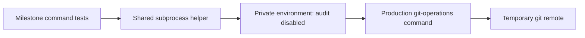

## Summary

Run the milestone branch command tests that can push in a private subprocess,
with auditing disabled and a temporary work directory. Reuse the existing
presync subprocess invocation through a shared test helper. Closes #5602.

## Spec

### Intent and Rationale

- The git-only request shield cannot disable auditing. Isolating the test
  process fixes the leak without widening the production env allowlist.

### Essential Design Decisions

- `runGitOperationsCommand` passes the JSON request as an argv element and
  decodes the last stdout line as the command result. Non-zero child exits
  report both output streams.
- The child clears inherited environment, retains HOME, PATH and the existing
  Deno cache setting, and sets `NO_HOST_GIT_CONFIG`, TMPDIR and WORK_DIR explicitly.
  Command requests retain their Git config settings and production validation.
- The two refusal tests remain in-process: their invalid env is refused before
  git runs. The success and push-failure cases use the isolated helper.

### Undiscoverable Facts

- Before the fix, running only the existing branch-recreation test with auditing
  enabled passed its remote-SHA assertion and wrote one successful `git-push`
  row targeting `origin/main:refs/heads/milestone/recreated`.
- Reproduction used private WORK_DIR, VIBE_AUDIT_DIR and TMPDIR paths and removed
  its owned temporary root afterwards; no live journal was used.

## Evidence

Test-support change only; no UI or production command behaviour changes.

- `worker/deno/tests/git_operations_subprocess_test.ts` runs the real command
  tests with auditing enabled in their ambient environment, once with WORK_DIR
  and once with VIBE_AUDIT_DIR. Both audit directories stay empty after the fix.
- Both regression cases failed against the unfixed branch-ensure test file:
  `command tests wrote audit state: anchors,audit-…jsonl`. Production code and
  fixtures were unchanged during that red run.
- #5602: milestone_branch_ensure_test.ts drives a real `git-operations` push
  that can write a `git-push` row to the live audit journal.

## Test Plan

- `worker/deno/tests/milestone_branch_ensure_test.ts`: retained the recreated
  branch's remote-SHA equality and the failed push's failure-message assertions;
  added checks that neither case creates an audit directory in its private
  WORK_DIR. No existing behaviour assertion was removed.
- `worker/deno/tests/milestone_presync_git_test.ts`: retained the accepted-config
  test's hook marker, refusal/success and remote-SHA assertions. Its child-exit
  assertion and JSON decoding moved into the shared helper.
- `worker/deno/tests/git_operations_subprocess_test.ts`: both hostile ambient
  audit cases were red on the unfixed suite and green after the fix. Each child
  runs the four command tests, including both env-validation refusals.
- Targeted `deno task test:unit` over those three files: passed, 15 tests.
- Targeted `deno fmt`, `deno lint` and `deno check --frozen`: passed for the
  three test files and both changed support modules.
- Related isolation comments in `worker/deno/tests/support/no_host_git_config.ts`
  now explain the subprocess helper. The old summary's accepted residual is a
  historical record; this change removes it for the affected command tests.
- Shared copies: the presync invocation was extracted and both milestone suites
  call it; no production rule or matcher changed.

## Merge verification

- CI and independent PR review remain pending.

## Not checked and remaining risks

- Live journals were not accessed. CI and macOS execution were not run here.
