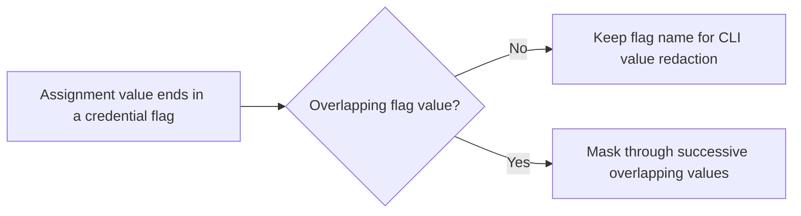

## Summary

Preserve credential flag names at assignment boundaries so their values remain
redacted. Mask overlapping nested flag values together. Closes #5608.

## Spec

### Intent and Rationale

- Masking an outer assignment previously hid a trailing credential flag's name
  from the CLI rule, leaving its value visible. Adjusting the assignment
  boundary keeps the existing CLI value parser responsible for simple cases.

### Essential Design Decisions

- Detection and replacement share `verdictOf` and the assignment walk.
- Classify the original value before changing its mask boundary, so a shortened
  cross-line prefix cannot become exempt as a short word or prose.
- When a flag's value ends in another credential flag taking a value, extend
  the assignment mask through successive overlaps instead of hiding a flag's
  name while leaving its value visible.
- Name probes read at most 150 characters. Overlap extensions advance through
  disjoint value spans; the input remains untruncated. The existing quoted-flag
  overlap handler shares the trailing-name matcher.

### Undiscoverable Facts

None.

## Evidence

- Backend redaction change; no visual surface changed.
- The regression file copied into an isolated checkout of unfixed `main`
  (`a0170265e`) had 19 failing cases and two passing controls, including failures
  on both same-line and consecutive-line inputs. The
  output exposed the credential value while `containsSecret` returned false
  on that output. Removing the outer label was an accepted control.
- The nested-value regression also failed against checkpoint `eaf8bc0fb`:
  preserving the old outer mask exposed the first flag's value. The final
  implementation masks both overlapping values.
- `worker/deno/tests/secret_redaction_flag_in_value_5608_test.ts` and the
  existing redaction suites passed: 668 tests, zero failures.
- Security review: this fix adds no sink, dependency, filesystem, network or
  process operation. It applies `capsec-secret-logging` in the existing shared
  redactor. SECURITY.md describes the nested-value exception; the threat
  model's existing redaction controls remain applicable.
- Provenance checked: #5608 — secret-assignment walk masks a credential flag's
  name inside an outer label's value and publishes the flag's value.
- Related provenance checked: #5330 — secret-assignment rule masks a credential
  CLI flag as an earlier label's value and publishes the flag's value.

## Test Plan

- Added `worker/deno/tests/secret_redaction_flag_in_value_5608_test.ts`:
  generated `#5608:` cases cover same-line and consecutive-line assignments,
  chained assignments, tabs, quoted values and independent following flags.
  `#5608: overlapping nested flags keep every value masked` checks two and
  three overlapping flags on both line layouts. These cases assert exact
  output, input detection, output detection, secret removal and idempotence.
- `#5608: shortening a cross-line mask keeps credential prefixes masked` in
  that file failed against the shortened-value classifier and passes with the
  original-value classifier, covering both short and prose-shaped prefixes.
- The same file's missing-value controls cover absent values, following
  options, bare assignment separators, equals-attached values and
  non-credential flags. Controls pin existing behaviour and may pass on base.
  Its hostile-size tests cover repeated flag names, a rejected suffix, long
  hyphen runs, 20,000 assignments and 20,000 overlapping flags without timing
  assertions.
- Modified seven expectations in
  `worker/deno/tests/secret_redaction_label_as_value_5310_test.ts`. Four round-9
  cases now retain flag names and mask their formerly exposed `x` values;
  two round-11 cases mask the credential prefixes before trailing flags.
  The round-13 neighbour case masks overlapping values and their intervening
  quote text. Those old preservation expectations conflict with the issue's
  value-redaction requirement. Every fixture and its detection, idempotence
  and original-secret-removal assertions remain.
- `deno task test:unit tests/secret_redaction*_test.ts
  tests/secret_transform_redaction_test.ts`: passed, 668 tests. Existing quoted
  flag regressions exercise the reused trailing-name matcher through the CLI
  rule as well as the changed assignment path.
- Targeted `deno fmt --check`, `deno lint` and frozen `deno check` on the
  production module and both changed test files: passed.
- Compared both redactors over 1,852 base and 1,854 head files: README,
  SECURITY.md, Markdown under docs and prompts, and redaction test sources.
  Three base files and five head files changed output, all containing the
  affected credential examples; no unexpected masking change was found.
  Labelled regression fixtures have zero false positives and zero false
  negatives at head. The prose corpus is not a labelled secret inventory, so
  its total false-negative count is unknown.
- The trailing-name pattern previously embedded in `throughFollowingFlag`
  now shares `flagNameEndingAt` with the new assignment-boundary helper.

## Merge verification

- CI and independent code review are pending.
