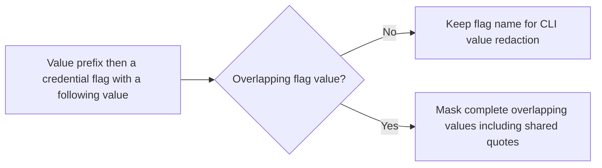

## Summary

Preserve credential flag names at assignment boundaries so their values remain
redacted. Mask overlapping nested flag values together, including escaped quoted
values that share a quote with a later flag. Closes #5608.

## Spec

### Intent and Rationale

- Masking an outer assignment previously hid a trailing credential flag's name
  from the CLI rule, leaving its value visible. Adjusting the assignment
  boundary keeps the existing CLI value parser responsible for simple cases.
- Overlapping flag values must be masked through their complete extent: stopping
  at a shared quote hides the next flag's name while publishing its credential.

### Essential Design Decisions

- Detection and replacement share `verdictOf` and the assignment walk.
- Classify the original value before changing its mask boundary, so a shortened
  cross-line prefix cannot become exempt as a short word or prose.
- When a flag's value ends in another credential flag taking a value, extend the
  assignment mask through successive overlaps. Both that extension and
  `redactCliFlags` use `cliFlagEnd`, which applies the existing shared-quote
  handling in `throughFollowingFlag`.
- Name probes read at most 150 characters. Overlap extensions advance through
  successive value spans; the input remains untruncated. The quoted-flag overlap
  handler also shares the trailing-name matcher.

### Undiscoverable Facts

None.

## Evidence

- Backend redaction change; no visual surface changed.
- Reproduced the verifier's regression at the pre-fix head: all four new
  `#5608: shared quotes after nested flags` tests failed. Both same-line and
  consecutive-line inputs exposed the final synthetic credential through
  `redactSecrets` and `redactGhBodyArgs`. The same four tests pass after the
  fix.
- The main assignment walk's `verdictOf` result now includes the complete nested
  CLI value extent. The new tests exercise this caller through both public
  redaction paths and check input detection, exact output, credential removal,
  output detection and idempotence, with single and double quotes.
- `capsec-secret-logging`: the synthetic credential is removed before it reaches
  the outbound `--body` argument. The shared redactor used by log sinks also
  removes it. No new sink, dependency, filesystem, network or process operation
  is introduced.
- Read SECURITY.md's “An assignment's value is judged, not only its label”
  section and the threat model's AP-13/C23 redaction controls. Updated
  SECURITY.md to describe the assignment-boundary exception and its shared-quote
  protection; the existing threat-model controls remain applicable.

## Test Plan

- Added `worker/deno/tests/secret_redaction_flag_in_value_5608_test.ts`:
  same-line and consecutive-line assignments, chained assignments, tabs, quoted
  values, independent following flags, nested overlaps and short or prose-shaped
  cross-line prefixes. Assertions cover exact output, detection, credential
  removal and idempotence. Missing-value controls and hostile-size cases retain
  coverage for bounded name probes, long hyphen runs, 20,000 assignments and
  20,000 overlapping flags.
- Four shared-quote regression tests in that file cover both line layouts and
  both public redaction paths, each with single and double quotes containing an
  escaped quote. All four were observed failing before the production fix.
- Modified seven expectations in
  `worker/deno/tests/secret_redaction_label_as_value_5310_test.ts` to retain
  trailing flag names and mask their values, mask credential prefixes before
  trailing flags, or mask overlapping values together. Fixtures and detection,
  idempotence and original-secret-removal assertions remain.
- From `worker/deno`,
  `deno task test:unit tests/secret_redaction*_test.ts
  tests/secret_transform_redaction_test.ts tests/gh_body_redaction_test.ts`:
  passed, 696 tests, zero failures. This includes existing escaped-quote,
  shared-quote and hostile-size regressions. Four existing tests emitted slow
  test warnings; the test command exited successfully.
- Targeted `deno fmt --check`, `deno lint` and frozen `deno check` on the
  production module and changed test files: passed.
- `markdownlint-cli2 SECURITY.md`: passed across the configured 246 published
  Markdown files. Archived summaries are excluded by that configuration.
- `deno task pr-summary-check --base origin/main --issue-body-file <body>
  --labels top-priority,failed-once`
  on the summary: 0 gates blocked, 0 not checked. Closure, two-axis review and
  reproduction status are not applicable, because the issue states no acceptance
  criteria and has no `bug` label.
- Shared-rule sweep: `CLI_FLAG_AT`, `CLI_FLAG_RULE_G` and the CLI rule already
  share `CLI_FLAG_VALUE`. The assignment overlap extension now calls the same
  complete-extent helper as `redactCliFlags`, rather than copying its quote
  condition. Existing callers of `CLI_FLAG_AT` use the unchanged full match.

- Full `deno task test:unit < /dev/null` from `worker/deno` on this head:
  exit 0. The 63 test files that import the redaction module, run together:
  1,703 passed, 0 failed.
- `./quality.sh < /dev/null` on this head:
  `Result: PASSED (with skipped
  checks)`. Config integration and checkov were
  skipped; every other stage passed.

## Merge verification

CI and independent code review are pending.

## Limitations

An earlier attempt was blocked by the pre-push gate's
`deno task test:unit (2081 files)` on another host. That host's output was not
available here, and the full unit suite and `./quality.sh` both pass on this
head, so the failure was not reproduced.
