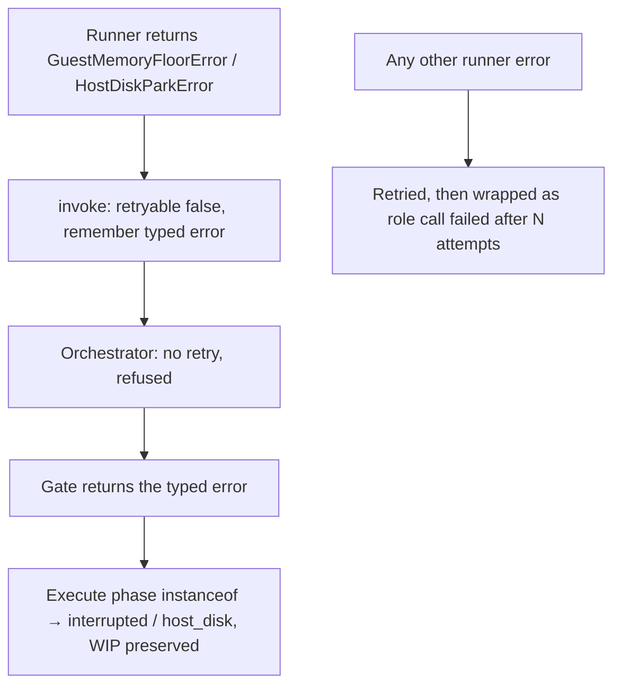

## Summary

On the external-orchestration path, a role call the runner stopped at the guest
memory floor or parked for host disk is no longer retried. Its typed error now
reaches the execute phase, which releases the run as `interrupted` (or
`host_disk`) with its work preserved. Before this fix the run was recorded as an
`internal_error` and auto-filed as a `worker-crash`. Closes #5618.

## Spec

### Intent and Rationale

- The issue's failure, `Claude execution failed: executor call failed after 2
  attempt(s): [GUEST_MEMORY_FLOOR] …`, comes from
  `worker/deno/lib/orchestration/issue_run_gate.ts`. Its `invoke` closure
  turned every failed runner result into a retryable `kind: "error"`. The
  orchestrator therefore started the executor again into the same low memory
  (the "2 attempt(s)"), and `runOrchestratedIssueRun` returned a new plain
  `Error`. That lost the `GuestMemoryFloorError` type, which
  `worker/deno/lib/phases/execute_phase.ts` checks with `instanceof` to release
  the run as interrupted.
- The fix goes at the gate, where the type is lost, rather than in the
  classifier. Matching the marker inside a wrapped reason would still have left
  the retry in place and the work unpreserved.

### Essential Design Decisions

- A protective stop is marked `retryable: false` using the existing
  orchestrator contract (Issue #4584). The orchestrator itself is unchanged.
- After the `timed_out` and `done` returns, the gate returns the original typed
  error. Other runner failures keep the retry and the
  `<role> call failed after N attempt(s):` wrapping.
- Assumption: `HostDiskParkError` gets the same treatment. It is the other typed
  protective stop that the execute phase handles by `instanceof`
  (Issue #5077), and the orchestrated path lost its type the same way.

### Undiscoverable Facts

- The failing run was the #5544 run on host
  `vibe-coder-65924-7f0d4fcd-2d69-4016-8437-e6dd361b4ccb`, which died in
  execute after 4204s (release comment linked from the issue).

## Evidence

This is a backend/CLI-only change. Issues cited in this diff:

- #5618: fix(worker): worker-crash — runs releasing with no PR
- #4815: Hard kill: container wedged in completion (watchdog)
- #5077: A host-disk park mid-execute is still logged as ERROR and released as
  internal_error
- #4584: fix(worker): worker-crash — runs releasing with no PR

Docs updated:

- `docs/CONTAINER.md` (guest memory floor section)
- `docs/TROUBLESHOOTING.md` (host-disk park paragraph)
- `docs/MANAGER-WORKER-CONTRACT.md` (retry transition now names the
  non-retryable calls)
- The `retryable` and `maxRetries` doc comments in
  `worker/deno/lib/orchestration/types.ts`

## Reproduction

- **symptom** — `Claude execution failed: executor call failed after 2
  attempt(s): [GUEST_MEMORY_FLOOR] guest memory stayed below its floor (460 MiB
  available, floor 806 MiB) for 2 readings in a row …`. The run was released as
  `internal_error`, classified `worker-crash` and auto-filed.
- **status** — `verified` — the regression test was observed failing against the unfixed code and passing after the fix. Against the base
  `issue_run_gate.ts`, the new tests failed:
  - the guest-floor gate test failed its `instanceof GuestMemoryFloorError`
    assertion;
  - the host-disk gate test failed its `instanceof HostDiskParkError`
    assertion;
  - the end-to-end execute-phase test got category `internal_error` instead of
    `interrupted`.

  All of them pass with the fix. The plain-error control passes on both trees.
- **regression test** —
  `worker/deno/tests/orchestration_protective_stop_5618_test.ts::protective stop - the execute phase releases an orchestrated guest memory floor stop as interrupted (Issue #5618)`

## Test Plan

New file: `worker/deno/tests/orchestration_protective_stop_5618_test.ts`. Its
inputs come from the real producers: `guestMemoryFloorReason` with the issue's
figures, and `inFlightParkReason(judgeHostDiskForBuild(…))`. Orchestrator
`maxRetries: 1` is set so that a retry would happen if it were allowed.

- **Gate, guest floor:** the error is `GuestMemoryFloorError` with an unchanged
  message, and the executor is called once.
- **Gate, host disk:** the error is `HostDiskParkError` with
  `agentStarted: true` and an unchanged message, and the executor is called
  once.
- **Gate control:** a plain `Error("boom")` is still retried (2 executor
  calls) and wrapped as `executor call failed after 2 attempt(s): boom`.
- **End to end:** the test runs the real `runOrchestratedIssueRun` under the
  real `workOnIssueExecuteClaude`. The result is category `interrupted`, the
  reason opens with `[GUEST_MEMORY_FLOOR]` with no `call failed after` prefix,
  `classifyRunFailure` gives `interrupted`, and the executor is called once.

No existing test was edited. Results:

- `deno task test:unit` on the new file,
  `worker/deno/tests/orchestration_3642_gate_test.ts`,
  `worker/deno/tests/codex_safety_refusal_5506_test.ts` and
  `worker/deno/tests/orchestration_3642_orchestrator_test.ts`: 85 passed,
  0 failed.
- `timeout 1500 ./quality.sh < /dev/null` on the head: `Result: PASSED (with
  skipped checks)`. The first run failed one markdownlint MD018: an `#5618`
  wrapped to the start of a line in `docs/CONTAINER.md`. That line was
  re-wrapped, and the gate re-run passed. Config integration and Checkov were
  skipped because they are unavailable on this host.
- Twinned rules: the execute phase's `instanceof` release branches and
  `quality_gate_remediation_phase.ts` were read. The remediation phase does not
  use the orchestrated path, so it needed no change. No other copy of the
  gate's runner-error mapping was found.

## Remaining risk

- Required CI and code review are not yet observed.
- A manager or reviewer call stopped at the floor takes the same path; only the
  executor case is tested.
