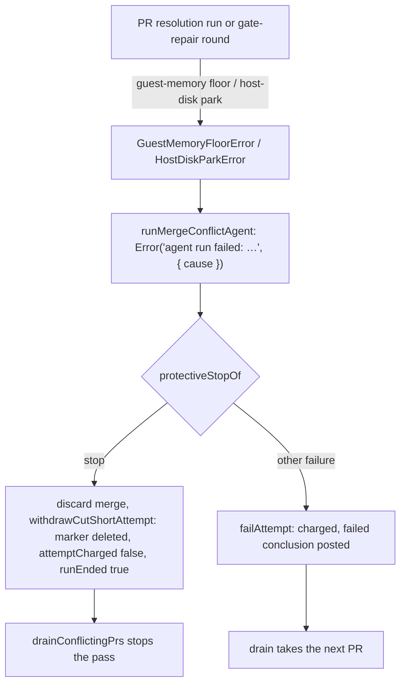

# PR Summary — Issue #5626

## Summary

A protective stop now ends a PR merge-conflict pass instead of feeding it the
next PR. When the guest-memory floor (`GuestMemoryFloorError`, Issue #4815) or
the host-disk park (`HostDiskParkError`) stops a PR's conflict agent, the
attempt is withdrawn uncharged, the merge is discarded, and the conflict drain
stops for the pass. This covers both agent runs of a PR attempt: the first
resolution run and a pre-push gate-repair round. Before this change the stop was
wrapped as a plain `agent run failed:` error. `failAttempt` then charged the PR
and posted a failed conclusion, and `drainConflictingPrs` started the next PR's
agent into the same low memory. This is the merge-conflict twin of the
issue-path fix in #5618.

The wedge on GRQ-23 itself (`vibe-coder-2582`, run `vibe-mwx93j4f-71ac3e`) is
not diagnosed. Its worker log and agent transcript were never mirrored, and the
facts file holds no guest probe (the container did not answer). This change is
related hardening, not a proven fix for that kill. Part of #5626.

## Spec

### Intent and Rationale

- Logs mirrored from GRQ-23 on 26 November show the pattern this fixes. At
  00:41:05 both slots of container `vibe-coder-65924` were stopped at the floor
  (490 and 571 MiB available, floor 806 MiB). Both started a new agent at
  00:41:08, while six `/usr/bin/ld` LTO links of about 2.4 GiB each were still
  running. Guest memory fell back to about 2.8 GiB at 00:42:54. Starting more
  agent work straight after a floor stop is what the stop exists to prevent.
- The merge-conflict path had no handling for the typed stop at all. A grep for
  `GuestMemoryFloorError` finds only the execute phase, the quality-fix loop and
  the orchestrated issue run.
- This follows the existing precedent rather than a new mechanism: a provider
  refusal (Issue #2613) already goes through `withdrawCutShortAttempt`, which
  sets `runEnded: true`, and the drain already stops on that.

### Essential Design Decisions

- `runMergeConflictAgent` keeps the error message byte-for-byte
  (`agent run failed: <message>`) and adds the typed stop as the error's
  `cause`. The milestone ladder, the gate repair and the fast checks therefore
  see exactly what they saw before. Only the tracked-PR path reads the cause,
  through the new `protectiveStopOf`.
- `protectiveStopOf` lives in the new `worker/deno/lib/protective_stop.ts` and
  is the one place that decides what a protective stop is. The orchestrated
  issue run (`orchestration/issue_run_gate.ts`, Issue #5618) used to repeat the
  same `instanceof` pair inline and now calls it. One small widening: the issue
  run now also sees a stop carried as an error's `cause`.
- The gate-repair round is handled in the processor, not in
  `verifyMergeBeforePush`, which is unchanged. The processor's `runRepairAgent`
  wrapper records a protective stop when the repair run fails. The verifier
  still reports that failure as `refused` ("repair agent failed: …"), but the
  processor withdraws it as cut short instead of calling `failAttempt`. Every
  verdict the worker cut short (deferred, run end, provider, protective stop)
  now goes through one withdrawal block.
- The milestone-branch sync and the milestone takeover keep their current
  handling, which reports the stop as an agent error. Their results feed three
  more consumers, and no evidence ties a milestone sync to this incident.
  `docs/CONTAINER.md` says so.
- A protective stop sets `runEnded: true`, so the drain returns
  `{ kind: "deadline" }` and records the next PR as left behind by the deadline
  bound. That is the same accounting a provider refusal already gets.

### Undiscoverable Facts

- I read the GRQ-23 logs from the shared `GRQ-VibeCoder-logs` mirror, which
  holds slot worker logs and agent sessions. The always-callback record for
  `vibe-mwx93j4f-71ac3e` has no worker log: "no worker log lines tagged
  unknown#0 … were found". The facts file
  `hard-kill-vibe-coder-2582-1795680883.facts.json` exists only in GRQ-23's
  `~/logs/hard-kill-archive/`, so I could not read it.
- Both memory guards were already deployed on GRQ-23 before this incident. The
  00:41:05 `[GUEST_MEMORY_FLOOR]` line is from Issue #4815, and the Issue #5529
  `Guest memory critically low` kills also appear in the GRQ-23 logs. So a
  missing guard does not explain this wedge.
- In the mirror, a later GRQ-23 session (#5544, run `vibe-mwxcrl17-7d30a0`) read
  the facts file `hard-kill-vibe-coder-2582-1795680883.facts.json`. Its guest
  probe reads "container exec did not answer: no answer within 10000ms", so it
  has no guest process list or memory reading.
- GRQ-23 was short of resources about 17 minutes before the wedge's last log
  line (07:57:54). At 07:40:32 both slots of another container,
  `vibe-coder-56863`, were parked because the host disk was below its floor
  (43.6 GB free, floor 46.0 GB). By the capture at 08:14 the disk had 68.4 GiB
  free. Nothing in the mirror shows that `vibe-coder-2582` itself hit a
  protective stop.
- Earlier merge-conflict watchdog kills on GRQ-3 (#5044, #5578, #5591) were
  closed without a code change. They have the same shape: the last step logged
  was the agent turn, the guest probe did not answer, and the silence lasted
  16–19 minutes.

## Evidence

Backend only; no UI file is touched.

- `worker/deno/lib/protective_stop.ts` (new): `protectiveStopOf`.
- `worker/deno/lib/merge_conflict_agent.ts`: the `cause` on the failed-run
  error.
- `worker/deno/lib/pr_merge_conflict_processor.ts`: the tracked-PR path
  withdraws on a protective stop (`cutShortByProtectiveStop`), in both the
  resolution run and the gate-repair round. The `attemptCharged` and `runEnded`
  TSDoc now list every withdrawal.
- `worker/deno/lib/orchestration/issue_run_gate.ts`: calls the shared
  `protectiveStopOf`.
- `worker/deno/lib/merge_conflict_drain.ts`: the stop log line and its comment
  now name every cut-short cause. The old line said "the run ended", which was
  already false for a provider refusal.
- `docs/audits/lib-sweep-coverage/top-up-5626.json`: the sweep slice that claims
  the new module (Issue #1609).
- `docs/CONTAINER.md` (the guest memory floor section, and the host-disk park
  section's "other steps that park" sentence) and `docs/MERGE.md` (new paragraph
  "A protective stop is not a conflict either", which names both agent runs).
- Issue numbers cited in the diff:
  - #5626: Hard kill: container wedged in merge-conflict (watchdog)
  - #5618: the issue-path fix whose inline check now calls `protectiveStopOf`
  - #4815: Hard kill: container wedged in completion (watchdog)
  - #2613: A provider outage (402 Insufficient Balance) must not be reported as
    unresolved merge conflicts or trigger merge fallbacks
  - #1693: Merge-conflict pass starts a resolution it cannot finish before the
    cycle ends, then charges the watchdog's SIGTERM to the PR as a failed
    attempt
  - #1772: PR merge-conflict pass: a ruleset-rejected push spends no attempt,
    and milestone-head PRs are left to the milestone sync

## Reproduction

- **symptom** — a guest-memory-floor stop of a PR merge-conflict agent was
  charged to the PR as a failed attempt. The drain then went on to start the
  next PR's agent into the same low memory. The reported symptom is that the
  container went silent in the merge-conflict agent turn and was reaped by the
  watchdog.
- **status** — `partial` — the new processor tests failed against the unfixed
  code and pass after the fix. For the resolution run, the guest-memory test
  failed with `attemptCharged` `true` (expected `false`), and the host-disk test
  failed with `undefined`. The two repair-round tests failed the same way
  against the processor before the repair-round fix.
- reason: the GRQ-23 wedge itself was not reproduced. Its evidence is only on
  GRQ-23, so nothing shows that this incident went through a floor stop.
- **regression test** —
  `worker/deno/tests/pr_merge_conflict_processor_test.ts::processMergeConflict - a guest-memory-floor stop withdraws the attempt and stops the drain (Issue #5626)`
  and
  `worker/deno/tests/pr_merge_conflict_processor_test.ts::processMergeConflict - a guest-memory-floor stop in a repair round withdraws the attempt and stops the drain (Issue #5626)`

## Acceptance Criteria

<!-- vibe-spec-review inputs="diff+issue-body" -->

- **partial** — "a container wedged and the launcher watchdog reaped it" (the
  cause of `vibe-coder-2582` going silent in the merge-conflict agent turn) —
  evidence:
  `worker/deno/tests/pr_merge_conflict_processor_test.ts::processMergeConflict - a guest-memory-floor stop in a repair round withdraws the attempt and stops the drain (Issue #5626)`
  — reviewer: partial — reason: the diff fixes a real merge-conflict defect (a
  protective stop was charged and the drain started the next PR's agent), but no
  evidence ties it to this wedge. The worker log and transcript were not
  mirrored, the facts file has no guest probe, the 07:40 disk park was on
  another container, and the last logged step is the agent turn itself.

## Standards Review

<!-- vibe-standards-review inputs="diff+CODING-STANDARDS.md" -->

- **violation** — DRY, one owner per rule: the protective-stop check was
  repeated in `orchestration/issue_run_gate.ts` — evidence:
  `worker/deno/lib/protective_stop.ts` — reason: fixed in this diff (shared
  `protectiveStopOf`, called by both paths)
- **violation** — every branch needs a test that reaches it: the unwrapped stop
  branch of `protectiveStopOf` was unreached — evidence:
  `worker/deno/tests/merge_conflict_agent_test.ts` — reason: fixed in this diff
  (the issue path now reaches it, and a test covers it)
- **violation** — an in-repo helper copied instead of called: a test repeated
  `makeRunner`'s body — evidence:
  `worker/deno/tests/merge_conflict_agent_test.ts` — reason: fixed in this diff
  (`makeRunner` takes an `Error` failure)
- **violation** — DRY: the repair-round withdrawal copied the cut-short block —
  evidence: `worker/deno/lib/pr_merge_conflict_processor.ts` — reason: fixed in
  this diff (one withdrawal block for every cut-short verdict)
- **violation** — a list a doc comment states must name the new member: the
  `attemptCharged` and `runEnded` TSDoc — evidence:
  `worker/deno/lib/pr_merge_conflict_processor.ts` — reason: fixed in this diff
- **violation** — a code change owes a docs change: the host-disk park section
  said every other parking step reports `internal_error` — evidence:
  `docs/CONTAINER.md` — reason: fixed in this diff
- **clean** — Australian English spelling, TSDoc on the new functions, naming,
  `Result` handling and log levels, positive and negative controls in the
  processor tests, the MERGE.md anchor link, and the doc statements about the
  discard, the uncharged withdrawal, the marker deletion and the milestone sync

## Test Plan

- Added to `worker/deno/tests/pr_merge_conflict_processor_test.ts`, with a
  `claudeError` option on the `makeClaude` / `runProcessor` harness so the stub
  can return `{ ok: false, error }`:
  - `a guest-memory-floor stop withdraws the attempt and stops the drain (Issue #5626)`.
    It asserts that nothing is charged, `runEnded` is `true`, the marker is
    deleted, no failed or resolved conclusion is posted, nothing is pushed, and
    `merge --abort` runs.
  - `a host-disk park withdraws the attempt and stops the drain (Issue #5626)`.
  - The control,
    `an agent run that fails to spawn is still judged (Issue #5626)`. An
    ordinary failed run keeps its marker and posts one failed conclusion
    containing "agent run failed", and `runEnded` stays undefined.
  - `a guest-memory-floor stop in a repair round withdraws the attempt and stops the drain (Issue #5626)`.
    It uses a clean merge, so the only agent run is the repair round, and a
    verifier stub that, like `verifyMergeBeforePush`, turns a failed repair run
    into `refused` ("repair agent failed: …"). It asserts that nothing is
    charged, `runEnded` is `true`, the marker is deleted, no conclusion is
    posted, nothing is pushed, and the local merge is reset.
  - `a host-disk park in a repair round withdraws the attempt (Issue #5626)`.
  - The control,
    `a repair round that fails to spawn is still judged (Issue #5626)`: the
    attempt is charged with one failed conclusion containing "repair agent
    failed".
- Added to `worker/deno/tests/merge_conflict_agent_test.ts`:
  - `a protective stop keeps its type under the failed run (Issue #5626)`: the
    message is unchanged, and `protectiveStopOf` returns the original instance.
  - `protectiveStopOf finds only a protective stop (Issue #5626)`: it returns an
    unwrapped stop as itself, and undefined for a plain error and for an
    ordinary cause.
- No existing test was edited. The harness options are additive (`claudeError`
  on the processor harness, and `makeRunner` in `merge_conflict_agent_test.ts`
  now also takes an `Error` failure). No test asserted the reworded drain log
  text (`merge_conflict_drain_test.ts` checks only its prefix).
- Red run against the unfixed code:
  `deno task test:unit tests/pr_merge_conflict_processor_test.ts` gave
  `111 passed | 2 failed`. The two protective-stop tests failed on
  `attemptCharged`, and the control passed.
- Red run of the repair-round tests against the processor before the
  repair-round fix: `114 passed | 2 failed`. The two repair-round stop tests
  failed, and the repair-round control passed.
- Green run at the head:
  `deno task test:unit tests/pr_merge_conflict_processor_test.ts tests/merge_conflict_agent_test.ts tests/merge_conflict_drain_test.ts tests/merge_conflict_drain_fairness_test.ts tests/orchestration_protective_stop_5618_test.ts tests/orchestration_3642_gate_test.ts tests/orchestration_3642_orchestrator_test.ts tests/external_orchestration_3642_phase_test.ts`
  gave `ok | 262 passed | 0 failed`.
- `deno fmt --check`, `deno lint` and `deno check` on the changed TypeScript
  files are clean.
- `./quality.sh < /dev/null` on the head after the repair-round fix:
  `Result: PASSED (with skipped checks)`. Config integration and checkov were
  skipped by the gate itself (no `.config.json`; no checkov on PATH). The
  completeness checks, deno tests, lint, type check, fmt, semgrep, gitleaks and
  markdownlint all passed. An earlier run of the gate on this fix failed twice,
  and both are fixed: the new module had no sweep slice, and a rewrapped line in
  `docs/CONTAINER.md` began with `#5626`, which markdownlint read as a heading.

### Not done or not checked

- The cause of the GRQ-23 wedge (see Acceptance Criteria).
- A protective stop in a milestone-branch sync or milestone takeover still reads
  as an agent error; this PR leaves that unchanged.
- The repair-round tests use a verifier stub that copies the real verifier's
  `refused` answer, not the real `verifyMergeBeforePush`. No drain-level test
  was added; the drain stopping is checked through `runEnded: true`.
