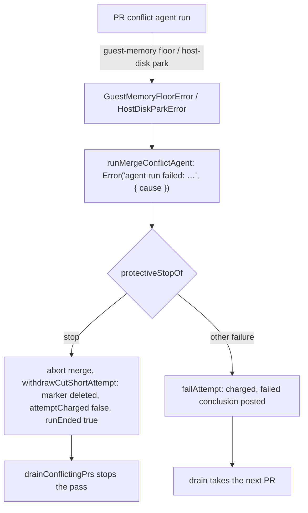

# PR Summary — Issue #5626

## Summary

A protective stop now ends a PR merge-conflict pass instead of feeding it the
next PR. When the guest-memory floor (`GuestMemoryFloorError`, Issue #4815) or
the host-disk park (`HostDiskParkError`) stops a PR's conflict agent, the
attempt is withdrawn uncharged, the merge is aborted, and the conflict drain
stops for the pass. Before this change the stop was wrapped as a plain
`agent run failed:` error. `failAttempt` then charged the PR and posted a failed
conclusion, and `drainConflictingPrs` started the next PR's agent into the same
low memory. This is the merge-conflict twin of the issue-path fix in #5618.

The wedge on GRQ-23 itself (`vibe-coder-2582`, run `vibe-mwx93j4f-71ac3e`) is
not diagnosed. Its evidence archive is on GRQ-23 only, and this run was on
another host. Part of #5626.

## Spec

### Intent and Rationale

- Logs mirrored from GRQ-23 on 26 November show the pattern this fixes. At
  00:41:05 both slots of container `vibe-coder-65924` were stopped at the floor
  (490 and 571 MiB available, floor 806 MiB). Both started a new agent at
  00:41:08, while six `/usr/bin/ld` LTO links of about 2.4 GiB each were still
  running. Guest memory fell back to about 2.8 GiB at 00:42:54. Starting more
  agent work straight after a floor stop is what the stop exists to prevent.
- The merge-conflict path had no handling for the typed stop at all. A grep for
  `GuestMemoryFloorError` finds only the execute phase, the quality-fix loop and
  the orchestrated issue run.
- This follows the existing precedent rather than a new mechanism: a provider
  refusal (Issue #2613) already goes through `withdrawCutShortAttempt`, which
  sets `runEnded: true`, and the drain already stops on that.

### Essential Design Decisions

- `runMergeConflictAgent` keeps the error message byte-for-byte
  (`agent run failed: <message>`) and adds the typed stop as the error's
  `cause`. The milestone ladder, the gate repair and the fast checks therefore
  see exactly what they saw before. Only the tracked-PR path reads the cause,
  through the new `protectiveStopOf`.
- The milestone-branch sync and the milestone takeover keep their current
  handling, which reports the stop as an agent error. Their results feed three
  more consumers, and no evidence ties a milestone sync to this incident.
  `docs/CONTAINER.md` says so.
- A protective stop sets `runEnded: true`, so the drain returns
  `{ kind: "deadline" }` and records the next PR as left behind by the
  deadline bound. That is the same accounting a provider refusal already gets.

### Undiscoverable Facts

- I read the GRQ-23 logs from the shared `GRQ-VibeCoder-logs` mirror, which
  holds slot worker logs and agent sessions. The always-callback record for
  `vibe-mwx93j4f-71ac3e` has no worker log: "no worker log lines tagged
  unknown#0 … were found". The facts file
  `hard-kill-vibe-coder-2582-1795680883.facts.json` exists only in GRQ-23's
  `~/logs/hard-kill-archive/`, so I could not read it.
- Both memory guards were already deployed on GRQ-23 before this incident. The
  00:41:05 `[GUEST_MEMORY_FLOOR]` line is from Issue #4815, and the Issue #5529
  `Guest memory critically low` kills also appear in the GRQ-23 logs. So a
  missing guard does not explain this wedge.
- Earlier merge-conflict watchdog kills on GRQ-3 (#5044, #5578, #5591) were
  closed without a code change. They have the same shape: the last step logged
  was the agent turn, the guest probe did not answer, and the silence lasted
  16–19 minutes.

## Evidence

Backend only; no UI file is touched.

- `worker/deno/lib/merge_conflict_agent.ts`: `protectiveStopOf`, and the
  `cause` on the failed-run error.
- `worker/deno/lib/pr_merge_conflict_processor.ts`: the tracked-PR path
  withdraws on a protective stop (`cutShortByProtectiveStop`).
- `worker/deno/lib/merge_conflict_drain.ts`: the stop log line and its comment
  now name every cut-short cause. The old line said "the run ended", which was
  already false for a provider refusal.
- `docs/CONTAINER.md` (guest memory floor section) and `docs/MERGE.md` (new
  paragraph "A protective stop is not a conflict either").
- Issue numbers cited in the diff:
  - #5626: Hard kill: container wedged in merge-conflict (watchdog)
  - #4815: Hard kill: container wedged in completion (watchdog)
  - #2613: A provider outage (402 Insufficient Balance) must not be reported as
    unresolved merge conflicts or trigger merge fallbacks
  - #1693: Merge-conflict pass starts a resolution it cannot finish before the
    cycle ends, then charges the watchdog's SIGTERM to the PR as a failed
    attempt
  - #1772: PR merge-conflict pass: a ruleset-rejected push spends no attempt,
    and milestone-head PRs are left to the milestone sync

## Reproduction

- **symptom** — a guest-memory-floor stop of a PR merge-conflict agent was
  charged to the PR as a failed attempt. The drain then went on to start the
  next PR's agent into the same low memory. The reported symptom is that the
  container went silent in the merge-conflict agent turn and was reaped by the
  watchdog.
- **status** — `partial` — the new processor tests failed against the unfixed
  code and pass after the fix. The guest-memory test failed with
  `attemptCharged` `true` (expected `false`); the host-disk test failed with
  `undefined`.
- reason: the GRQ-23 wedge itself was not reproduced. Its evidence is only on
  GRQ-23, so nothing shows that this incident went through a floor stop.
- **regression test** —
  `worker/deno/tests/pr_merge_conflict_processor_test.ts::processMergeConflict - a guest-memory-floor stop withdraws the attempt and stops the drain (Issue #5626)`

## Acceptance Criteria

- **missing** — "a container wedged and the launcher watchdog reaped it" (the
  cause of `vibe-coder-2582` going silent in the merge-conflict agent turn) —
  reason: the facts file and worker log are only in GRQ-23's
  `~/logs/hard-kill-archive/`, and this run was not on GRQ-23. This PR fixes the
  merge-conflict defect the GRQ-23 logs do show, but not a verified cause of
  this kill.

## Test Plan

- Added to `worker/deno/tests/pr_merge_conflict_processor_test.ts`, with a
  `claudeError` option on the `makeClaude` / `runProcessor` harness so the stub
  can return `{ ok: false, error }`:
  - `a guest-memory-floor stop withdraws the attempt and stops the drain (Issue #5626)`.
    It asserts that nothing is charged, `runEnded` is `true`, the marker is
    deleted, no failed or resolved conclusion is posted, nothing is pushed, and
    `merge --abort` runs.
  - `a host-disk park withdraws the attempt and stops the drain (Issue #5626)`.
  - The control, `an agent run that fails to spawn is still judged (Issue #5626)`.
    An ordinary failed run keeps its marker and posts one failed conclusion
    containing "agent run failed", and `runEnded` stays undefined.
- Added to `worker/deno/tests/merge_conflict_agent_test.ts`:
  - `a protective stop keeps its type under the failed run (Issue #5626)`: the
    message is unchanged, and `protectiveStopOf` returns the original instance.
  - `protectiveStopOf finds only a protective stop (Issue #5626)`: it returns
    undefined for a plain error and for an ordinary cause.
- No existing test was edited. The harness option is additive, and no test
  asserted the reworded drain log text (`merge_conflict_drain_test.ts` checks
  only its prefix).
- Red run against the unfixed code: `deno task test:unit tests/pr_merge_conflict_processor_test.ts`
  gave `111 passed | 2 failed`. The two protective-stop tests failed on
  `attemptCharged`, and the control passed.
- Green run at the head: `deno task test:unit tests/pr_merge_conflict_processor_test.ts tests/merge_conflict_agent_test.ts tests/merge_conflict_drain_test.ts tests/merge_conflict_drain_fairness_test.ts`
  gave `ok | 171 passed | 0 failed`.
- `deno fmt --check`, `deno lint` and `deno check` on the changed TypeScript
  files are clean.
- `./quality.sh < /dev/null` on the head: `Result: PASSED (with skipped
  checks)`. Config integration and checkov were skipped by the gate itself;
  deno tests, lint, type check, fmt, semgrep, gitleaks and markdownlint all
  passed.

### Not done or not checked

- The cause of the GRQ-23 wedge (see Acceptance Criteria).
- A protective stop in a milestone-branch sync or milestone takeover still reads
  as an agent error; this PR leaves that unchanged.
