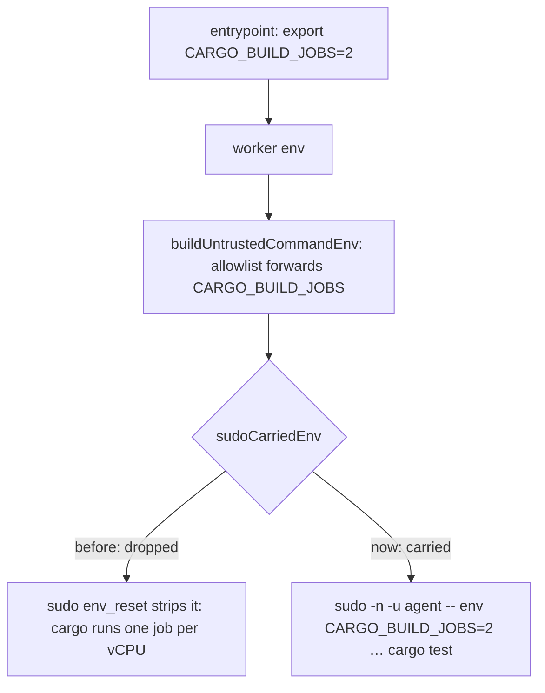

# PR Summary — Issue #5626

## Summary

Repository gate commands that the worker drops to the `agent` account now keep
the guest's cargo job cap. The container entrypoint exports
`CARGO_BUILD_JOBS=2` (Issue #4225) so that cargo cannot exhaust the swapless
guest's memory. But the worker runs a repository's own commands as
`sudo -n -u agent -- …`, and the sudo rule has no `SETENV` or `env_keep`, so
`env_reset` strips the child environment. Only what `sudoCarriedEnv`
(`worker/deno/lib/quality_gate_phase.ts`) returns travels in argv, and it
carried only `CARGO_TARGET_DIR` and the egress proxy. Every dropped
`cargo check` and `cargo test` therefore ran with one job per vCPU: the milestone
merge and resolution gates, the merge fast checks (both through
`runRepositoryCommand` in `worker/deno/lib/untrusted_gate_spawn.ts`) and the
quality gate. `sudoCarriedEnv` now also carries `CARGO_BUILD_JOBS`, but only
when its value is a positive whole number. Closes #5626.

## Spec

### Intent and Rationale

- This pass ran on GRQ-23, where
  `~/logs/hard-kill-archive/hard-kill-vibe-coder-2582-1795680883.facts.json` is
  readable. Its worker-log tail shows that the merge-conflict agent was the
  milestone sync's agent rung for `milestone/downturn-protection` in
  `stSoftwareAU/GRQ-AutoTrader`, a Cargo workspace (`Running Codex CLI …` at
  07:56:54). The transcript tail ends with the agent's `turn.completed` and the
  reply "Not run: formatting, lint, compilation or tests; the worker handles
  those checks". So the agent had finished, and the next step was the worker's
  own resolution gate (`verifyResolvedTree`), which runs the workspace's
  `cargo check` and `cargo test`.
- After 07:57:54 the whole worker process logged nothing, on any lane, and the
  guest boot log shows a process storm. The PIDs of the launcher's exec probes
  went 20290 (07:58:17), 29647 (08:00:19) and 1079 (08:02:21): about 11,000
  processes in four minutes, and the counter wrapped. By 08:04 vminitd logged
  repeated memory-threshold warnings. At 08:12:56 the exec failed with
  `Connection reset by peer`, and the watchdog reaped the container. An uncapped
  cargo build of a large workspace fits all of this. Issue #5529's evidence also
  fits: six `/usr/bin/ld` linkers ran at once under a cap of 2.
- The guards that exist do not cover this step. The guest memory floor
  (Issue #4815) and the early-OOM guard (Issue #5529) watch only agent runs in
  `claude_runner.ts`, and `docs/CONTAINER.md` says quality-gate commands are not
  watched. The fix restores the cap that was meant to apply, at the one helper
  that decides what crosses sudo. It adds no new guard.

### Essential Design Decisions

- The value travels only when it matches `/^[1-9][0-9]{0,3}$/`. An argv element
  must be a plain `NAME=value`, and a job cap of 0 or an odd string is never
  something the guest set.
- The change is made in the shared `sudoCarriedEnv`, so both of its callers get
  it: the quality gate's spawn (`quality_gate_phase.ts`) and
  `runRepositoryCommand`. Every caller wants the cap. A command that runs as the
  worker, not dropped, is unchanged, because `carryEnvThroughSudo` leaves a
  non-`sudo` argv alone and `Deno.Command`'s `env` already carries the cap.
- The worker does not choose the number. A host run that never set
  `CARGO_BUILD_JOBS` still carries nothing and stays uncapped, as
  `untrusted_command_env.ts` already documents.

### Undiscoverable Facts

- The facts file carries no guest memory reading: every guest probe reads
  "container exec did not answer: no answer within 10000ms". The memory
  exhaustion is inferred from the process storm, the vminitd warnings and the
  silence, not measured. Which account ran that gate's cargo is not logged
  either. In the production container the `agent` account is present, so the
  gates drop to it.
- The recurrence on GRQ-25 (`vibe-coder-30298`, run `vibe-mwxyq7bj-a41252`,
  20:07) has its archive only on GRQ-25, which this pass could not read. It came
  before #5631 merged at 21:35.
- PR #5631, the earlier pass on this issue, stops a merge-conflict pass after a
  protective stop. That still holds, and this change is separate from it.

## Evidence

Backend only. No UI file is touched.

- `worker/deno/lib/quality_gate_phase.ts`: `sudoCarriedEnv` carries
  `CARGO_BUILD_JOBS`. The TSDoc of `sudoCarriedEnv` and `carryEnvThroughSudo`
  names it.
- `docs/CONTAINER.md` (the bullet "The placement travels in argv for the
  untrusted account") and the `container/entrypoint.sh` comment above
  `export CARGO_BUILD_JOBS=2` say that the cap travels through sudo.
- Issue numbers cited in the diff:
  - #5626: Hard kill: container wedged in merge-conflict (watchdog)
  - #4225: Worker container locks up during agent cargo/deno test builds:
    guest-wide stall, no OOM, reaped only by the 11400s watchdog (8× in 32h on
    GRQ-3)
  - #4877, #2247, #4927, #5011: already cited in the TSDoc lines that were
    edited

## Reproduction

- **symptom** — the container went silent after the milestone sync's
  merge-conflict agent turn on a Cargo workspace, stopped answering exec, and
  was reaped by the launcher's watchdog.
- **status** — `partial` — the regression tests were observed failing against
  the unfixed `sudoCarriedEnv` and passing after the fix. On the base code, the
  dropped `cargo test` argv was
  `-n,-u,agent,--,env,CARGO_TARGET_DIR=…,GIT_CONFIG_COUNT=1,…,cargo,test`, with
  no `CARGO_BUILD_JOBS`.
- reason: the guest wedge itself (memory exhausted by the uncapped build) was
  not reproduced. That would need a real guest building GRQ-AutoTrader, and the
  archived facts have no guest memory reading.
- **regression test** —
  `worker/deno/tests/untrusted_gate_spawn_test.ts::a command dropped to the untrusted account keeps the guest's cargo job cap (Issue #5626)`

## Test Plan

- Added to `worker/deno/tests/quality_gate_phase_test.ts`:
  - `sudoCarriedEnv - the cargo job cap travels through sudo (Issue #5626)`:
    from an environment holding `PATH`, `CARGO_BUILD_JOBS` and `GH_TOKEN`,
    exactly `{ CARGO_BUILD_JOBS: "2" }` is carried.
  - `sudoCarriedEnv - a job cap that is not a positive whole number stays out of argv (Issue #5626)`:
    the control `"2"` is carried. `"2; rm -rf /"`, `"0"`, `"-1"`, `""`, `"02"`,
    `"2 "` and `"99999"` are each left out.
- Added to `worker/deno/tests/untrusted_gate_spawn_test.ts`:
  - `a command dropped to the untrusted account keeps the guest's cargo job cap (Issue #5626)`.
    It calls the real `runRepositoryCommand("cargo", ["test"])` with the agent
    drop, and asserts that `CARGO_BUILD_JOBS=2` sits after `env` and before
    `cargo test` in the spawned argv. The control, a source without the cap,
    has no `CARGO_BUILD_JOBS=` element.
- No existing test was edited. The quality gate's own spawn reads the process
  environment and has no injected-source harness, so that caller is covered
  through the shared helper's tests, not through its own spawn.
- Red run (before the fix):
  `deno task test:unit tests/quality_gate_phase_test.ts tests/untrusted_gate_spawn_test.ts`
  gave `146 passed | 3 failed`. The three failures were the new tests.
- Green run (head):
  `deno task test:unit tests/quality_gate_phase_test.ts tests/untrusted_gate_spawn_test.ts tests/credential_channel_4705_test.ts tests/merge_fast_checks_credentials_4705_test.ts`
  gave `174 passed | 0 failed`, and
  `deno task test:unit tests/merge_fast_checks_access_4697_test.ts tests/merge_fast_checks_test.ts tests/milestone_merge_gate_test.ts`
  gave `94 passed | 0 failed`. `deno fmt --check`, `deno lint` and `deno check`
  on the changed TypeScript are clean, and `bash -n container/entrypoint.sh`
  passes.

### Not done or not checked

- The guest wedge was not reproduced on a real guest (see Reproduction).
- The GRQ-25 recurrence's archive was not read.
- The memory guards still watch only agent runs. A gate's cargo now runs at
  the guest's cap, but it is not itself watched for memory.
