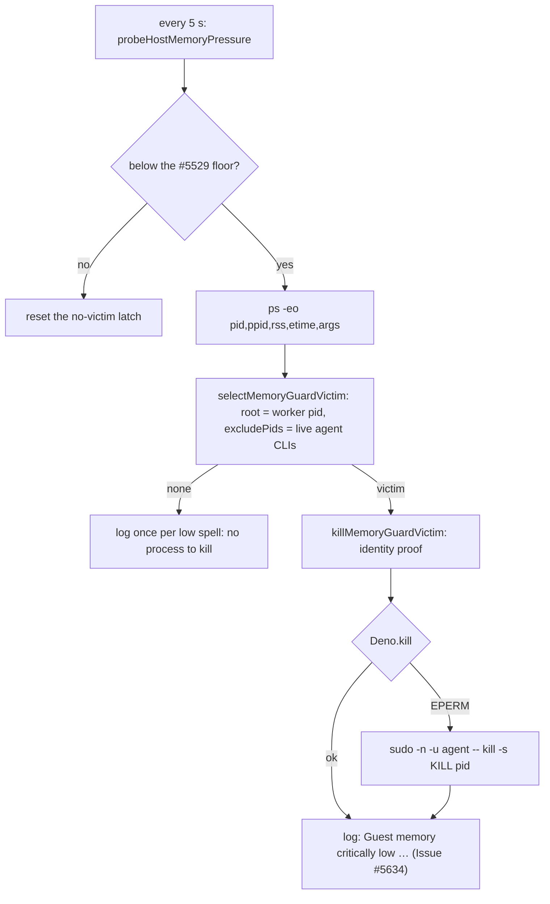

# PR Summary — Issue #5634

## Summary

The worker now runs a memory guard that watches every process it starts, not
just the process tree of one agent run. The guest wedged during an agent turn.
Its last in-run reading was MemAvailable 208 MiB, two minutes before it went
silent. That is well under both existing guards' floors (3% and 5% of the guest,
with minimums of 256 MiB and 512 MiB). Both guards act only on one agent run's
own process tree. The early-OOM guard (Issue #5529) kills the largest process in
that tree, and the guest memory floor (Issue #4815) stops that agent. So memory
held by anything else the worker starts was never acted on. That covers another
lane's quality gate, the merge fast checks and the milestone gates.

The new `WorkerMemoryGuard` (`worker/deno/lib/worker_memory_guard.ts`) runs
every 5 seconds for the life of the `run-core` loop. Below the #5529 floor it
sends SIGKILL to the largest process of at least 256 MiB in the worker's own
process tree, after the same identity proof the per-run guard uses. A live agent
CLI is never chosen, and neither is the worker itself. Gate commands run as the
separate `agent` account, which the worker cannot signal directly, so for those
the kill goes through `sudo -n -u agent -- kill`. Closes #5634.

## Spec

### Intent and Rationale

- This pass ran on GRQ-23. The evidence for `vibe-coder-98473` is archived only
  on GRQ-3, so it was not read. What is known comes from the issue body: phase
  `execute`, last step `agent turn`, MemAvailable 208 MiB at 22:04:21Z, last log
  line at 22:06:41Z, and no answer to the guest probe.
- At 208 MiB, both per-run guards should have acted on anything in the agent's
  own tree within one tick (5 s for the floor, 20 s for #5529), yet the guest
  kept running for another 2m20s and then wedged. Something the agent-run guards
  cannot see is the gap that the base code confirms. `docs/CONTAINER.md` stated
  that quality-gate and pre-flight commands "are not watched".
- The fix extends the #5529 rule to a wider tree rather than adding a new rule.
  It reuses `selectMemoryGuardVictim`, `killMemoryGuardVictim`,
  `memoryGuardFloorBytes` and `formatMemoryGuardKill`, so the floor and the
  identity proof have one owner.

### Essential Design Decisions

- The tree root is the worker's pid (`Deno.pid`). Live agent CLI pids
  (`listActiveAgentRuns`) are excluded through the new `excludePids` option, so
  the guard never stops an agent CLI itself. A process inside an agent's tree
  can still be chosen, exactly as the per-run guard would choose it. Both guards
  pick the largest process in their own tree, so when the hog is inside an agent
  tree they pick the same pid. The identity proof then keeps the second signal
  from reaching a stranger.
- On `Deno.errors.PermissionDenied`, the kill falls back to
  `sudo -n -u agent -- kill -s KILL <pid>`, built with `asUntrustedUser`. This
  was observed here: `Deno.kill` on an `agent`-owned process throws
  `EPERM: Operation not permitted`, while the sudo kill succeeds and the target
  exits 137.
- A process re-parented away from the worker (a backgrounded job whose shell
  exited) has no live chain to the worker, so it is still never chosen. When no
  process qualifies, a single line is logged for each low spell.
- The guard is started in `commands/run_core.ts`, beside
  `armGuestMemoryFloor(true)`, and stopped in a `finally`. This means unit tests
  never inherit the host's memory.

### Undiscoverable Facts

- The hog in the GRQ-3 incident is not known. The diagnosis is that memory
  outside the agent's tree went unwatched. It is inferred from the reading, the
  silence and the guards' code, and not from the archive.
- The cargo job cap that #5626's pass carries through sudo is on a separate,
  unmerged branch. This change does not depend on it.

## Evidence

Backend only. No UI file is touched.

- Issue numbers cited in the diff:
  - #5634: Hard kill: container wedged in execute (watchdog)
  - #5529: Hard kill: container wedged in setup (watchdog)
  - #4815: Hard kill: container wedged in completion (watchdog)

## Reproduction

- **symptom** — the guest ran out of memory during an agent turn and stopped
  answering, and the launcher's watchdog reaped the container.
- **status** — `partial` — the new tests were written first. They failed against
  the base code, because `worker/deno/lib/worker_memory_guard.ts` and the
  `excludePids`/`scope` options did not exist. After the fix they pass.
- reason: the guest wedge was not reproduced. The archive is on GRQ-3, and
  reproducing it would need a real guest exhausted by a process outside every
  agent tree.
- **regression test** —
  `worker/deno/tests/worker_memory_guard_5634_test.ts`

- Other changes in the diff:
  - `worker/deno/lib/memory_guard.ts`: `selectMemoryGuardVictim` takes
    `excludePids`. `formatMemoryGuardKill` takes `scope: "worker"`, and the
    default `"agent-run"` text is unchanged. `MemoryGuardKillDeps.kill` may
    return a promise, which is awaited. The three refusal reasons of
    `killMemoryGuardVictim` now name "the root" or "the tree" rather than "the
    agent", because the worker guard reaches them too. The per-run guard's
    `Memory guard left pid=… alone` line therefore reads differently, and its
    tests assert only `killed === false` and "changed hands", which is unchanged.
  - `worker/deno/commands/run_core.ts` starts and stops the guard.
  - The `worker/deno/lib/memory_pressure.ts` header names the new guard.
  - `docs/TROUBLESHOOTING.md` has a new paragraph after the #5529 one.
  - `docs/CONTAINER.md`: the #4815 floor still does not stop gate commands, and
    the new guard does cover them.
  - `docs/audits/lib-sweep-coverage/top-up-5634.json` claims the new module for
    the sweep ledger.

## Test Plan

- New: `worker/deno/tests/worker_memory_guard_5634_test.ts` (14 tests), driving
  `WorkerMemoryGuard.tick()` and `killWorkerTreeProcess` with injected deps:
  - A gate `cargo test` of 3 GiB under `sudo`, outside any agent tree, is killed
    rather than an agent's 400 MiB child. The log carries
    `Guest memory critically low`, the pid and `Issue #5634`.
  - The agent CLI itself is never chosen, and the next largest process is.
  - Above the floor, nothing is read, killed or logged, though a large process
    is present.
  - A large process with ppid 1 (outside the worker's tree) is not killed. The
    no-victim line is logged once per low spell and again after a recovery.
  - A `ps` failure, a victim whose start time changes, a kill that throws, and a
    probe that throws are each logged or refused without a kill.
  - An async kill is awaited before the kill line is logged. A failed first
    worker fingerprint is refused, then retried and killed on the next tick.
  - `killWorkerTreeProcess`:
    - A successful direct signal runs nothing.
    - `PermissionDenied` runs exactly
      `sudo -n -u agent -- kill -s KILL <pid>`.
    - A failing sudo rejects with its stderr cause
      (`sudo: a password is required`).
    - Any other error is rethrown without sudo.
- Added to `worker/deno/tests/memory_guard_5529_test.ts`:
  - `excludePids` stops pid 105 being chosen, and the control without it does
    choose 105.
  - The `"worker"` scope text names #5634, and the default text still names
    "this agent run's tree" and #5529.
- No existing test was edited.
- Red run: the new tests were written before the library changes. The run
  failed at load with `Module not found .../lib/worker_memory_guard.ts`.
- Green run on the head:
  `deno task test:unit tests/worker_memory_guard_5634_test.ts tests/memory_guard_5529_test.ts tests/claude_runner_guest_memory_floor_4815_test.ts tests/guest_memory_floor_4815_test.ts`
  gave `53 passed | 0 failed`. `deno task check:manifests` gave
  `876 passed | 0 failed | 1 ignored`. `deno fmt --check`, `deno lint` and
  `deno check` on the changed TypeScript are clean.
- `./quality.sh < /dev/null` was run once, under `timeout 1500`, and did not
  finish: exit 124. Before the cut-off, every stage it reached passed except
  completeness checks. That failure was `lib_sweep_coverage_test.ts`, because
  the new module was not claimed by any sweep slice. It is fixed by
  `top-up-5634.json`, and `check:manifests` now passes as above. Config
  integration and Checkov were skipped (no `.config.json`, no checkov). There
  was not enough budget left to re-run the whole gate.

<!-- vibe-quality-gate-skipped reason="the full ./quality.sh run timed out at 1500 s; its only failure (completeness checks) was fixed and re-run green, but the run budget could not cover a second full gate" -->

### Not done or not checked

- The guest wedge was not reproduced, and the GRQ-3 archive was not read.
- The production wiring in `commands/run_core.ts` (start and stop, and
  `productionWorkerMemoryGuardDeps`) has no test of its own. Only the guard and
  the kill helper are tested through injected deps.
- The sudo fallback was observed by hand on this container, not in a test
  against the real `agent` account.
- A process re-parented away from the worker is still never killed.
