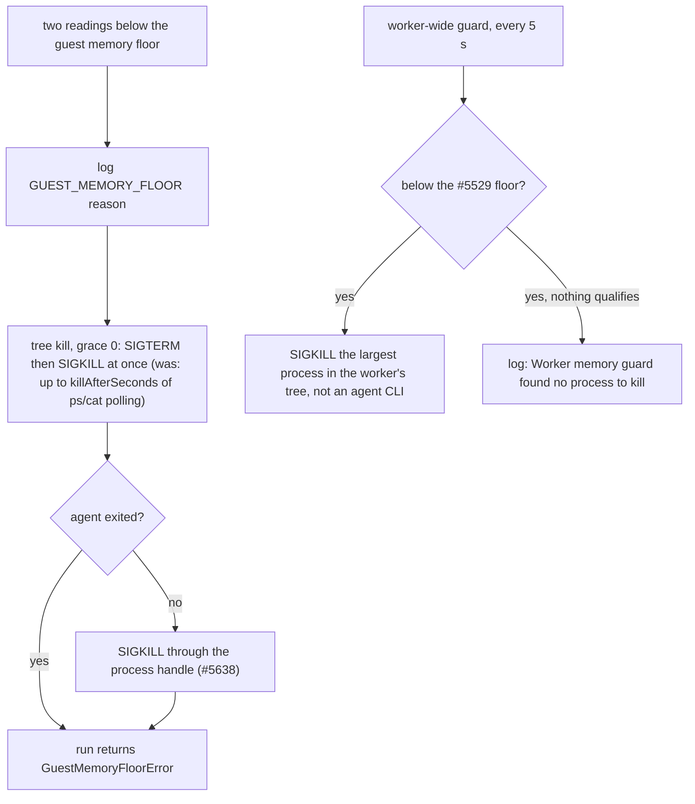

# PR Summary — Issue #5634

## Summary

Two hard kills on GRQ-3 wedged the guest during an agent turn. The facts added
to the issue for the second one (`vibe-coder-72248`) show the guest memory floor
stopped the agent at 03:32:56Z, and that was also the last line the worker
logged.

This PR makes three changes:

- **The floor stop no longer waits out a SIGTERM grace.** It used to pass the
  run's `killAfterSeconds` (30 s by default) to the tree kill. The tree kill
  then sent SIGTERM and polled once a second, spawning `ps` and `cat` each time,
  before any SIGKILL. A guest already below its floor kept the tree's memory for
  that whole wait. The floor now passes a grace of 0, so SIGKILL follows SIGTERM
  straight away. The #5638 kill through the agent's process handle stays as the
  backstop.
- **A worker-wide memory guard is added**
  (`worker/deno/lib/worker_memory_guard.ts`). Every 5 s, below the #5529 floor,
  it sends SIGKILL to the largest process of at least 256 MiB in the worker's
  own process tree. It never chooses an agent CLI or the worker itself. This
  covers memory held outside any agent run's tree, such as a quality gate or
  merge check.
- **The hard-kill body's `Memory guards:` figure (#5638) now reads the worker
  guard's lines correctly.** Its "no process to kill" line used to open with the
  kill prefix, so it was reported as a kill. It now has its own prefix, and
  every line where the worker guard took no action reads as
  `a memory guard could not act`.

Closes #5634.

## Spec

### Intent and Rationale

- The evidence on GRQ-3 was not read from here. The diagnosis rests on the
  issue's facts and the base code:
  - The floor fired at the last log line.
  - On base, the floor stop passed `killAfterSeconds` to `terminateDescendants`
    and `terminateProcessTree` (`worker/deno/lib/pid_guard.ts`). Both wait in a
    loop that spawns `ps` and `cat` once a second.
- A grace of 0 reuses the existing primitives unchanged. With 0, both functions
  skip the wait loop and send SIGKILL right after SIGTERM.
- The worker-wide guard reuses `selectMemoryGuardVictim`,
  `killMemoryGuardVictim`, `memoryGuardFloorBytes` and `formatMemoryGuardKill`.
  The floor and the identity proof therefore each have one owner.

### Essential Design Decisions

- **Only the guest-memory floor path drops the grace.** The host-disk stop and
  the other callers keep `killAfterSeconds`: this change targets only the stop
  that fires while the guest is short of memory.
- **The worker-wide guard's tree** is rooted at `Deno.pid`.
  - It excludes live agent CLI pids through the new `excludePids` option.
  - A kill refused with `PermissionDenied` (a process running as the `agent`
    account) is retried as `sudo -n -u agent -- kill -s KILL <pid>`.
- **The guard's log prefixes are exported constants**
  (`WORKER_MEMORY_GUARD_COULD_NOT`, `_LEFT_ALONE`, `_FAILED`, `_NO_VICTIM`).
  `hardKillMemoryGuards` reads them, so the writer and the reader share one
  copy. Only a real kill opens with `MEMORY_GUARD_KILL_PREFIX`.

### Undiscoverable Facts

- `vibe-coder-72248` facts:
  `Last liveness tick: MemAvailable 715 MiB (logged
  2026-11-27 03:32:26Z)`.
  `Memory guards: guest memory floor stopped the agent
  (logged 2026-11-27 03:32:56Z)`.
  `Last log time: 2026-11-27 03:32:56Z`.
- The agent is not spawned with `setsid`, so it shares the worker's process
  group. A group SIGKILL is therefore not available, and descendants are still
  found and signalled one by one through spawned `ps`/`kill`.

## Evidence

Backend only. No UI file is touched.

- Issue numbers cited in the diff:
  - #5634: Hard kill: container wedged in execute (watchdog)
  - #5638: Hard kill: container wedged in completion (watchdog)
  - #5529: Hard kill: container wedged in setup (watchdog)
  - #4815: Hard kill: container wedged in completion (watchdog)

## Reproduction

- **symptom** — the guest memory floor stopped the agent, the worker logged
  nothing more, and the launcher's watchdog reaped the silent guest.
- **status** — `partial` — the grace wait was reproduced and fixed. The new test
  runs an agent that ignores SIGTERM, with a 3600 s grace. On the unfixed
  `claude_runner.ts`, the floor stop never returned:
  `timeout 90 deno task test:unit tests/claude_runner_guest_memory_floor_grace_5634_test.ts`
  exited 124. With a grace of 0 it passes.
- reason: the guest wedge itself was not reproduced. It needs a real guest
  exhausted of memory, and the archive for this kill is on GRQ-3.
- **regression test** —
  `worker/deno/tests/claude_runner_guest_memory_floor_grace_5634_test.ts`

## Test Plan

- **New:**
  `worker/deno/tests/claude_runner_guest_memory_floor_grace_5634_test.ts`. This
  uses the real tree kill, with no injected `killProcessTree`. The agent stub
  ignores SIGTERM and stays gated, and `killAfterSeconds` is 3600. The run must
  return `GuestMemoryFloorError` with the literal floor reason.
  - Red on base: hung, killed by `timeout 90` (exit 124).
  - Green on the head.
- **New:** `worker/deno/tests/worker_memory_guard_5634_test.ts` (14 tests). They
  drive `WorkerMemoryGuard.tick()` and `killWorkerTreeProcess` with injected
  deps.
  - A gate process outside any agent tree is killed in preference to an agent's
    child. The agent CLI itself is never chosen.
  - Above the floor, nothing is read or killed.
  - A ppid-1 process is not killed.
  - The no-victim line is logged once per low spell, as the literal
    `Worker memory guard found no process to kill: …` line.
  - A `ps` failure, a changed start time, a throwing kill or probe, and a failed
    first fingerprint are each handled.
  - The `sudo -n -u agent -- kill -s KILL <pid>` fallback is used, and a failing
    sudo rejects with its stderr.
- **Added to `worker/deno/tests/memory_guard_5529_test.ts`:** `excludePids`
  stops a pid being chosen, and a control without it chooses that pid. The
  `"worker"` scope names #5634, and the default text is unchanged.
- **Added to `worker/deno/tests/hard_kill_guest_facts_test.ts`:**
  - A no-victim line logged by the real `WorkerMemoryGuard` reads as
    `a memory guard could not act`, not a kill.
  - Each worker could-not prefix is read on its own.
  - A `scope: "worker"` kill line still reads as a kill.
  - The first two failed against the unchanged library: the first read as
    `early-OOM guard killed a process`, the second as
    `none logged in the log tail`. The third passed before and after, as
    expected.
- **Existing tests:** no existing test on the base branch was edited. No `-`
  lines appear under `worker/deno/tests/` in `git diff origin/main...HEAD`.
- **Targeted run on the head:**
  `deno task test:unit tests/claude_runner_guest_memory_floor_grace_5634_test.ts tests/claude_runner_guest_memory_handle_kill_5638_test.ts tests/claude_runner_guest_memory_floor_4815_test.ts tests/memory_guard_5529_test.ts tests/worker_memory_guard_5634_test.ts tests/hard_kill_guest_facts_test.ts tests/hard_kill_report_test.ts`
  gave 176 passed, 0 failed. A second run, with
  `tests/hard_kill_facts_backfill_4815_test.ts` and without the three runner
  tests, gave 182 passed, 0 failed.
- **`./quality.sh < /dev/null` on `c3731bf11`:**
  - Every stage passed except markdownlint, including deno tests (parallel and
    serial), lint, type check, fmt, semgrep and gitleaks.
  - Markdownlint failed with one MD018 violation: a wrapped
    `docs/TROUBLESHOOTING.md` line began `#5634;`.
  - Config integration was skipped (no `.config.json`). Checkov was skipped (no
    checkov on PATH).
- **Markdownlint after the fix:** `e9c7a93ad` rewraps that line.
  `deno run -A worker/deno/mod.ts check-markdownlint` then gave
  `markdownlint: PASSED (246 file(s) checked)`. The full gate was not re-run,
  because only that Markdown line changed.

### Not done or not checked

- The guest wedge was not reproduced, and the GRQ-3 archive was not read.
- The descendants are still found and signalled through spawned `ps`/`kill`,
  which can time out on a starving guest. That is not removed, only the wait
  between SIGTERM and SIGKILL.
- The `run_core.ts` start and stop of the worker-wide guard has no test of its
  own. The sudo fallback was observed by hand, not tested against the real
  `agent` account.
