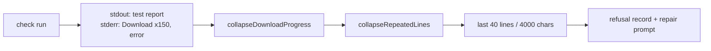

# PR Summary — Issue #5637

## Summary

The merge gate's recorded output, and the output it hands a repair round, now
keeps the failing test's report when a cold Deno module cache prints hundreds of
`Download https://…` progress lines. Each run of those lines collapses into one
`[N Deno module download line(s) omitted]` line before the 40-line tail is
taken. One exported owner, `keepOutputTail` in
`worker/deno/lib/milestone_merge_gate.ts`, replaces the three identical private
`tail()` copies in the merge gate, the resolution gate and the PR-path fast
checks. Closes #5637.

## Spec

### Intent and Rationale

- The refusal behind #5637 recorded only Deno `Download` lines, the `Task` line
  and `error: Test failed`. Deno writes those to stderr and the test report
  (`ERRORS`, `FAILURES`, `FAILED | …`) to stdout. `spawnTask` joins stdout then
  stderr and keeps the last 40 lines, so the report was cut. The repair round
  got no diagnosis and "changed nothing in the tree", and three refused cycles
  became the fallback.
- Collapsing the noise keeps the report and still shows that lines were dropped.
  The alternative was to tail each stream on its own, but that changes the order
  and size of every check's record, not just the noisy case.

### Essential Design Decisions

- A line is dropped only when, after `stripAnsi` (reused from
  `github_actions_log_fetcher.ts`) and `trimEnd`, it is exactly
  `Download <http(s) URL>`. `Downloaded …`, `error: Failed downloading …`, a
  bare `Download` and `Download failed: …` are kept.
- Each consecutive run becomes one marker line with its count, so nothing is
  dropped without a trace (fail loud). The 40-line / 4000-character limits and
  `collapseRepeatedLines` are unchanged.
- The pattern is matched on the gate's in-memory output only. Nothing persisted
  changes shape, and the toolchain-gap detectors still read the raw output
  before the tail.

### Undiscoverable Facts

- The private run's full refusal reason was found in this host's
  `self-heal.jsonl` (`milestone_branch_sync` `sync_failed`,
  2026-11-26T23:32:05Z). It is 7,859 characters of `Download` lines around
  `deno task test:unit …
  failed (exit 1)` and `error: Test failed`, with
  "repair round 1 changed nothing in the tree".
- Observed with the real Deno 2.9.8 (`deno task test:unit`, `--reporter=dot`,
  cold `DENO_DIR`): the `Download` lines print as
  `\x1b[0m\x1b[32mDownload\x1b[0m https://…` on stderr, byte for byte the
  record's form, and the failure report prints on stdout.
- Which GRQ unit test failed is still unknown, because the record never held it.
  This change makes the next refusal, and its repair round, carry it.

## Evidence

Backend-only change; no UI file is touched.

- `worker/deno/tests/milestone_gate_output_tail_5637_test.ts` drives the three
  production entry points with the observed stdout and stderr:
  `verifyResolvedTree` through the real `spawnTask` join, `checkMergedTree` and
  `runMergeFastChecks`. It also tests `collapseDownloadProgress` directly.

## Reproduction

- **symptom** — the merge-gate refusal and the repair round carried only Deno
  `Download https://…` lines and `error: Test failed`, never the failing test,
  so the repair changed nothing and the sync fell back
  (`deno task test:unit in /home/vibe/auto-issue-work/GRQ failed (exit 1)`)
- **status** — `verified` — the three entry-point tests were observed failing
  against the unfixed code (`FAILED | 0 passed | 3 failed`: the kept output held
  only download lines, the `Task` line and `error: Test failed`, with no
  `the ensemble error is common`), and they pass after the fix
- **regression test** —
  `worker/deno/tests/milestone_gate_output_tail_5637_test.ts` (the
  `verifyResolvedTree`, `checkMergedTree` and `runMergeFastChecks` cases)

## Test Plan

- Added `worker/deno/tests/milestone_gate_output_tail_5637_test.ts`, 9 tests:
  - three entry-point tests, red on base and green after the fix;
  - two separate download runs give two markers, each with its own count;
  - a single line gives `[1 …]`;
  - the uncoloured (NO_COLOR) form collapses;
  - the look-alikes are kept verbatim;
  - output with no download lines comes back unchanged;
  - a hostile 100,000-escape line comes back unchanged (an output assertion, no
    timing).
- No existing test was edited.
- `deno task test:unit` over the new file plus
  `milestone_resolution_gate_test.ts`,
  `milestone_resolution_gate_cause_5162_test.ts`,
  `milestone_merge_gate_test.ts`, `milestone_merge_gate_cause_test.ts` and
  `merge_fast_checks_test.ts`: 94 passed, 0 failed.
- `./quality.sh`: every check up to and including `deno tests` (849s) and
  `deno lint` passed, except markdownlint (MD018 on a re-wrapped `#5637).` line
  in `docs/workflows/milestones.md`, since fixed). The run hit my 900s bound
  before its last steps. I then ran those directly: `deno fmt
  --check` passed
  (3956 files), `deno check` on the changed modules and `lib/git_pull.ts`
  passed, and markdownlint on the fixed doc passed.
  <!-- vibe-quality-gate-skipped reason="the full ./quality.sh run hit the 900s command bound after deno tests and deno lint passed; the remaining fmt, type-check and markdownlint steps were run directly and pass" -->

Not checked: a full `./quality.sh` run from start to finish on the final head,
and a fresh sync of the private milestone branch. Remaining risk: a Deno release
that changes the `Download` line's wording would no longer be collapsed. The
output would then be no worse than it was before this change.
