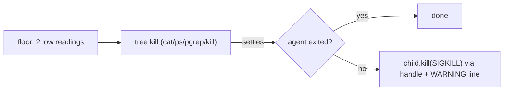

# PR Summary — Issue #5638

## Summary

Once the guest memory floor decides to stop the agent, the agent now stops even
when the guest has no memory left to start a process. The floor's process-tree
kill (`killClaudeProcessTree`) works through `cat`, `ps`, `pgrep` and `kill`,
each a new process. On an exhausted guest every one of them times out, so the
agent kept running until the container wedged. When that tree kill comes back
with the agent still not exited, the runner now sends SIGKILL through the
agent's own `Deno.ChildProcess` handle, which starts no new process, and logs
`Guest-memory floor sent SIGKILL through the agent's process handle, PID <pid>`.
Whether this was the cause of the GRQ-3 wedge filed here is still unconfirmed,
because that host's archive is still missing. Part of #5638.

## Spec

### Intent and Rationale

- GRQ-3's archive for this kill is still not in the `GRQ-VibeCoder-logs` mirror
  (re-fetched 27 November, head `1849a64e`; the newest GRQ-3 day is 21
  November). The same failure is in GRQ-23's archived log for
  `stSoftwareAU/VibeCoder#5544` (run `vibe-mwwt65ra-8a3ceb`, 26 November). There
  the floor fired at 460 MiB, but the stop then logged
  `Failed to kill claude process (PID 46242): ps timed out after 10000ms` and
  `Failed to kill claude descendants (PID 46242): pgrep timed out after 10000ms`.
  Memory then stayed near 200 MiB for more than 20 minutes.
- In this issue, memory read 219 MiB, which is below the 512 MiB floor, yet the
  log ran on for five more minutes with no sign of the agent stopping. That
  matches the same pattern.
- Killing through the handle needs no process table and no fingerprint read.
  Deno refuses `kill` on a child it has already reaped, so the signal can only
  reach the process the runner started.

### Essential Design Decisions

- The handle kill runs only after the tree kill has settled, whether it resolved
  or threw. This keeps the tree kill's order (descendants first, then the
  parent) whenever its probes can run.
- `childExited` is set from `child.status`. If the agent was reaped in the
  meantime, the `TypeError` "Child process has already terminated" is ignored.
  Any other error is logged as `Guest-memory kill failed for PID …`, the line
  the memory-guards figure already counts.
- Only the floor path changed. The watchdog, silence and host-disk kills keep
  `killClaudeProcessTree` as before. `RunClaudeOptions.killProcessTree` is a
  seam whose production default is `killClaudeProcessTree`.
- Processes the agent started that outlive it are still left to the leftover
  reaper, and that reaper also runs `ps` and `sh` (`agent_leftover_reaper.ts`).

### Undiscoverable Facts

- Deno 2.9.8 throws `TypeError: Child process has already terminated` from
  `ChildProcess.kill` after exit, checked in a scratch run.
- In the GRQ-23 log, the processes holding the memory were six `ld` linkers of
  about 2.3 GiB each. Those are the agent's descendants, not the agent.

## Evidence

Backend only. The new test is
`worker/deno/tests/claude_runner_guest_memory_handle_kill_5638_test.ts`.

## Reproduction

- **symptom** — the floor stop was logged, but the agent kept running because
  every spawned kill probe timed out (`ps timed out after 10000ms`), until the
  watchdog reaped the guest
- **status** — `partial` — reason: a guest out of memory was not staged. The
  test injects a tree kill that signals nothing, or throws
  `ps timed out after 10000ms`, mirroring the logged lines. Because the base
  branch has no such seam, the red run used the seam without the handle kill. It
  hung until `timeout 90` ended it (exit 124), and it passes after the fix.
- **regression test** —
  `worker/deno/tests/claude_runner_guest_memory_handle_kill_5638_test.ts::guest memory handle kill - a tree kill that signals nothing still stops the agent (Issue #5638)`

## Acceptance Criteria

- **missing** — a container wedged and the launcher watchdog reaped it, so the
  run never released its claim — reason: the agent now stops even when no
  process can be started, but two things are still not done. GRQ-3's archive is
  absent, so it is unconfirmed that this run wedged this way. And the agent's
  surviving descendants (the GRQ-23 `ld` linkers) are still reaped only through
  a spawned `ps`.

## Test Plan

- New `worker/deno/tests/claude_runner_guest_memory_handle_kill_5638_test.ts`.
  The real agent stub stays gated, so only a kill can end it:
  - "a tree kill that signals nothing still stops the agent" asserts a
    `GuestMemoryFloorError` with the literal floor reason, one tree-kill call
    and the literal handle-kill WARNING line.
  - "a tree kill that throws still stops the agent" also asserts
    `Guest-memory kill failed for PID <pid>: ps timed out after 10000ms`.
  - The control "a healthy guest never calls the tree kill" asserts exit 0, no
    tree-kill call and no handle-kill line.
- Not staged: the agent being reaped between the tree kill settling and the
  handle kill (the ignored `already terminated` branch). That window cannot be
  timed without a wall-clock race.
- No existing test was edited. `deno task test:unit` over the new file,
  `worker/deno/tests/claude_runner_guest_memory_floor_4815_test.ts` and
  `worker/deno/tests/execute_phase_guest_memory_floor_4815_test.ts`: 10 passed,
  0 failed.
- `timeout 1500 ./quality.sh < /dev/null` on the code commit:
  `Result: PASSED (with skipped checks)`. Config integration and Checkov were
  skipped. Deno tests, lint, type check, fmt, markdownlint, mermaid, semgrep and
  gitleaks passed.
- Docs: `docs/CONTAINER.md` (the guest memory floor section) and
  `docs/TROUBLESHOOTING.md` (the `[GUEST_MEMORY_FLOOR]` entry) describe the
  handle kill.

Not checked: a guest that has really run out of memory, and GRQ-3's archive for
this kill. Remaining risk: descendants that outlive the agent still hold their
memory until the leftover reaper's `ps` can run.
