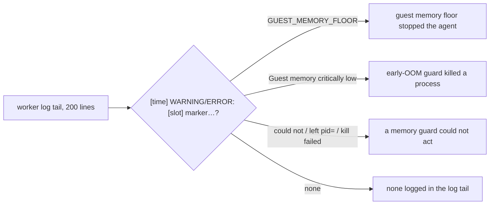

## Summary

The hard-kill issue body gains a `**Memory guards:**` figure. It reports, from
the worker log tail, whether the two in-run memory guards acted before the
wedge. The guest memory floor (Issue #4815) may have stopped the agent. The
early-OOM guard (Issue #5529) may have killed a process, or a guard may have
logged that it could not act. Each figure carries the time of the newest such
line. The #5638 body showed guest memory at 219 MiB five minutes before the log
went silent, which is below both guards' floors, but nothing in it said whether
either guard fired. The cause of this wedge is still unknown, so the wedge is
not fixed. Part of #5638.

## Spec

### Intent and Rationale

- The killed run was `stSoftwareAU/GRQ-AutoTrader#6942` (completion phase) on
  GRQ-3, container `vibe-coder-22185`, worker commit `fd1c82892`. Its archive is
  on GRQ-3 only. GRQ-3's sessions for 26–27 November are not in the
  `GRQ-VibeCoder-logs` mirror, so the transcript and worker log could not be
  read here.
- The public figures fit guest memory exhaustion during an agent turn: 219 MiB
  available at the last liveness tick (23:49:32Z), then five more minutes of log
  with no further minute tick, then silence. Both guards should act at that
  level, so the next question is whether they did. The issue body could not
  answer it. This figure answers it on every later hard kill.
- No guard, timeout or kill path changed. Without the evidence, a behaviour
  change would be a speculative fix for an unreproduced fault.

### Essential Design Decisions

- `hardKillMemoryGuards` (`worker/deno/lib/hard_kill_guest_facts.ts`) counts a
  line only when the marker opens the message: straight after
  `[<time>Z] WARNING:` or `ERROR:`, or after one slot tag such as
  `[s1 owner/repo#N]`. A marker quoted mid-message or inside an
  `[agent-progress]` tool detail does not count, so agent text cannot fake a
  guard action.
- The markers are owned by the guards: `GUEST_MEMORY_FLOOR_MARKER` and the new
  `GUEST_MEMORY_KILL_FAILED` in `guest_memory_floor.ts`, and
  `MEMORY_GUARD_KILL_PREFIX`, `MEMORY_GUARD_COULD_NOT` and
  `MEMORY_GUARD_LEFT_ALONE` in `memory_guard.ts`. `formatMemoryGuardKill` and
  the four log calls in `claude_runner.ts` now build their text from these
  constants. The text they emit is unchanged.
- The figure is fixed words plus a captured timestamp, never log text. Each line
  is cut to 2,000 characters before matching, and both patterns are linear.

### Undiscoverable Facts

- The run id and issue come from GRQ-3's failure report
  `docs/logs/Vibe-Coder-GRQ-3/20261127-001935.log` in the GRQ-health checkout.
  That report names the run `vibe-mwy4pmhc-c036b9`, `GRQ-AutoTrader#6942` and
  phase `completion`. Its archive paths under `runs/GRQ-3/2026-11-27/` are not
  in the logs mirror.
- The real floor-stop line used as a test fixture was copied from this host's
  own worker log (`GRQ-AutoTrader#5644`, 26 November 00:34:34Z).

## Evidence

Backend only. The change adds one fixed-shape line to the auto-filed issue body.

## Reproduction

- **symptom** —
  `The launcher's watchdog found the guest silent and not
  answering its exec probe.`,
  phase `completion`, last step `agent turn`, after `MemAvailable 219 MiB` at
  the last liveness tick.
- **status** — `not-run` — reason: the evidence archive is only on GRQ-3, and
  nothing here reproduces a guest exhausting its memory. This PR adds a
  diagnostic figure, not a fix.
- **regression test** —
  `worker/deno/tests/hard_kill_guest_facts_test.ts::the real floor-stop line is read (Issue #5638)`

## Acceptance Criteria

<!-- vibe-spec-review inputs="diff+issue-body" -->

- **partial** — a container wedged and the launcher watchdog reaped it, so the
  run never released its claim — evidence:
  `worker/deno/tests/hard_kill_guest_facts_test.ts::the real floor-stop line is read (Issue #5638)`
  — reviewer: partial — reason: future hard-kill reports now say whether a
  memory guard acted, but the wedge is not fixed and a reaped run still never
  releases its claim. The cause cannot be found without GRQ-3's archive, which
  is still missing from the logs mirror (checked 27 November, mirror head
  `117ee15c`, newest GRQ-3 day 21 November).

## Test Plan

- `worker/deno/tests/hard_kill_guest_facts_test.ts` adds `hardKillMemoryGuards`
  tests, each asserting a literal result:
  - "the real floor-stop line is read (Issue #5638)" uses a production log line.
  - "producer-built floor and kill lines are read, newest of each (Issue #5638)"
    builds its lines with `guestMemoryFloorReason` and `formatMemoryGuardKill`.
    Two floor stops at different times show that the newest one is reported.
  - "each could-not-act prefix is read on its own (Issue #5638)" checks the
    kill-failed, left-alone and could-not prefixes, each in a one-line tail,
    with and without a slot tag.
  - "look-alikes do not count (Issue #5638)" covers an `[agent-progress]` line
    quoting both markers, a marker in mid-message and a line with no timestamp.
    Each reads `none logged in the log tail`.
  - "an empty tail reads none logged" and "a hostile long line returns" (50,000
    characters).
- `worker/deno/tests/hard_kill_report_test.ts`: the test "the body carries the
  guest and host figures under the last log time" now expects
  `**Memory guards:** none logged in the log tail` after the liveness-tick line.
  Its slice grows from seven figures to eight, because this PR adds the line.
  Every other expected line is unchanged. The new test "a floor stop in the log
  tail shows in the body (Issue #5638)" asserts the figure in the rendered body.
- Before the change, these two files failed: 76 passed, 3 failed, because
  `hardKillMemoryGuards` did not exist. After it they passed: 126 passed, 0
  failed.
- `timeout 1500 ./quality.sh < /dev/null` on the code commit returned
  `Result: PASSED (with skipped checks)`. Config integration and Checkov were
  skipped. The deno tests, lint, type check, fmt, markdownlint, mermaid, semgrep
  and gitleaks passed.
- No persisted shape, destructive operation, failure ledger or new external
  input. The other hard-kill test files
  (`hard_kill_facts_backfill_4815_test.ts`, `hard_kill_evidence_test.ts`) and
  the guard tests (`memory_guard_5529_test.ts`,
  `guest_memory_floor_4815_test.ts`,
  `claude_runner_guest_memory_floor_4815_test.ts`) passed unchanged.

## Merge verification

Required CI and fleet review have not been observed for this branch.

## Remaining risk

The figure covers only the 200-line worker log tail, so a guard action logged
earlier reads `none logged in the log tail`. Not checked: GRQ-3's archive for
this kill, and whether the guards fired in this run.
