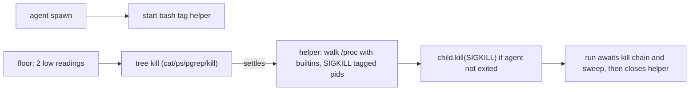

# PR Summary — Issue #5638

## Summary

When the guest memory floor fires, it now also kills the agent's descendants
without starting a process. On an exhausted guest, the memory is held by those
descendants (the `cargo`/`ld` processes the agent's Bash commands start), not by
the agent. Until now only the leftover reaper reached them, and it has to spawn
`sh`, `pgrep` and `grep`, each of which times out on a full guest. A bash helper
(`lib/guest_memory_tag_reaper.ts`) now starts beside the agent while the floor
is armed. When the floor fires and the tree kill returns, it walks `/proc` with
shell builtins only and SIGKILLs every process carrying the run's
`VIBE_AGENT_SPAWN_TAG`. It logs
`Guest-memory floor SIGKILLed the agent's tagged processes without spawning: <n> signalled for PID <pid>`.
The handle kill that PR #5641 added still runs after the sweep. Closes #5638.

## Spec

### Intent and Rationale

- In GRQ-23's archived log for `stSoftwareAU/VibeCoder#5544`, the floor fired
  but `ps timed out after 10000ms`. Six `ld` linkers of about 2.3 GiB each kept
  the guest starved for more than 20 minutes. This issue's reading (219 MiB,
  below the 512 MiB floor, then 16 minutes of silence) fits the same pattern.
- A process-group kill does not reach those processes. Claude Code runs each
  Bash command in its own session (observed from this run's own shell:
  `pgid = sid` = the bash pid, while `claude` itself has pgid 1). So the run's
  spawn tag is the only mark they share.
- Deno refuses `/proc/<pid>/environ` without `--allow-all`
  (`NotCapable: Requires all access`), so the walk runs in bash, started while
  memory is still plentiful.

### Essential Design Decisions

- The helper's script uses builtins only (glob, `read`, `kill`, `[ ]`,
  arithmetic): no command substitution, pipe or external command. A comment in
  the script says to keep it that way.
- Identity: a process is signalled only when its environ holds the exact entry
  `VIBE_AGENT_SPAWN_TAG=<tag>`. That is a second copy of the leftover reaper's
  `grep -z -x -F` rule. A contract test compares the two against tagged,
  near-miss, prefix-only and untagged processes. The tag shape is checked with
  the reaper's own `TAG_PATTERN`, which is now exported.
- The sweep runs once the tree kill settles, resolved or failed, and before the
  handle kill. The run awaits the floor's whole kill chain and the sweep before
  it closes the helper, on both the normal path and the throw path. On a full
  guest that wait is bounded by the tree kill's own spawn timeouts.
- If the helper cannot start, the runner logs a warning and carries on. The tree
  kill and the handle kill still stop the agent.

### Undiscoverable Facts

- Deno 2.9.8's `Deno.Command` `detached: true` does give the child its own
  session, but that does not help, for the reason above. `Deno.kill` also needs
  unscoped `--allow-run`, which the worker has (`run.sh`).
- GRQ-3's archive for this kill is still not in the logs mirror, so this wedge's
  own transcript was not read.

## Evidence

Backend only.

## Reproduction

- **symptom** — the floor stop was logged, but every spawned kill probe timed
  out (`ps timed out after 10000ms`), and the agent's descendants kept the guest
  starved until the watchdog reaped it
- **status** — `partial` — reason: a guest that had really run out of memory was
  not staged. The tests stand in for a full guest with a tree kill that signals
  nothing and a leftover-reaper finder that fails with
  `pgrep timed out after 10000ms`. With only `lib/claude_runner.ts` restored to
  `origin/main`, in a throwaway worktree, the handle-kill test file hung until
  `timeout 300` ended it: nothing killed the tagged descendant, and it held the
  stub's stdout open. At the head it passes. Against the earlier wiring, before
  the close-race fix, the race test failed with `descendant still running`.
- **regression test** —
  `worker/deno/tests/claude_runner_guest_memory_handle_kill_5638_test.ts::guest memory handle kill - a descendant still holding memory is killed without spawning (Issue #5638)`

## Test Plan

- New `worker/deno/tests/guest_memory_tag_reaper_test.ts`, which starts real
  `sleep` processes:
  - "a sweep signals the tagged processes and nothing else": the tagged sleep, a
    tagged `bash -c` and its grandchild die. The `<tag>0` near-miss and the
    untagged process survive. A second sweep returns 0.
  - "a malformed tag is refused before anything spawns".
  - "a sweep after close rejects and close twice is fine".
  - "a helper that dies makes the sweep reject with its cause" asserts
    `exited before answering`.
  - "the sweep lists exactly the pids the leftover reaper's scan finds" compares
    against `DEFAULT_LEFTOVER_REAPER_DEPS.findTagged`.
- `worker/deno/tests/claude_runner_guest_memory_handle_kill_5638_test.ts` drives
  `runClaudeWithTimeout` with a real agent stub and failing leftover-reaper
  seams:
  - "a descendant still holding memory is killed without spawning" has a
    positive control that the descendant is alive before the floor fires. It
    asserts the descendant is gone and the sweep line names at least 2
    signalled.
  - "a descendant is swept even when the agent exits before the tree kill
    returns": the agent dies first and a detached descendant must still be
    swept, with no `Guest-memory kill failed` line.
  - The existing healthy-guest control now also asserts no sweep line. No other
    existing assertion was changed or removed.
- These tests poll real processes until they exit (20 ms steps, up to 5 s),
  because the outcome under test is a real kill.
- `timeout 1500 ./quality.sh < /dev/null` at the head:
  `Result: PASSED (with skipped checks)`. Config integration and Checkov were
  skipped. Deno tests (parallel and serial), lint, type check, fmt,
  markdownlint, mermaid, semgrep, gitleaks and the completeness checks passed.
- `docs/audits/lib-sweep-coverage/top-up-5638.json` claims the new module for
  the sweep ledger.
- Docs: the guest memory floor section of `docs/CONTAINER.md`, the
  `[GUEST_MEMORY_FLOOR]` entry in `docs/TROUBLESHOOTING.md`, and the header of
  `lib/agent_leftover_reaper.ts` describe the sweep.

Not checked:

- a guest that had really run out of memory;
- a trace proving the helper never forks (`strace` is not installed; the claim
  rests on the script using builtins only);
- GRQ-3's archive for this kill.

Remaining risks:

- A process that clears or rewrites its own environment drops the tag and
  escapes the sweep.
- The helper adds one idle `bash` per agent run while the floor is armed.
