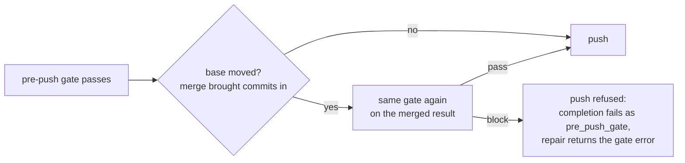

# PR Summary — Issue #5646

## Summary

Two worker paths merged the PR's base into the branch and then pushed the
merged result without the pre-push gate. CI was therefore the first thing to
run `deno test` on the combination. Both paths now run the same gate again when
the merge actually brought commits in, and a block refuses the push:

- **Completion phase, just before `gh pr create`.** The last-minute catch-up in
  `completionBody` (`worker/deno/lib/phases/completion_phase.ts`) merges a base
  that moved while the gates ran. It then pushed with `pushUnpushedCommits`
  directly. Now it runs `gateBeforePush()` first. A block fails the run as
  `pre_push_gate`, with the same once-per-run recovery turn as the first gate,
  and no PR is raised.
- **Repair passes (CI fix, review feedback, spelling).** Step 1c of
  `commitAndPushPending` (`worker/deno/lib/git_push.ts`) runs
  `mergeBaseBeforePush` after Step 1b's gate. A merge with outcome `updated`
  now re-runs Step 1b's `gateUnpushedCommits` call, through one shared closure,
  whenever the caller passed a `preFlight` spec. A block returns the gate's
  error and the merge commit stays local.

Closes #5646.

## Spec

### Intent and Rationale

- The pre-push gate picks the `deno test` files from the files the branch's
  own commits change. It reads the test text from the working tree. Running it
  after the merge therefore also runs tests that came in from the base and name
  a file the branch changed: the #5451 failure shape.
- Re-gating only an `updated` merge keeps the cost off the common case. A
  branch already current, or a declined or unreadable merge, runs the gate once,
  as before.

### Essential Design Decisions

- A block on the merged result fails closed. It does not fall back to pushing
  the pre-merge head. A head that fails once merged with its base would only
  come back as GitHub's `update-branch` merge and fail CI there.
- The repair re-gate reuses Step 1b's arguments, including its
  `preFlightAlreadyRan` flag. So the repo's pre-flight commands re-run on the
  merged tree only when Step 1b ran them; the changed-file checks always re-run.
- The completion re-gate is the existing `gateBeforePush()` closure, so it
  formats first, uses the same comparable base and shares the run's single
  recovery turn.

### Undiscoverable Facts

- Each of the three cited PRs failed CI for a different reason. The job logs
  show:
  - **#5451** (job 137531106880): `gitleaks_check_test.ts` failed on
    `28c1eee08`. That is a merge of `milestone/ci-gate-parity` committed by
    `GitHub` (an `update-branch` merge) at 06:44, three minutes after the PR
    was raised behind its base. The base commit, #5447's `3706ea80c`, had
    landed at 06:22. The run's worker log is not on this host, so it is not
    confirmed which local sync step left the branch behind.
  - **#5501** (job 138114832995): the wall-clock growth test
    `dummy_test_scan_growth_5236_test.ts` took 58 ms against a 50 ms allowance
    on the CI runner. The local gate had run and passed it. PR #5501's own
    `2ba5b0193` hardened it.
  - **#5518** (job 138258703056): a new completion test needed
    `markdownlint-cli2`, which the fleet image has and the CI `validate` runner
    does not. The local gate had run and passed it. PR #5518's own `10390009b`
    skips it when the tool is absent.
- For #5501 and #5518 the local gate did run `deno test` and it passed, so
  neither was a skipped path. Their tests were fixed in those PRs.

## Evidence

Backend-only change: no UI files are touched.

- Red before the fix, with the production code unchanged:
  - In `worker/deno/tests/completion_phase_last_currency_test.ts`, two tests
    failed. The merge-order test saw `push, merge, push` with no gate after the
    merge. The blocked-catch-up test got `status: continue`.
  - In `worker/deno/tests/pr_push_base_sync_test.ts`, the new blocked-merge
    test failed with "the merged result must be refused".
- Green after the fix: 33 passed across `completion_phase_last_currency_test.ts`
  and `completion_phase_pre_push_gate_3689_test.ts`. All 7 passed in
  `pr_push_base_sync_test.ts`.
- Issue numbers cited as provenance:
  - #5646: Shift left: fleet PRs keep failing CI on `deno test` that a local
    gate could catch (this issue).

## Test Plan

- `worker/deno/tests/completion_phase_last_currency_test.ts`:
  - `deps()` stubs `gateUnpushedCommits` with a per-call answer and records a
    `gate` event.
  - "a base that moved during the gates is merged in and pushed before the PR
    is created": the two old assertions (last event before create is `push`,
    the one before it is `merge`) become one assertion that the last three
    events are `merge, gate, push`. Both old facts still hold, and the gate
    between them is new.
  - "a branch still current when the PR is raised is not pushed again": it also
    asserts the gate ran exactly once. This pins unchanged behaviour, so it was
    green on base as expected.
  - Added "a catch-up merge the gate blocks is never pushed and the PR is not
    raised". It asserts category `pre_push_gate`, a reason starting with
    `PRE_PUSH_GATE_MARKER`, no PR create and no push after the merge. Its
    positive control: the `merge` event shows the catch-up path was reached.
- `worker/deno/tests/pr_push_base_sync_test.ts`, with real git and a moved
  `origin/main`:
  - Added "a fix whose merged result fails the pre-flight gate is not pushed,
    and the merge stays local (Issue #5646)". It uses `test ! -f base.txt`,
    which passes before the merge and fails after it. It asserts a
    `PrePushGateBlockedError` naming the command, that `origin/feature` is
    unchanged, and that the merge is present locally.
  - Added a control with an always-passing pre-flight command. The push carries
    both the fix and `base.txt`.
  - The existing tests are unchanged.
- Regression runs on the final head (all passed): `git_push_preflight_test.ts`,
  `commit_and_push_pending_test.ts`, `pr_round_repo_formatters_test.ts`, and
  `completion_phase_pre_push_gate_3689_test.ts`.
- `./quality.sh < /dev/null`: PASSED. The gate itself skipped config
  integration and checkov.
- Guards on the new paths: both reuse the existing gate calls unchanged. The
  completion path keeps the recovery-turn cap, the host-disk park and the
  `pre_push_gate` category. The repair path keeps Step 1b's compare and
  baseline refs. None is excluded.
- Docs: `docs/INTERNALS.md` now says that both merges are gated before the push
  (the "One push per fix" section), and lists the catch-up merge among the
  second blocks that get no further recovery turn (the `pre_push_gate`
  section). The doc comments of `mergeBaseBeforePush` and `commitAndPushPending`
  were changed the same way.

## Not checked

- I could not read the #5451 run's worker log, so it is not proven that the
  catch-up path, rather than a declined or unreadable PR-raise sync, left that
  PR behind. A PR raised behind its base through a declined or unknown sync
  still gets GitHub's `update-branch` merge, which no local gate sees.
- The CI `validate` runner and the fleet image still have different tools, for
  example `markdownlint-cli2`. A test that passes only where a tool is
  installed can still pass locally and fail on CI, as #5518 did.
- Wall-clock growth tests built on `tests/support/growth.ts` can still flake on
  a loaded CI runner, as #5501's did.
