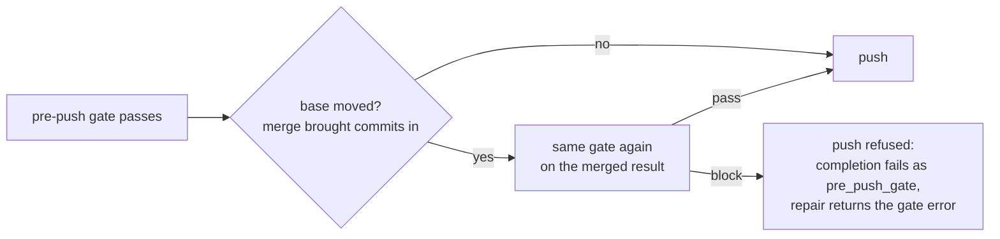

# PR Summary — Issue #5646

## Summary

Two worker paths merged the PR's base into the branch and then pushed the merged
result without the pre-push gate. CI was therefore the first thing to run
`deno test` on the combination. Both paths now run the same gate again when the
merge actually brought commits in, and a block refuses the push:

- **Completion phase, just before `gh pr create`.** The last-minute catch-up in
  `completionBody` (`worker/deno/lib/phases/completion_phase.ts`) merges a base
  that moved while the gates ran. It then pushed with `pushUnpushedCommits`
  directly. Now it runs the pre-push gate first, without formatting or an
  agent recovery turn. A verdict block fails the run as `pre_push_gate`, and
  no PR is raised. The claim-freshness check follows the catch-up push.
- **Repair passes (CI fix, review feedback, spelling).** Step 1c of
  `commitAndPushPending` (`worker/deno/lib/git_push.ts`) runs
  `mergeBaseBeforePush` after Step 1b's gate. A merge with outcome `updated` now
  re-runs Step 1b's `gateUnpushedCommits` call, through one shared closure,
  whenever the caller passed a `preFlight` spec. A block returns the gate's
  error and the merge commit stays local.

Closes #5646.

## Spec

### Intent and Rationale

- The pre-push gate picks the `deno test` files from the files the branch's own
  commits change. It reads the test text from the working tree. Running it after
  the merge therefore also runs tests that came in from the base and name a file
  the branch changed: the #5451 failure shape.
- Re-gating only an `updated` merge keeps the cost off the common case. A branch
  already current, or a declined or unreadable merge, runs the gate once, as
  before.

### Essential Design Decisions

- A block on the merged result fails closed. It does not fall back to pushing
  the pre-merge head. A head that fails once merged with its base would only
  come back as GitHub's `update-branch` merge and fail CI there.
- The repair re-gate reuses Step 1b's other arguments but always runs the repo's
  pre-flight commands: `preFlightAlreadyRan` is `false`, even when Step 1b
  skipped them because Step 1 had just created a commit. Step 1b's skip stands
  for the pre-merge tree only; a pre-merge result cannot certify the merged
  tree.
- The completion re-gate uses the same comparable base and gate verdict but
  cannot create formatter or recovery commits after the pre-PR verifier and
  summary gates. A later run must take any repairs through those checks. The
  normal gate retains its once-per-run recovery turn. The claim-freshness
  check runs after the late gate and push to prevent a PR for a closed issue.

### Undiscoverable Facts

- Each of the three cited PRs failed CI for a different reason. The job logs
  show:
  - **#5451** (job 137531106880): `gitleaks_check_test.ts` failed on
    `28c1eee08`. That is a merge of `milestone/ci-gate-parity` committed by
    `GitHub` (an `update-branch` merge) at 06:44, three minutes after the PR was
    raised behind its base. The base commit, #5447's `3706ea80c`, had landed at
    06:22. The run's worker log is not on this host, so it is not confirmed
    which local sync step left the branch behind.
  - **#5501** (job 138114832995): the wall-clock growth test
    `dummy_test_scan_growth_5236_test.ts` took 58 ms against a 50 ms allowance
    on the CI runner. The local gate had run and passed it. PR #5501's own
    `2ba5b0193` hardened it.
  - **#5518** (job 138258703056): a new completion test needed
    `markdownlint-cli2`, which the fleet image has and the CI `validate` runner
    does not. The local gate had run and passed it. PR #5518's own `10390009b`
    skips it when the tool is absent.
- For #5501 and #5518 the local gate did run `deno test` and it passed, so
  neither was a skipped path. Their tests were fixed in those PRs.

## Evidence

Backend-only change: no UI files are touched.

- Earlier worker evidence: the blocked-catch-up test returned
  `status: continue` before the original fix; the repair blocked-merge test
  failed with "the merged result must be refused". The worker reported green
  targeted runs before the final review changes.
- The repair test file now contains eight test cases. The updated completion
  tests cover a repairable late block and issue closure during the gate.
  The final review changes require a fresh CI run; no new local test result
  is claimed.
- Issue numbers cited as provenance:
  - #5646: Shift left: fleet PRs keep failing CI on `deno test` that a local
    gate could catch (this issue).

## Test Plan

- `worker/deno/tests/completion_phase_last_currency_test.ts`:
  - The gate fixture bases its verdict on whether the base was merged and
    whether an agent repair was made, not on gate call counts or order.
  - "a base that moved during the gates is merged in and pushed before the PR is
    created": asserts the merged head was pushed before creation.
  - "a branch still current when the PR is raised is not pushed again": keeps
    the original no-merge and one-push assertions.
  - Added "a catch-up merge the gate blocks is never pushed and the PR is not
    raised". It asserts category `pre_push_gate`, a reason starting with
    `PRE_PUSH_GATE_MARKER`, no PR create and no push after the merge. Its
    positive control: the `merge` event shows the catch-up path was reached.
    The simulated agent could repair the block, so accepting a late recovery
    and pushing would fail this test.
  - "an issue closed during the catch-up gate never gets a PR": the issue
    closes when the gate sees the merged tree; expects `early_exit`, the
    stale-claim reason and no PR creation.
- `worker/deno/tests/pr_push_base_sync_test.ts`, with real git and a moved
  `origin/main`:
  - Added "a fix whose merged result fails the pre-flight gate is not pushed,
    and the merge stays local (Issue #5646)". It uses `test ! -f base.txt`,
    which passes before the merge and fails after it. It asserts a
    `PrePushGateBlockedError` naming the command, that `origin/feature` is
    unchanged, and that the merge is present locally.
  - Added "a worker-created fix commit still runs pre-flight after merging its
    base (Issue #5646)": the fix is an uncommitted file that Step 1 commits, so
    Step 1b skips pre-flight, and the same `test ! -f base.txt` must still block
    the merged tree. This was the review's gate-bypass case.
  - Added a control with an always-passing pre-flight command. The push carries
    both the fix and `base.txt`.
  - The existing tests are unchanged.
- Earlier worker regression runs passed: `git_push_preflight_test.ts`,
  `commit_and_push_pending_test.ts`, `pr_round_repo_formatters_test.ts`, and
  `completion_phase_pre_push_gate_3689_test.ts`. The earlier quality run passed
  with config integration and checkov skipped; CI must verify the new head.
- Guards: normal completion retains formatting, the recovery cap and host-disk
  park. The catch-up gate deliberately excludes formatting and agent recovery
  (and therefore recovery-specific host-disk parking) after the verifier and
  summary gates. It keeps verdict and infrastructure failure classification,
  and the freshness check runs afterwards. Repair re-gating retains Step 1b's
  compare and baseline refs but always runs pre-flight on the merged tree.
- Docs: `docs/INTERNALS.md` describes both merged-tree gates, the late gate's
  no-recovery rule and the final freshness check. The repair helper doc
  comments describe the merged-tree pre-flight gate.

## Not checked

- I could not read the #5451 run's worker log, so it is not proven that the
  catch-up path, rather than a declined or unreadable PR-raise sync, left that
  PR behind. A PR raised behind its base through a declined or unknown sync
  still gets GitHub's `update-branch` merge, which no local gate sees.
- The CI `validate` runner and the fleet image still have different tools, for
  example `markdownlint-cli2`. A test that passes only where a tool is installed
  can still pass locally and fail on CI, as #5518 did.
- Wall-clock growth tests built on `tests/support/growth.ts` can still flake on
  a loaded CI runner, as #5501's did.
