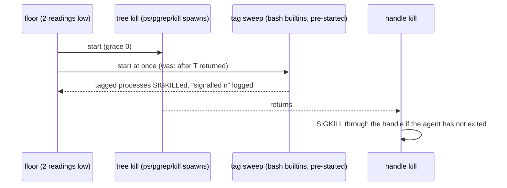

# PR Summary — Issue #5647

## Summary

At 2026-11-27 10:08:05Z, the guest memory floor stopped the agent on GRQ-3
(`vibe-coder-64233`), and that was the last line the worker logged. The guest
then stopped answering, and the watchdog reaped it 18m 44s later. The #5634 fix
(PR #5643, no TERM grace at the floor) merged at 12:27Z, after this kill, so
that run did not have it.

At the head, one more wait sat between the floor and the kills that work on a
full guest. The floor's tag sweep walks `/proc` with bash builtins in a
pre-started helper, so it needs no new process. Even so, it started only once
the tree kill returned. The tree kill spawns `ps`, `pgrep`, `cat` and `kill` for
each process in the tree, and each spawn has a 10 s timeout. On a starving
guest, that held the sweep back while the agent's tagged processes kept their
memory.

The sweep now starts as soon as the floor fires, beside the tree kill. The
handle kill (#5638) still runs after the tree kill returns, when the agent has
not exited.

Closes #5647.

## Spec

### Intent and Rationale

- The kills that fork nothing are the only ones sure to act on a guest out of
  memory, so they must not wait behind the one that spawns many processes.
  `docs/CONTAINER.md` already recorded those spawns timing out on a full guest
  (`ps timed out after 10000ms`, 2026-11-26).
- This reuses the existing `GuestMemoryTagReaper.sweep()`
  (`worker/deno/lib/guest_memory_tag_reaper.ts`) without changing it. Only when
  it is called has moved, in `worker/deno/lib/claude_runner.ts`.
- `RunClaudeOptions` gains an optional `startGuestMemoryTagReaper`, defaulting
  to the real `startGuestMemoryTagReaper`. It is a test seam: production passes
  nothing, so the sweep ordering is the same with or without it. Tests inject a
  starter that throws, so the run behaves as it does when the tag reaper did not
  start and only the tree kill and the handle kill can stop the agent.

### Essential Design Decisions

- **The handle kill stays after the tree kill.** Killing the agent through its
  handle first would reparent its descendants before the tree walk lists them.
  When the tag reaper did not start, the tree walk is the only way to reach
  them.
- **Accepted trade-off:** the sweep kills the agent too, because the agent
  carries the tag. A descendant that dropped the tag from its environment can
  therefore be reparented before the tree walk reaches it. The leftover reaper
  (`reapAgentLeftovers`) cannot recover it: it only finds processes whose
  environment carries the spawn tag. The only backstop for such an untagged
  descendant is the descendant snapshot collector (`collectOrphans` in
  `claude_runner.ts`), and it only knows processes seen in a snapshot, taken
  every 20 s by default. An untagged descendant started after the last snapshot,
  and reparented before the tree walk lists it, is left running; this change
  does not guarantee it is collected. Before this change, on a guest where the
  tree kill's spawns still worked, the tree walk listed it while the agent was
  alive. A sweep that acts at once beats a complete kill that arrives after the
  spawn timeouts.
- **No log line or prefix changed.** The sweep line is still
  `Guest-memory floor SIGKILLed the agent's tagged processes without spawning:
  <n> signalled for PID <pid> (Issue #5638)`,
  so `hardKillMemoryGuards` and the docs that quote it stay valid.

### Undiscoverable Facts

- Merge times: PR #5642 (the tag reaper, #5638) merged at 08:55Z and PR #5643
  (the #5634 fix) at 12:27Z on 2026-11-27. The wedge was at 10:08Z.
- The evidence for this kill, kept in `~/logs/hard-kill-archive/` on GRQ-3, was
  not readable from here.

## Evidence

Backend only. No UI file is touched.

- Issue numbers cited in the diff:
  - #5647: Hard kill: container wedged in issue (watchdog)
  - #5638: Hard kill: container wedged in completion (watchdog)
  - #5634: Hard kill: container wedged in execute (watchdog)

## Reproduction

- **symptom** — the guest memory floor stopped the agent, the worker logged
  nothing more, and the launcher's watchdog reaped the silent guest.
- **status** — `partial` — the ordering defect was reproduced. The new test
  holds the tree kill open, as spawn timeouts do, and checks whether the tagged
  descendant is still alive when the tree kill returns. Against the unfixed
  `claude_runner.ts` it failed
  (`the descendant outlived the tree kill: the
  sweep waited for it`,
  `5 passed | 1 failed`). With the fix it passes.
- reason: the guest wedge itself was not reproduced. It needs a real guest
  exhausted of memory, and the archive for this kill is on GRQ-3.
- **regression test** —
  `worker/deno/tests/claude_runner_guest_memory_handle_kill_5638_test.ts::guest
  memory handle kill - the tag sweep runs while the tree kill is still in
  flight (Issue #5647)`

## Test Plan

- **New test** in
  `worker/deno/tests/claude_runner_guest_memory_handle_kill_5638_test.ts`:
  `the tag sweep runs while the tree kill is still in flight (Issue #5647)`.
  - **Setup:** the agent stub starts `sleep 300` in the background, and the test
    checks that the sleep is live before the floor fires. The injected tree kill
    signals nothing and polls for up to 5 s, as a tree kill stuck in spawn
    timeouts would.
  - **Assertions:** the run returns `GuestMemoryFloorError` with the literal
    floor reason, and the tree kill is called once. The descendant is gone
    before the tree kill returns, and the tag-sweep warn line is logged.
  - **Results:** red on the unfixed code, green on the head.
- **Existing tests edited**, both in
  `worker/deno/tests/claude_runner_guest_memory_handle_kill_5638_test.ts`, plus
  the file's header comment:
  - `a tree kill that signals nothing still stops the agent (Issue #5638)` and
    `a tree kill that throws still stops the agent (Issue #5638)` now run with
    `tagReaperUnavailable: true`, which injects a `startGuestMemoryTagReaper`
    that throws, so no sweep runs in them. Their assertions are unchanged.
  - **Obsolete base behaviour:** at the base, the sweep started only after the
    tree kill returned, so the handle kill was always the first kill to act
    after a tree kill that signalled nothing or failed. With the sweep beside
    the tree kill, it can legitimately stop the tagged agent first, and the
    handle-kill warn line these tests require is then not logged.
  - **Remaining behaviour:** the handle kill is the only path that can end the
    run when the tag reaper did not start, and these two tests still require it
    to (and the kill-failed error line when the tree kill rejects). They no
    longer exercise the handle kill with a live tag reaper.
  - **Covering tests for runs with a live reaper:**
    `the tag sweep runs while the tree kill is still in flight (Issue #5647)`
    and
    `a descendant still holding memory is killed without spawning (Issue #5638)`,
    both in the same file.
- **Existing tests unchanged** and still passing with the sweep moved:
  `a descendant is swept even when the agent exits before the tree kill returns (Issue #5638)`
  and `a healthy guest never calls the tree kill (Issue #5638)`.
- **Targeted run** on the head:
  `deno task test:unit tests/claude_runner_guest_memory_handle_kill_5638_test.ts tests/claude_runner_guest_memory_floor_grace_5634_test.ts tests/claude_runner_guest_memory_floor_4815_test.ts tests/guest_memory_tag_reaper_test.ts`
  gave 18 passed, 0 failed.
- **`./quality.sh < /dev/null`** on `989c737fd`:
  `Result: PASSED (with skipped
  checks)`.
  - Passed: deno tests (parallel 11m33s, serial 4m39s), lint, type check, fmt,
    markdownlint, mermaid, semgrep and gitleaks.
  - Skipped: config integration (no `.config.json`) and checkov (not on PATH).

### Not done or not checked

- The guest wedge was not reproduced, and the GRQ-3 archive was not read. So it
  is not confirmed that this wait, rather than something outside the agent's
  tree such as tmpfs, held the memory.
- The tree kill still finds and signals processes through spawned
  `ps`/`pgrep`/`kill`. Only the sweep no longer waits for it.
