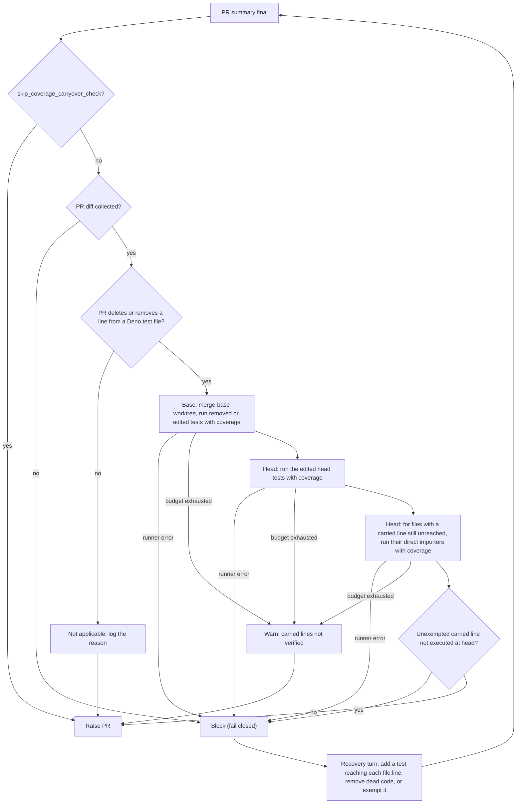

# Coverage carry-over check

The coverage carry-over check is a PR-raise gate (Issue #3795). It checks that
the production lines a removed or rewritten test used to execute are still
executed by some test on the branch, and blocks the PR when a carried line is
not.

## Why

A fleet PR that rewrites or deletes a test the linked issue retires sometimes
leaves a branch whose only test was that test. The removed-assertion gate checks
the stated reason for each removed assertion, and the mutation check mutates only
the lines a PR adds or changes. The orphaned lines are unchanged, so neither gate
looks at them, and the branch can ship with no test reaching them. The target
pattern is `rewritten-test-drops-live-branch`.

## When it runs

The gate runs in the issue-run completion phase, beside the mutation check:
after the PR summary is final and before the PR is raised. It joins the late
summary gates and feeds the same single recovery turn, which may change tests.

Unless `skip_coverage_carryover_check` is set (or the runner is not wired), the
worker first collects the PR diff with `git diff --unified=0 --no-renames
<base>...HEAD`. A base ref that cannot be resolved, or a diff that cannot be
collected, is an `error` and blocks the PR, whatever the PR touches. Then the
repository's `quality_credentials` are resolved; if they cannot be, the check is
not applicable.

With the diff in hand, tests run only when it deletes an existing Deno test file
(`*_test.ts`, `*.test.ts` and similar) or removes at least one line from one.
Any other diff, including pure additions to tests, is not applicable and runs no
tests.

## Flow



## Steps

1. Run `git merge-base <base> HEAD` and check out the merge base in a temporary
   detached `git worktree`.
2. Run only the removed or edited test files, at their base versions, with
   `deno test --no-check -A --coverage=<dir>` from their Deno project directory,
   then `deno coverage --lcov`. Collect the non-test production lines they
   executed.
3. Map each line through `git diff --unified=0 --no-renames <base>...HEAD`. A
   line deleted or rewritten at head is out of scope.
4. At head, run per Deno project the head versions of the edited tests that
   still exist, with coverage. Carried lines they execute are done.
5. Only for the files that still have an unexecuted carried line, run per Deno
   project the head tests that import that file directly (the edited tests are
   not run again), with coverage. Importers run one carried file at a time, in
   its own batch, and what is still unexecuted is recomputed after each batch,
   so a module an earlier batch's importer already reaches (directly, or
   through that importer's own imports) is skipped. When every carried line is
   already executed, this step runs nothing.
6. Block when a carried line is not executed at head and not exempted. The
   block lists the first 40 such `file:line` locations, then `… and N more`, and
   asks for a test that reaches each one, removal if it is dead code, or an
   exemption in the PR summary.

The temporary worktree is removed afterwards with `git worktree remove --force`.
If that fails, the directory is deleted and `git worktree prune` runs.

## Languages

Only Deno is checked; Rust repositories are not checked yet. When the diff
removes lines from no Deno test file but does remove lines from a `.rs` file
under a `tests/` directory, the check is not applicable and logs `Rust coverage
carry-over needs cargo-llvm-cov, which the worker container does not install`.
Any other Rust change, including removing a `#[cfg(test)]` unit test in `src/`,
logs `the diff removes no lines from an existing Deno test file`.

## Outcomes

| Outcome                  | Meaning                                                                                 | Blocks the PR? |
| ------------------------ | --------------------------------------------------------------------------------------- | -------------- |
| Not applicable           | Skipped by `skip_coverage_carryover_check`; runner not wired; `quality_credentials` could not be resolved; the diff removes no line from a Deno test file (the Rust reason when it removes lines from a `.rs` file under a `tests/` directory); or no Deno project sits above the edited tests. Logged | No |
| Completed, no uncovered  | Every carried line is executed at head, or is exempted                                  | No             |
| Completed, uncovered     | At least one carried line is not executed at head and is not exempted                   | Yes            |
| Budget exhausted         | The fixed 600 s budget ran out; a warning, never a pass                                 | No             |
| Error                    | PR diff not collected (including an unresolvable base ref), or the runner failed: merge-base, worktree, base or head tests failing, or coverage export | Yes (fail closed) |

## Exemption

A carried line that no test can reasonably reach may be exempted by a PR-summary
line naming the location and giving a reason, in the same convention as the
mutation check:

```text
- `worker/deno/lib/example.ts:42` — exempt (untestable): <reason>
```

## Configuration

Set `skip_coverage_carryover_check` (boolean, default `false`) under
`repo_config["owner/repo"]` in `.config.json`. `true` skips the check for that
repository. There is no budget setting; the budget is fixed at 600 seconds
(`DEFAULT_COVERAGE_CARRYOVER_BUDGET_SECONDS`).

The test runs receive the repository's resolved `quality_credentials`, the same
credentials the mutation check passes (see [Configuration](CONFIGURATION.md)).

## Known limits

- Beyond the head versions of the edited tests, the head side counts only tests
  that import a carried module directly. A line reached only indirectly, through
  another module, is reported uncovered. Exempt it with a reason.
